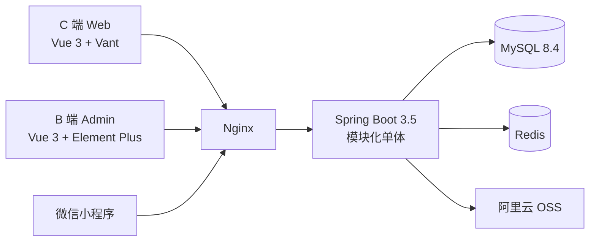

<p align="center">
  
</p>

<h1 align="center">云河FC</h1>

<p align="center">单支业余足球队的运营工具与对外展示窗口</p>

云河FC 面向 8 人制业余球队，覆盖建赛、报名、候补、签到、事件比分、阵容分组，以及排行榜、队内活动、球队账本、动态与相册等日常运营。项目提供三个客户端，共用同一套后端 API：

- **C 端 Web**：访客查看赛程与球队数据；登录球员报名，并查看活动、账本、动态与相册
- **B 端管理后台**：管理员维护比赛、球员、阵容、分组、活动、账本、通知与审计
- **微信小程序**：与 C 端同口径的核心球员体验，支持微信登录、比赛邀请与活动分享卡片

## 项目状态

- 需求与设计已冻结：需求文档 v1.62，设计文档 01–06 已评审
- MVP 已实现：账号权限、球员档案、比赛、报名候补、考勤、事件比分、阵容分组、通知、审计、系统配置
- 后续批次已实现：排行榜、队内活动、球队账本、动态与相册（内容批次待发版验收）
- 数据契约：36 张业务表、137 个 API、37 个权限码，Flyway 迁移至 V21

## 功能

| 领域 | 能力 |
|---|---|
| 账号与权限 | 手机号 + 密码登录、微信小程序登录、短信绑定手机号、待审核/正常/注销状态、RBAC 自定义角色、C → B 一次性票据免登录交接、Redis 会话（C 端 7 天 / B 端 12 小时） |
| 球员与球队 | 球员档案、星级与位置、球衣号、赛季统计、球队页、7 项排行榜（出场/进球/助攻/场均/胜率/乌龙） |
| 比赛运营 | 比赛创建与状态机、延期/取消/恢复、比赛多图、赛程筛选、比赛邀请与小程序分享卡片 |
| 报名与考勤 | 报名、候补与递补、名额控制与并发防超卖、签到、名单与考勤、缺勤处理 |
| 事件与比分 | 事件录入与本人编辑、计分事件推导比分、比分兜底、24 小时编辑窗口 |
| 阵容与分组 | 阵型模板、阵容拖拽与版本冲突、队内分组、按星级均衡、分组与阵容联动 |
| 通知与审计 | 业务通知、已读与 90 天物理清理、审计查询、年度导出 |
| 队内活动 | 独立于比赛的活动实体、状态流转与恢复、报名队列、家属报名、活动图片、分享封面 |
| 球队账本 | 收支流水、内置与自定义分类、明细/统计双视图、按日小计与周期趋势 |
| 动态与相册 | 时间线动态、相册照片、点赞、举报、照片压缩上传、OSS 签名读与缩略图 |

## 技术栈

| 层 | 选型 |
|---|---|
| 后端 | Java 21、Spring Boot 3.5.x、Spring Security、MyBatis-Plus、Flyway |
| 数据 | MySQL 8.4（唯一事实源）、Redis 6.2.24（会话/缓存/限流/锁） |
| 异步 | Outbox + 进程内有界线程池事件分发；Quartz JDBC 定时任务 |
| 前端 | Vue 3、Vite、TypeScript、Pinia、Vue Router；C 端 Vant 4，B 端 Element Plus 2 |
| 小程序 | 微信原生小程序 + Vant Weapp |
| 存储 | 阿里云 OSS（私有 Bucket + 15 分钟签名 URL） |
| 部署 | Docker Compose + Nginx，单 ECS |

## 系统结构



后端按业务领域分包（`auth`、`player`、`match`、`registration`、`attendance`、`event`、`lineup`、`grouping`、`stats`、`notification`、`audit`、`settings`、`activity`、`ledger`、`content`），模块间通过应用服务、只读端口或领域事件协作。

## 目录结构

```text
backend/                 Spring Boot 单部署单元
frontend/
  apps/web/              C 端 Web（Vue 3 + Vant）
  apps/admin/            B 端管理后台（Vue 3 + Element Plus）
  apps/miniprogram/      微信小程序（原生 + Vant Weapp）
  packages/              api-client、permissions、shared
  e2e/                   Playwright 用例
docs/
  design/                01–06 设计文档
  rules/                 数据库/API/异步消息/日志/Java 规则
  adr/                   架构决策记录
scripts/sql/             业务 DDL、Quartz DDL、测试数据
prototype/               静态可交互原型
deploy/                  Docker Compose、Nginx、Dockerfile、RUNBOOK
```

## 快速开始

### 前置环境

- JDK 21（后端编译与测试必须使用 21）
- Node 24、pnpm 12（`frontend/package.json` 已固定）
- Docker（集成测试通过 Testcontainers 启动 MySQL 8.4 / Redis 6.2.24）
- 本地 MySQL 与 Redis，供后端 dev profile 使用

### 后端

本机推荐使用 `scripts/dev-backend.sh`：按本机 Docker 端口（MySQL 3307、Redis 6380）启动，并从 `~/.zshrc` 读取微信小程序与 OSS 凭证。

```bash
./scripts/dev-backend.sh
```

没有微信与 OSS 凭证时，用 mock 模式手动启动：

```bash
cd backend
SPRING_PROFILES_ACTIVE=dev OSS_MODE=mock WECHAT_MINI_MODE=mock \
  DB_URL='jdbc:mysql://localhost:3306/yunhefc?useSSL=false&allowPublicKeyRetrieval=true&serverTimezone=Asia/Shanghai&characterEncoding=utf8' \
  REDIS_PORT=6379 \
  ./mvnw spring-boot:run
```

默认端口 `8080`；更多环境变量见 `backend/README.md`。

### Web 前端

```bash
cd frontend
pnpm install
pnpm dev:web      # http://localhost:5273
pnpm dev:admin    # http://localhost:5274/admin/
```

Vite 把 `/api` 代理到 `http://localhost:8080`。

### 微信小程序

```bash
cd frontend
pnpm install
pnpm --filter @yunhefc/miniprogram prepare:vant
```

用微信开发者工具导入 `frontend/apps/miniprogram` 并填写 AppID。本地联调把 `utils/config.ts` 改为 `'local'`，并在「详情 → 本地设置」勾选「不校验合法域名」。不要使用开发者工具的「构建 npm」，统一执行 `prepare:vant`。

### 测试数据

```bash
mysql -uyunhefc -pyunhefc yunhefc < scripts/sql/test-data.sql
```

测试账号 `1001` / `1002`，密码 `Passw0rd!`。

### 静态原型

```bash
python3 -m http.server 4173 --directory prototype
```

访问 `http://localhost:4173/index.html`。原型仅用于演示交互与信息架构，不是生产代码。

## 验证

```bash
# 后端
cd backend && ./mvnw test && ./mvnw verify

# 前端
cd frontend
pnpm -r build
pnpm -r typecheck
pnpm -r test
pnpm lint
pnpm format:check

# 小程序
pnpm --filter @yunhefc/miniprogram typecheck
pnpm --filter @yunhefc/miniprogram test
```

Playwright 冒烟测试依赖已启动的后端与种子数据：

```bash
cd frontend
pnpm exec playwright install chromium
pnpm test:e2e
```

## 部署

生产为单 ECS + Docker Compose（MySQL 8.4 / Redis / backend / Nginx），应用镜像由 CI 构建并推送 ACR。发布由 `.github/workflows/deploy.yml` 手动触发，只接受属于 `origin/main` 的提交。完整步骤、回滚与排障见 [`deploy/RUNBOOK.md`](deploy/RUNBOOK.md)；生产密钥只放服务器 `.env`，不入库、不进 Git。

## 文档

| 内容 | 位置 |
|---|---|
| 需求与验收口径 | `docs/云河FC-需求文档.md` |
| 功能模块 | `docs/design/01.功能模块梳理.md` |
| 页面与交互 | `docs/design/02.页面结构与交互设计.md` |
| 整体架构 | `docs/design/03.整体架构设计.md` |
| 数据库设计 | `docs/design/04.数据库设计.md` |
| API 与权限 | `docs/design/05.API接口设计.md` |
| 评审结论与决策 | `docs/design/06.设计方案评审结果.md` |
| 编码与数据规则 | `docs/rules/*.md` |
| 架构决策记录 | `docs/adr/` |
| 领域术语 | `CONTEXT.md` |
| 可交互原型 | `prototype/README.md` |
| 前端开发说明 | `frontend/README.md` |
| 后端开发说明 | `backend/README.md` |

## 开发约定

- 需求、数据库、API、页面任一变更，必须同步所有受影响文档与原型；冲突时以需求文档与 `docs/design/06` 已确认决策为准。
- 数据库不使用 `CHECK` 约束与物理外键；枚举、范围与跨字段规则由应用层强校验。
- API 统一 `/api/v1/{c|b}/**`，成功 `code=0`；枚举响应返回数字字段与 `fieldLabel`；高风险写接口带 `Idempotency-Key`。
- 会话与权限由后端判定，前端权限码只用于导航与渲染。
- 未经明确要求不提交 git；`main` / `prod` 分支禁止提交与推送。
