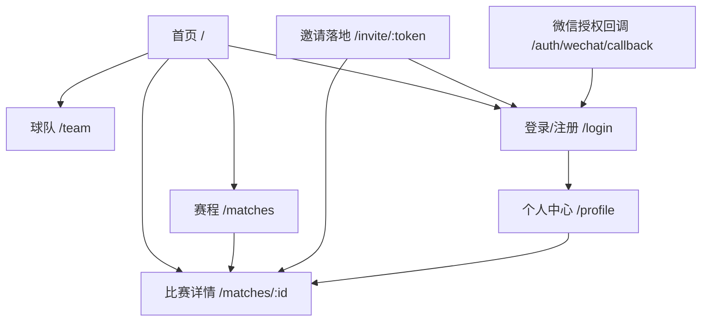
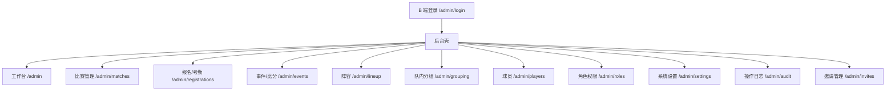
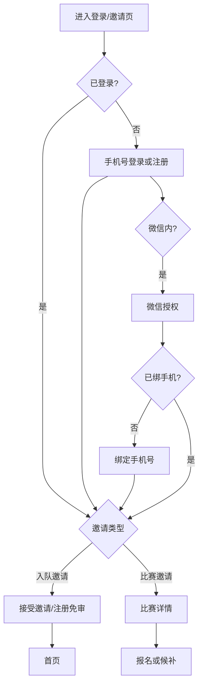
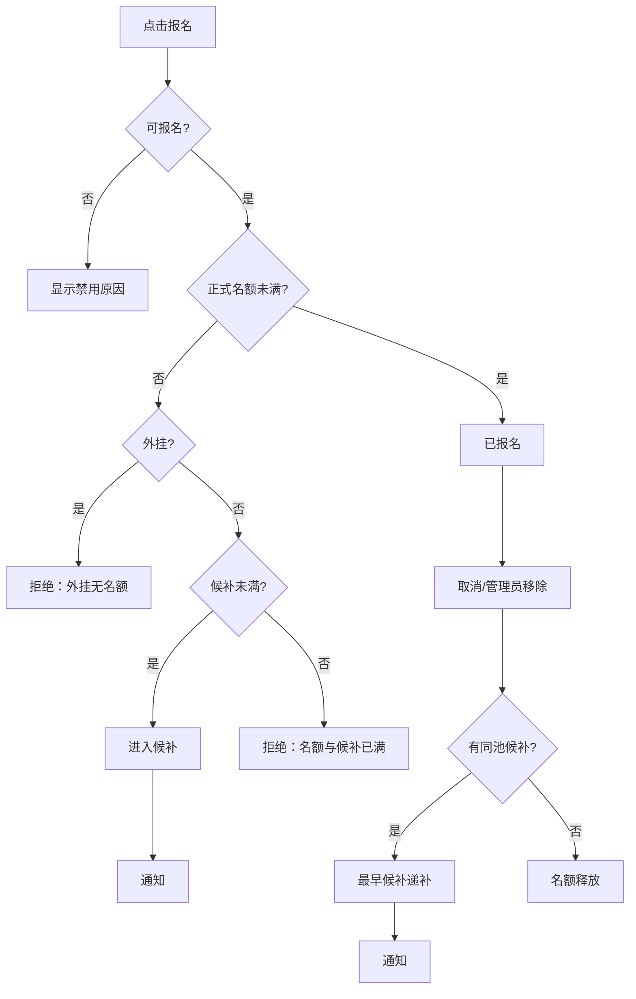
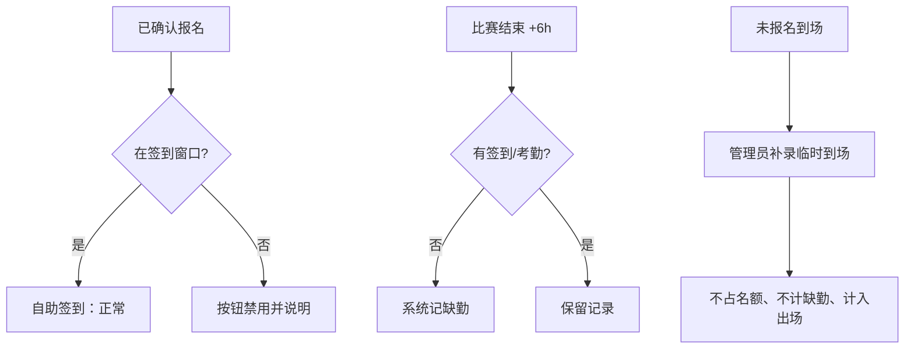
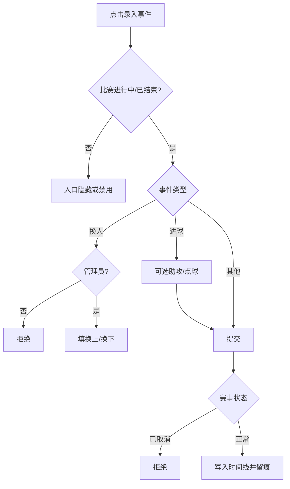
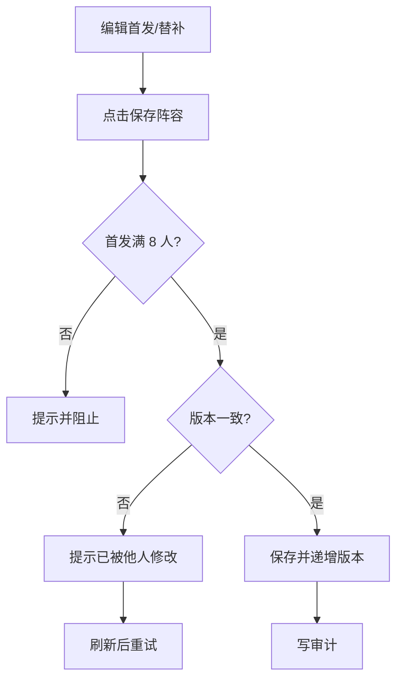
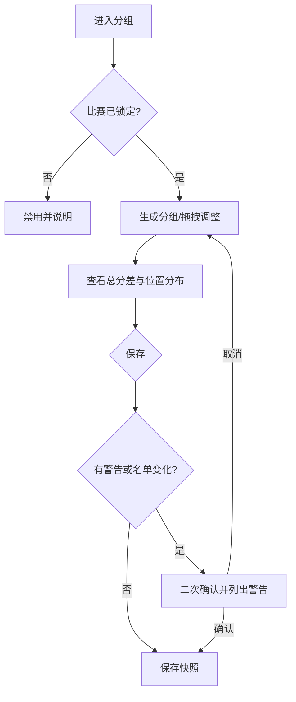
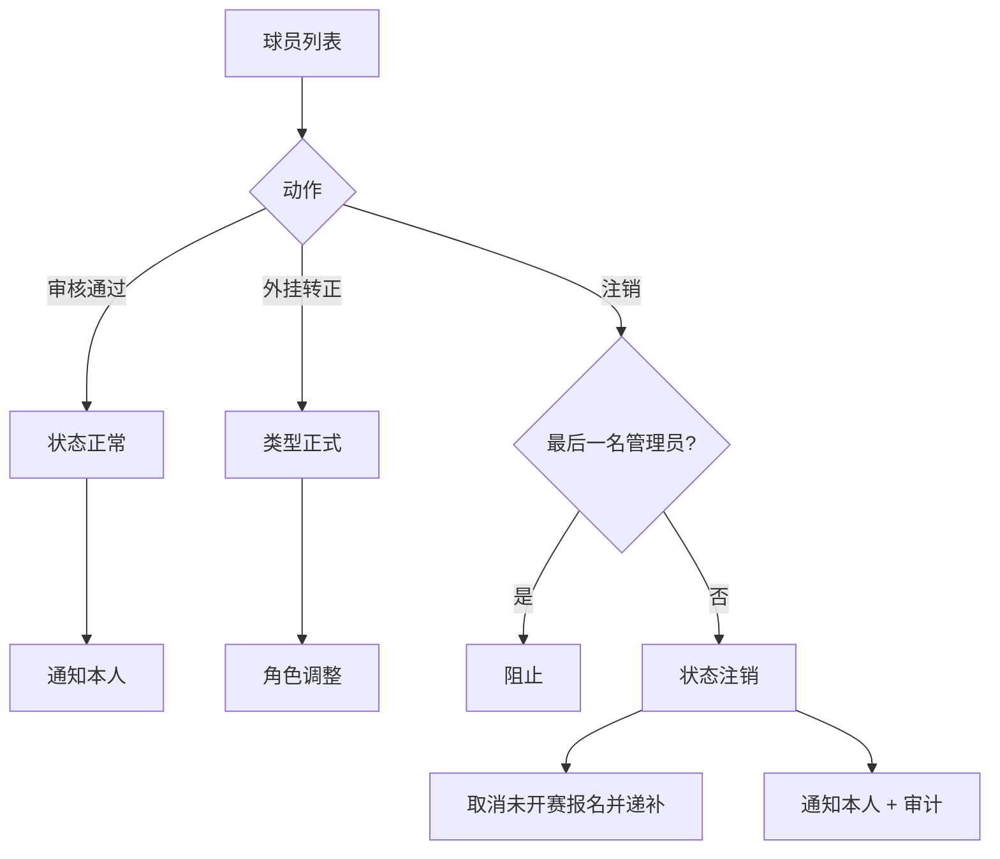

# 云河FC 页面结构与交互设计

- 文档版本：v0.9（第二轮整体评审修正）
- 编写日期：2026-11-09
- 依据材料：`docs/云河FC-需求文档.md`（v1.15）、`docs/design/01.功能模块梳理.md`（v0.9）、`prototype/`
- 文档范围：信息架构、页面结构、交互规则与页面状态；不含高保真视觉稿、接口、数据库或代码

## 1. 文档说明

### 1.1 目的

把功能模块落到页面与交互：明确站点地图、导航、每个页面的区域与动作、关键流程和异常状态，作为 UI 设计、前端开发和测试用例的共同依据。

### 1.2 原则

- 沿用原型已验证的信息架构，补齐需求已有但原型缺失的页面，不重新发明流程。
- 每个动作可回溯到权限点与需求编号。
- 权限表现区分三种：不可见、禁用并说明原因、允许操作但服务端拒绝。
- C 端移动优先，以微信内置浏览器为基线；B 端以 PC 为主。
- 本阶段只描述结构与交互，不规定视觉细节。

## 2. 信息架构与导航

### 2.1 C 端站点地图

比赛详情内部按 Tab 组织：概览、报名、事件、阵容（有权限时）、分组（队内/训练赛且有权限时）。

### 2.2 B 端站点地图

B 端分区按 `ADMIN_SECTION_PERMISSIONS` 过滤；无权限分区不出现在侧栏，直接访问显示 403。映射固定为：dashboard=任一后台权限、matches=`match:view:any`、registrations=`attendance:view:any`、events=`event:edit:any`、lineup=`lineup:view:any`、grouping=`grouping:view:any`、players=`player:view:any`、roles=`role:view:any`、settings=`settings:view:any`、audit=`audit:view:any`、invites=`invite:manage:any`。

### 2.3 页面与角色可见性

| 页面 | 访客 | 待审核 | 外挂 | 正式 | 管理员 |
|---|---|---|---|---|---|
| 首页 | 公开 | 公开 | 公开 | 公开 | 公开 |
| 赛程 | 公开 | 公开 | 公开 | 公开 | 公开 |
| 比赛详情·概览 | 公开 | 公开 | 公开 | 公开 | 公开 |
| 比赛详情·报名 | 登录引导 | 只读提示 | 本人 | 全队 | 全队 |
| 比赛详情·事件 | 公开 | 公开 | 公开 | 公开 | 公开 |
| 比赛详情·阵容 | 无 | 无 | 无 | 只读 | 只读 |
| 比赛详情·分组 | 无 | 无 | 无 | 只读 | 只读 |
| 球队 | 公开 | 公开 | 公开 | 公开 | 公开 |
| 登录/注册 | 公开 | 公开 | 公开 | 公开 | 公开 |
| 个人中心 | 登录引导 | 受限 | 本人 | 本人 | 本人 |
| 邀请落地 | 公开 | 公开 | 公开 | 公开 | 公开 |
| B 端登录 | 公开 | 公开 | 公开 | 公开 | 公开 |
| B 端各分区 | 无 | 无 | 无 | 按权限 | 按权限 |

说明：外挂不可查看阵容与分组（需求 §7 权限矩阵）；正式球员可查看但不可编辑。

### 2.4 导航结构

**C 端**

- 顶部：品牌标识；首页、赛程、球队；管理后台入口（仅具备后台权限时显示）；右侧为用户入口或登录按钮。
- 移动端：顶部导航 + 底部快捷栏（首页 / 赛程 / 球队 / 我的）；管理后台不进入底栏。
- 比赛详情使用 Tab，不新增一级导航。

**B 端**

- 左侧栏按业务分组：运营（工作台、比赛、报名/考勤、事件/比分）、战术（阵容、分组）、球队（球员、角色权限）、系统（邀请、设置、日志）。
- 顶栏：当前分区标题、比赛选择器等上下文、用户与退出。
- URL 保留 `section`、`match`、`side` 参数，刷新可恢复，链接可分享给其他管理员。

## 3. 全局交互规范

### 3.1 反馈层级

| 场景 | 形式 | 规则 |
|---|---|---|
| 操作成功 | Toast | 2–3 秒自动消失，不阻塞 |
| 表单创建/编辑 | 弹窗 | 弹窗内提交，提交中禁用按钮，防重复提交 |
| 不可逆/高影响操作 | 二次确认 | 取消比赛、删除事件、移除报名、注销球员、重新生成分组、离开未保存表单 |
| 持续性状态 | 页面内横幅 | 待审核、比赛已取消、分组名单变化 |
| 字段错误 | 行内提示 | 错误紧贴字段，提交时聚焦第一个错误 |

### 3.2 页面状态

| 状态 | 表现 | 处理 |
|---|---|---|
| 首次加载 | 骨架屏/占位 | 避免整页空白 |
| 空数据 | 空态说明 + 下一步入口 | 赛程空 → 重置筛选；报名空 → 报名 CTA |
| 请求失败 | 错误说明 + 重试 | 保留已输入内容 |
| 无权限 | 403 页/分区守卫 | 说明所需权限，提供返回 |
| 未找到 | 404 页 | 比赛不存在、邀请不存在 |
| 会话过期 | 跳转登录并带 redirect | 登录后回到原页面 |
| 只读/终态 | 禁用操作并说明原因 | 如“已结束的比赛不能编辑” |
| 服务端拒绝 | Toast/横幅 + 刷新数据 | 用于并发、名额已满、版本冲突 |

### 3.3 权限表现规则

- **不可见**：无查看权限的分区、Tab、导航入口直接不渲染。
- **禁用并说明**：有查看权限但当前状态不允许（未锁定不能分组、终态不能编辑），按钮保留但禁用，并给出原因文本。
- **允许但拒绝**：仅在并发或状态已被他人改变时使用；服务端拒绝后必须刷新页面数据，不能只弹提示。
- 禁止仅靠颜色表示禁用；禁用控件需要 `title`/说明文本。

### 3.4 表单规范

- 必填字段有标记；长度、范围、格式在前端即时校验，服务端再次校验。
- 日期时间使用带“确定”的日期时间选择器，避免移动端原生控件不一致。
- 提交中按钮显示进行态并禁用；成功后关闭弹窗并刷新对应区域。
- 有未保存修改时关闭弹窗/离开页面需确认。
- 危险操作确认框默认焦点在“取消”。

### 3.5 响应式与兼容

| 断点 | 规则 |
|---|---|
| ≥1000px | C 端多栏；B 端侧栏展开 |
| 760–1000px | C 端两栏收缩；B 端侧栏折叠为图标/抽屉 |
| <760px | C 端单列；顶部导航横向滚动；表格横向滚动；B 端侧栏变顶部横向导航 |

- C 端以 360–430px 为主，触摸目标不小于 44px。
- 微信内置浏览器：处理底部安全区；不依赖 hover；分享能力后续接 JS-SDK。
- 分组调整等拖拽操作必须提供点击/按钮替代方案。
- B 端表格设置最小宽度并允许横向滚动，操作列固定。

### 3.6 可访问性

- 键盘可达，焦点可见；弹窗焦点陷阱，Esc 关闭。
- 尊重 `prefers-reduced-motion`。
- 文字与背景对比度满足常用无障碍标准；状态不能只用颜色区分。
- 表单控件有可读标签，图标按钮有 `aria-label`。

## 4. 页面清单

### 4.1 C 端

| 编号 | 页面 | 路由 | 主要角色 | 目的 | 关键动作 |
|---|---|---|---|---|---|
| C01 | 首页 | `/` | 全部 | 下一场比赛与快速参与 | 查看赛程、报名、进入详情 |
| C02 | 赛程 | `/matches` | 全部 | 浏览与筛选全部比赛 | 筛选、分页、进入详情 |
| C03 | 比赛详情 | `/matches/:id` | 全部 | 查看与参与单场比赛 | 报名、取消、签到、录事件、看阵容/分组 |
| C04 | 球队 | `/team` | 全部 | 展示正式球员 | 展开更多、查看球员信息 |
| C05 | 登录/注册 | `/login` | 未登录 | 进入系统 | 登录、注册、微信授权、找回密码 |
| C06 | 个人中心 | `/profile` | 登录用户 | 管理个人资料与记录 | 编辑资料、通知、我的报名、退出 |
| C07 | 邀请落地 | `/invite/:token` | 全部 | 接受入队/比赛邀请 | 接受邀请、登录/注册、去报名 |
| C08 | 微信授权回调 | `/auth/wechat/callback` | 微信内用户 | 完成微信登录/绑定 | 绑定手机号、跳转 |
| C09 | 错误页 | `/403`、`/404` | 全部 | 说明与返回 | 返回上一页/首页 |

### 4.2 B 端

| 编号 | 分区 | 路由 | 目的 |
|---|---|---|---|
| B00 | 后台登录 | `/admin/login` | 管理员/有后台权限的用户进入 B 端 |
| B01 | 工作台 | `/admin` | 总览待办与最近操作 |
| B02 | 比赛管理 | `/admin/matches` | 建赛、编辑、状态、延期、重新排期、取消 |
| B03 | 报名/考勤 | `/admin/registrations` | 名单、递补、签到与考勤修正 |
| B04 | 事件/比分 | `/admin/events` | 录事件、改比分、时间线 |
| B05 | 阵容 | `/admin/lineup` | 排阵型、首发、替补、模板 |
| B06 | 队内分组 | `/admin/grouping` | 生成、拖拽调整、保存快照 |
| B07 | 球员 | `/admin/players` | 档案、审核、转正、注销 |
| B08 | 角色权限 | `/admin/roles` | 角色 CRUD、权限分配 |
| B09 | 系统设置 | `/admin/settings` | 报名默认值与分组权重 |
| B10 | 操作日志 | `/admin/audit` | 查询关键操作 |
| B11 | 邀请管理 | `/admin/invites` | 创建/撤销入队与比赛邀请 |

### 4.3 页面与模块/需求对应

| 页面 | 主要模块 | 需求依据 |
|---|---|---|
| C01 首页 | M03、M04、M13 | MATCH-09、REG-02/04 |
| C02 赛程 | M03、M12、M13 | MATCH-09、LIST-01/04 |
| C03 比赛详情 | M03–M08、M13 | MATCH-12、REG、ATT、EVENT、LINEUP、GROUP |
| C04 球队 | M02、M13 | TEAM-01~05 |
| C05 登录/注册 | M01 | AUTH-01~07 |
| C06 个人中心 | M01、M02、M04、M09 | PLAYER-07、REG-11、NOTIFY-03 |
| C07 邀请落地 | M01、M03、M04 | INVITE-01~05 |
| C08 微信授权回调 | M01 | AUTH-03 |
| C09 错误页 | 全局 | — |
| B01 工作台 | M03、M10 | MATCH、审计 |
| B02 比赛管理 | M03 | MATCH-01~13、15、16（MATCH-14 为二期） |
| B03 报名/考勤 | M04、M05 | REG、ATT |
| B04 事件/比分 | M06 | EVENT-01~15 |
| B05 阵容 | M07 | LINEUP-01~08 |
| B06 队内分组 | M08 | GROUP-01~12 |
| B07 球员 | M02、M01 | PLAYER、TEAM、RBAC |
| B08 角色权限 | M01 | RBAC-01~07 |
| B09 系统设置 | M11 | CONFIG-01/02、GROUP-02/04 |
| B10 操作日志 | M10 | 审计 |
| B11 邀请管理 | M01、M03 | INVITE-01~05 |

## 5. C 端页面规格

### 5.1 C01 首页

**布局区域**：Hero（下一场比赛）、近期赛程（3 场）、球队火力（二期占位，不显示数据）、空态。

**组件与动作**

- Hero 卡片：比赛类型、状态、主客队、时间、场地、场次编号、报名队列（正式/外挂/候补）。
- 报名 CTA 按身份与状态分支：访客 → 登录；待审核 → 提示；已报名 → 查看详情；未满 → 直接报名；正式球员满额 → 加入候补；外挂满额 → 直接拒绝并说明；截止/锁定 → 禁用并说明。
- 近期赛程卡片进入详情；球队火力仅显示区块标题与“二期上线”说明，不展示具体数据。

**状态**：无下一场比赛时展示“暂无待进行比赛”并提供去赛程入口，不回退到历史比赛。

**移动端**：单列；Hero 信息优先级为主客队 → 时间地点 → 队列。

### 5.2 C02 赛程

**布局区域**：筛选区、结果列表、分页。

**组件与动作**

- 筛选：比赛类型、地点、状态、年份、月份；点击“搜索”生效，“重置”清空；默认展示全部比赛（`scope=all`），按开赛时间降序。
- 列表卡片：日期/星期、主客队、比分或 VS、类型、地点、场次编号（右上）；有胜方时胜方名称使用红色背景。
- 分页：默认 10 条，可选 20/50/100；空结果显示重置入口。

**移动端**：筛选使用底部抽屉，内含全部筛选项与搜索、重置；卡片信息两行以内。

### 5.3 C03 比赛详情

**顶层区域**：比赛头部（类型、状态、主客队、比分、时间、场地、场次编号、分享按钮；正式球员额外显示“邀请队友”）；管理员额外显示状态下拉，可直接修改比赛状态（不跳转后台）；下拉展示全部状态（含已延期/已取消），选择延期/取消在 C 端弹窗内完成并复用 MAT-07/MAT-08 规则；管理员可将比赛重置为任意状态（含回退/终态恢复）。有事件时比分显示事件推导值。Tab：概览、报名、事件、阵容、分组。

**概览**

- 仅保留报名概况（作废场次显示历史条数与“已作废”横幅），卡片占满内容区。
- 不再展示事件统计、阵容预览和管理员快捷入口；事件统计移至“事件”Tab。

**报名**

- 本人报名卡：状态徽标、名额进度、报名/取消/签到按钮及禁用原因。
- 已取消比赛：显示“报名作废”，隐藏取消、签到与名单操作。
- 名单与考勤：正式球员/管理员可见全队；外挂只看本人。
- 管理员移除报名跳转 B03，C 端名单只读；移除结果需提示真实递补情况。

**事件**

- 顶部为比赛事件统计卡（进球/牌/换人；已结束比赛显示比分）。
- 统计卡下方为“录入事件”“去管理后台”按钮；按权限显示，无录入权限或不在窗口内时禁用并通过标题说明原因。
- 按钮下方直接渲染事件时间线，不再显示“事件时间线”标题；统计卡保留事件总数；时间线卡片内不重复显示后台入口。
- 比分卡、事件推导说明和“事件与比分不一致”警告已移除；比分与推导值统一在比赛头部展示。
- 选择主队（橙队）时，球员/助攻/换上/换下只显示橙队分组成员；选择客队（兰队）时只显示兰队分组成员；无分组时显示本场确认报名球员。
- 时间线支持编辑本人的事件（24h 内）；管理员删除/补录跳转 B04；已取消比赛隐藏操作。

**阵容**：主/客切换、阵型与首发/替补只读；对手方仅阵型占位。

**分组**：A/B 两列、总分差、位置分布、名单变化警告；管理员可深链到后台分组。

**状态**：比赛不存在 → 404；已取消 → 全局作废提示；已结束 → 阵容不可保存，事件在赛后 24h 内可修改、管理员可补录/删除，比分可修正。

**移动端**：Tab 横向滚动；球场按宽度缩放；时间线压缩为单列。

### 5.4 C04 球队

**布局区域**：球队简介、球员列表。

**组件与动作**

- 按前锋/中场/后卫/门将分组；组内按本赛季出场降序 → 号码升序；每组默认前 10，可展开/收起。
- 球员卡：头像、姓名、号码、位置、星级、地区。
- “展开更多/收起”切换其余球员；无筛选、无详情页。
- 出场/进球/助攻为本赛季数据，来自统计汇总表，允许最多 10 分钟延迟。

**状态**：无球员时显示空态；注销球员不出现。

### 5.5 C05 登录/注册

**布局区域**：Tab（登录/注册）、表单、辅助入口。

**登录**

- 手机号 + 密码；错误提示不区分“手机号不存在/密码错误”。
- 注销账号提示联系管理员；待审核账号登录后仍为只读。
- 微信授权入口仅在微信内置浏览器显示。

**注册**

- 手机号、验证码、密码（8–64 位，含字母数字）、姓名、主位置。
- 自助注册进入待审核并默认 GUEST；入队邀请注册免审为 PLAYER；比赛邀请只引导、不改变账号状态。
- 成功后按 `redirect` 白名单跳转；无 redirect 回首页。

**辅助**：找回密码、微信绑定说明；换绑手机需联系管理员操作；邀请链接进入时在表单上方展示邀请上下文。

### 5.6 C06 个人中心

**布局区域**：身份卡、通知、我的报名、账号与安全。

- 身份卡：头像、姓名、角色、脱敏手机号、号码、位置、星级；编辑资料弹窗（姓名/地区/主副位置/头像）。
- 通知：个人中心区块展示未读标记、单条已读、全部已读；点击进入关联比赛/页面；MVP 不新增独立通知页。
- 我的报名：分“进行中 / 历史”两组，默认进行中；显示已报名/候补/已作废/已取消；进入比赛详情。
- 账号与安全：修改密码（短信验证码重置，AUTH-06）、微信绑定状态（解绑仅管理员操作）、退出登录。
- 待审核用户显示横幅，隐藏写操作入口。

**移动端**：单列卡片；编辑弹窗全屏化。

### 5.7 C07 邀请落地

**状态判断顺序**：token 不存在 → 404；过期/撤销/次数用尽 → 失效说明；有效 → 展示邀请内容。

**入队邀请**：球队简介、邀请人、加入按钮；未登录先登录/注册，注册免审；已是成员则提示无需重复加入。

**比赛邀请**：比赛摘要（时间、地点、名额）、邀请人；未登录先登录/注册，之后进入比赛详情报名；自助注册为待审核，审核通过前不能报名；比赛邀请不改变账号状态。比赛已满则提示候补或已截止。

**边界**：比赛邀请不改变账号状态；入队邀请不自动报名比赛。

### 5.8 C08 微信授权回调

- 系统页：授权处理中 → 成功跳转；首次登录 → 绑定手机号表单；失败 → 重试或改用手机号登录。
- 一个 openid 只绑定一个账号；换绑需先由管理员解绑。

### 5.9 C09 错误页

- 403：说明所需权限与当前身份，提供返回首页/切换账号。
- 404：资源不存在，提供返回上一页/首页。

## 6. B 端页面规格

### 6.1 后台壳

- 左侧栏按权限过滤；当前分区高亮。
- 顶栏：分区标题、上下文选择器（比赛/侧）、用户菜单。
- 分区守卫：无权限直接访问显示 403，不渲染页面内容。
- 移动端：侧栏折叠为顶部横向导航；表格横向滚动。

### 6.2 B00 后台登录

- 同一账号体系；登录成功后进入有权限的第一个分区。
- 无后台权限的账号登录后提示“无后台权限”，提供返回 C 端。
- 微信登录入口仅在微信内显示（如后续支持）。

### 6.3 B01 工作台

- 指标卡：下一场比赛、已确认报名、待审核用户、今日操作数；由 MAT-09（含 `scope=upcoming`）、PLR-05、AUD-01 组合读取，不新增聚合接口。
- 下一场比赛卡片：报名/考勤、排阵容快捷入口。
- 最近操作：5 条，点击进入日志。

### 6.4 B02 比赛管理

- 列表：比赛、类型、时间、状态、报名数、操作；分页。
- 创建弹窗：比赛名称、类型、赛制（固定 8 人制）、开始/结束、场地、赛事、主客队、我方主客、赛季、轮次、正式名额（总名额=正式+外挂展示）、外挂名额、候补上限、含外挂、比分；默认值由表单预填并随请求显式提交。自动流转不在创建表单中切换，由 MATCH-05 自动流转 + MAT-06 手动覆盖/恢复自动流转管理。
- 编辑弹窗：比赛名称、时间、场地、赛事、轮次、主客队名称、正式/外挂/候补名额、含外挂；赛季、类型、我方主客不可改（P-04 已确认）；正式/外挂名额分别不得低于对应已确认人数；比分只通过事件/比分入口修改。
- 校验：开始时间必须晚于当天 10:00（P-08）；时长 2–4 小时；截止/锁定自动推导且只读；赛季四位年份。
- 状态：下拉展示全部状态（含已延期/已取消）；普通状态直接重置并通知，选择已延期/已取消分别进入延期/取消流程；管理员可将任意比赛（含终态）重置为任意状态，重置后停止自动流转；终态不可编辑比赛信息；管理员可提前锁定。
- 延期弹窗：新时间、重算截止/锁定，确认后状态置为“已延期”；新增“重新排期”弹窗，选新时间后回报名中并恢复自动流转。
- 取消比赛为危险操作，需二次确认并说明报名作废。

### 6.5 B03 报名/考勤

- 比赛选择器按时间倒序，默认最新场次。
- 统计卡：正式/外挂/候补/临时到场；已取消场次显示作废并隐藏临时到场。
- 名单分栏：正式、候补、外挂；行内显示报名状态、考勤状态、考勤来源（自签/管理员/系统）与操作按钮。
- 操作：正常/缺勤、补录临时到场、移除报名（确认 + 真实递补提示）。
- 终态：不可移除；已取消不可考勤。

### 6.6 B04 事件/比分

- 比赛选择器；比分编辑器与事件时间线。
- 录入事件：类型、球员、球队、半场、分钟；助攻仅进球；换上/换下仅换人；换人仅管理员。
- 时间线：管理员可编辑/删除；已取消比赛只读。
- 比分保存：与事件不一致时提示但不阻止。

### 6.7 B05 阵容

- 比赛选择器；主/客切换；阵型选择（8 套预置 + 自定义模板）。队内/训练赛可排主客双方球员；阵容页展示本场报名球员并按分组结果分橙队/兰队两列，点击队伍切换阵容；有分组时橙队阵容只显示橙队分组成员、兰队只显示兰队分组成员，跨队拖拽/保存拒绝。对外比赛对手方仅阵型与占位，不录入球员。
- 可排球员 = 对应分组名单 ∩ 当前本场 CONFIRMED 且账号 ACTIVE 的报名；已取消/注销/未报名球员即使残留在旧分组中也不可排入首发或替补。页面数据由 `REG-06`（本场报名）+ `GRP-02`（分组、未分组与名单差异）+ `LIN-02`（阵容）组合。
- 新建阵容时后端返回默认阵型、空首发、全部可排球员进替补、version=0；首发需管理员从替补拖拽 8 人到位。首发为 0 时页面提示“从替补中拖拽 8 名球员到球场位置”。
- 分组名单与当前报名不一致时，页面顶部显示警告并列出新增/移除球员，引导先到 B06 重新生成并保存分组；未分组球员归入“未分组（无法排入阵容）”，不会进入首发/替补。
- 球场：拖拽或点击安排首发；替补区支持加入/移出；未分配球员可显式“加入替补”。
- 保存阵容：首发必须 8 人；版本冲突提示“已被他人修改”，要求刷新重试；已延期（POSTPONED）与终态比赛禁用保存。
- 另存模板：只写模板目录，不改变本场阵容；自定义模板可重命名/删除，预置模板不可改/删。
- 终态比赛禁用保存；对手方仅阵型与占位。

### 6.8 B06 队内分组

- 仅队内赛/训练赛；未锁定显示原因并禁用生成/保存/清除。
- 展示本场所有确认报名球员（球队球员/外挂）；有分组时按结果分两列展示，未分组/不参与球员单独列出；提供“清除分组”按钮，确认后清除当前分组并允许重新生成。
- 生成前确认覆盖；生成后展示 A/B、总分差、位置分布。生成算法含随机因子，连续重新生成不应总是同一结果；门将：0/1 名只提示不阻断，≥2 名时校验每队至少 1 名（P-06 已确认）。
- 桌面端拖拽调整；移动端采用“点选球员 → 点选目标队”的点击移动方案。
- 保存前若有名单变化或均衡警告，二次确认并列出警告。
- 保存后写快照；名单变化只提示，不自动重算。

### 6.9 B07 球员

- 筛选与排序、分页；表格列：号码、头像、姓名、地区、类型、管理员、状态、位置、星级、操作。
- 编辑弹窗：号码、姓名、地区、位置、副位置、星级、头像；正式球员号码重复时直接拒绝保存并提示修改。
- 审核通过仅对待审核账号可用（只激活，默认 GUEST）；外挂转正仅对 ACTIVE 外挂可用；注销仅对 ACTIVE 账号可用，需确认，自动取消未开赛报名并递补，不可恢复。
- 最后一名管理员不可注销。
- 管理员可换绑手机号、解绑微信（AUTH-11/AUTH-12）；操作需确认并留痕。

### 6.10 B08 角色权限

- 角色列表：默认角色不可删、有用户占用不可删。
- 权限勾选按分组展示；保存后立即生效。
- 用户角色分配：至少一个角色；外挂与正式互斥；管理员必须叠加正式；保留至少一个 `role:manage` 用户。
- 所有变更写审计并通知受影响用户（角色变更）。

### 6.11 B09 系统设置

- 报名默认值：正式/外挂/候补上限。
- 分组参数：手动/自动权重、自动分子权重、最少出场。
- 校验非法值；保存后只影响新建比赛/后续分组；写审计。

### 6.12 B10 操作日志

- 时间倒序、分页；展示操作人、动作、对象、时间。
- 展开查看变更前后快照；空态提示。
- 不支持编辑/删除日志。

### 6.13 B11 邀请管理

- 列表：类型、关联比赛、邀请人、有效期、已用次数/上限、状态。
- 创建：入队邀请或比赛邀请；比赛邀请需选择比赛；有效期默认 7 天；次数默认不限，可设上限。
- 操作：复制链接、撤销；撤销后链接立即失效。
- 权限：管理邀请仅管理员；正式球员在比赛详情页创建比赛邀请（C03 增加入口），不进入 B11。

## 7. 关键交互流程

### 7.1 登录、注册与邀请

### 7.2 报名、候补与递补

### 7.3 签到与缺勤

### 7.4 事件录入与权限

### 7.5 阵容保存与版本冲突

### 7.6 分组生成与保存

### 7.7 管理端审核与注销

## 8. 页面状态矩阵

### 8.1 比赛状态 × 主要动作

| 比赛状态 | 报名 | 取消报名 | 签到 | 录事件 | 编辑阵容 | 分组 |
|---|---|---|---|---|---|---|
| 报名中 | ✓ | ✓ | ✓（窗口内） | — | ✓ | — |
| 报名截止 | — | ✓ | ✓（窗口内） | — | ✓ | — |
| 锁定 | — | 仅管理员 | ✓（窗口内） | — | ✓ | ✓ |
| 进行中 | — | — | ✓（窗口内） | ✓ | ✓ | 只读 |
| 已结束 | — | — | ✓（窗口内，至当天 23:59） | ✓（补录/24h） | — | 只读 |
| 已取消 | —（作废） | — | — | — | — | — |
| 已延期 | — | — | — | — | — | — |

说明：签到由签到窗口驱动，不按比赛状态开关；只要已确认报名、比赛未取消/延期且在窗口内即可签到。阵容在非终态且未延期时可编辑；终态与 POSTPONED 禁用。表中“—”表示入口隐藏或禁用；管理员移除报名在非终态可用。已延期是等待重新排期的稳定状态，重新排期后回报名中（P-02 已确认）。

### 8.2 页面通用状态

| 页面 | 空态 | 错误态 | 权限态 |
|---|---|---|---|
| 首页 | 无待进行比赛 | 加载失败重试 | 报名 CTA 按身份分支 |
| 赛程 | 无匹配比赛 + 重置 | 加载失败重试 | 公开 |
| 比赛详情 | 无报名/无事件 | 比赛不存在 404 | 阵容/分组 Tab 隐藏 |
| 球队 | 无正式球员 | 加载失败重试 | 公开 |
| 个人中心 | 无通知/无报名 | 加载失败重试 | 未登录引导 |
| 邀请落地 | — | 失效/过期/撤销 | 公开，接受需登录 |
| B 端分区 | 列表空态 | 加载失败重试 | 无权限 403 |

## 9. 视觉方向（采用原型现有样式）

按审核结论，UI 不再另起视觉方向，直接沿用原型 `prototype/assets/css/style.css` 的设计体系。

**色彩**

- 页面底色 `#f4f6fa`，内容卡片 `#ffffff`。
- 深蓝 `#0b1220` / `#111c33`：首页 Hero、后台侧栏。
- 主绿 `#0f7a4d` / `#16a34a`：主按钮、进行中状态、进度条。
- 辅助色：蓝 `#2563eb`、金 `#f5c451`、红 `#dc2626`，用于徽标与状态。

**字体与形状**

- 字体：Inter、PingFang SC、Microsoft YaHei 系统栈。
- 圆角：卡片 16px，小控件 10px；卡片使用轻阴影，层级靠留白与阴影区分。

**布局**

- C 端：深蓝 Hero + 白色下一场卡片；近期赛程为三列卡片；球队火力为横向球员卡；二期能力为白色卡片网格。
- 比赛详情：深蓝比分头图 + 白色 Tab 面板 + 两栏卡片。
- B 端：深蓝左侧栏 + 浅灰内容区 + 白色统计卡与列表卡。

**原则**

- 页面结构、间距、组件样式均以原型为准，不新增配色或组件风格。
- 新页面（邀请落地、通知中心等）只复用既有组件与令牌，不引入第二套视觉语言。

试排文件见 `docs/design/ui/`：首页、比赛详情、后台工作台，静态 HTML 直接复用原型样式。

## 10. 审核结论与已确认事项

### 10.1 已确认决策

| 编号 | 结论 |
|---|---|
| PQ-01 | C 端移动端增加底部快捷栏：首页 / 赛程 / 球队 / 我的 |
| PQ-02 | 移动端赛程筛选使用底部抽屉，包含全部筛选项与搜索、重置 |
| PQ-03 | 比赛邀请落地先展示摘要并进入比赛详情，再按状态报名/候补 |
| PQ-04 | 移动端分组采用“点选球员 → 点选目标队”的点击移动方案；桌面端保留拖拽 |
| PQ-05 | 通知中心放在个人中心区块，MVP 不新增独立通知页 |
| PQ-06 | B 端 URL 保留 `section/match/side`，支持刷新恢复与分享 |
| PQ-07 | UI 采用原型现有视觉体系（深蓝 Hero + 绿色主色 + 白色圆角卡片），不另起视觉方向 |
| PQ-08 | 比赛详情保留 5 个 Tab：概览/报名/事件/阵容/分组 |
| PQ-09 | 个人中心“我的报名”分“进行中 / 历史”两组，默认进行中 |
| PQ-10 | B 端侧栏按运营/战术/球队/系统四组分区 |
| PQ-11 | 正式球员在比赛详情页创建比赛邀请，入口与“分享”并列 |
| PQ-12 | 首页“球队火力”保留为二期占位，不展示数据 |

### 10.2 确认状态

P-01~P-15 已确认，见 `docs/design/06.设计方案评审结果.md` §8；页面结构层无阻塞项。
