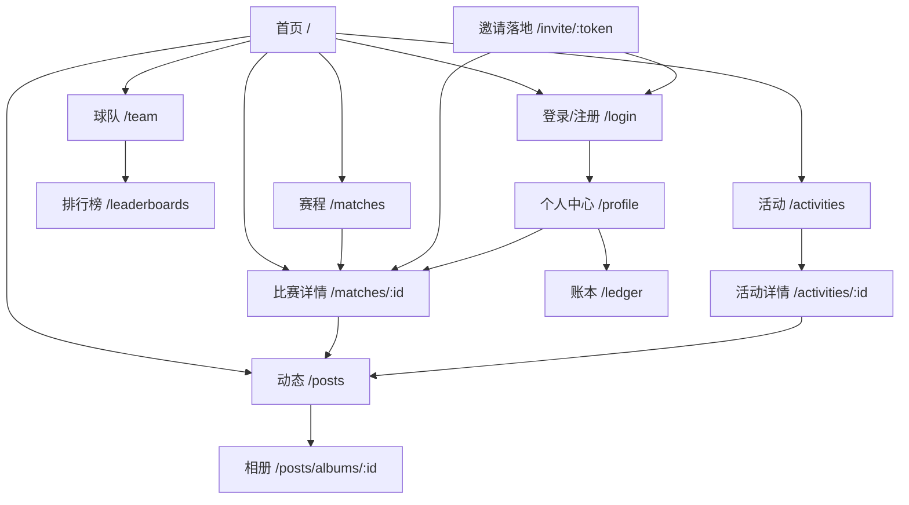
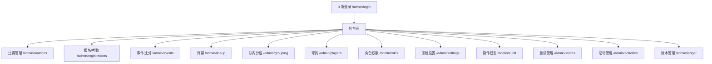
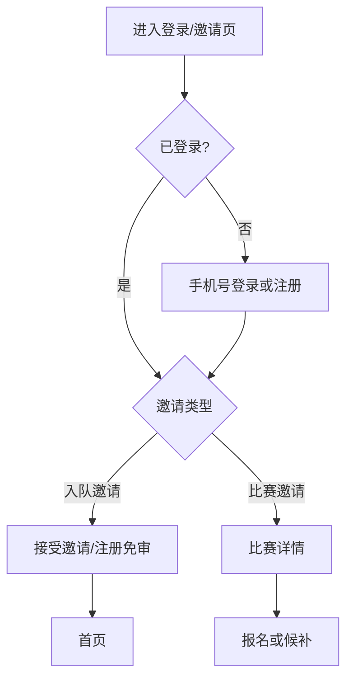
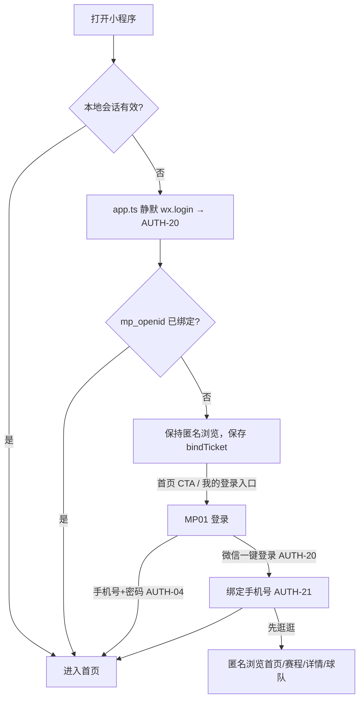
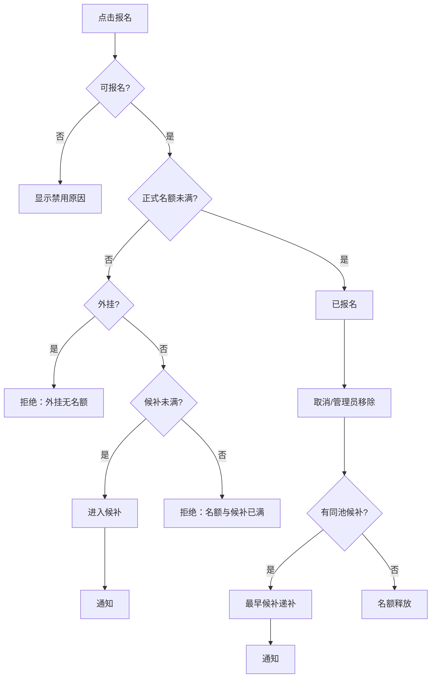
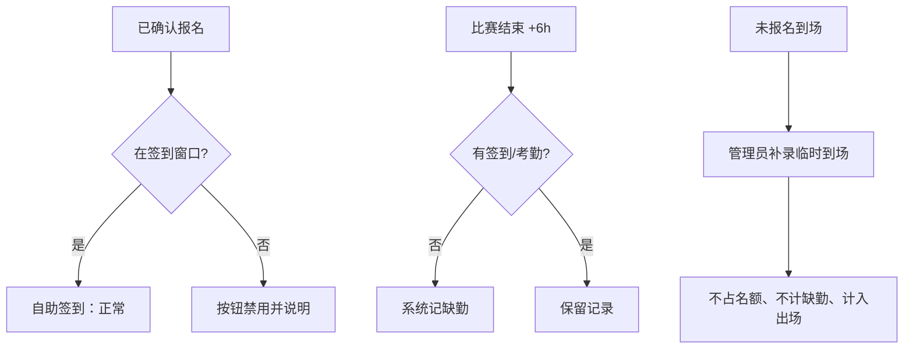
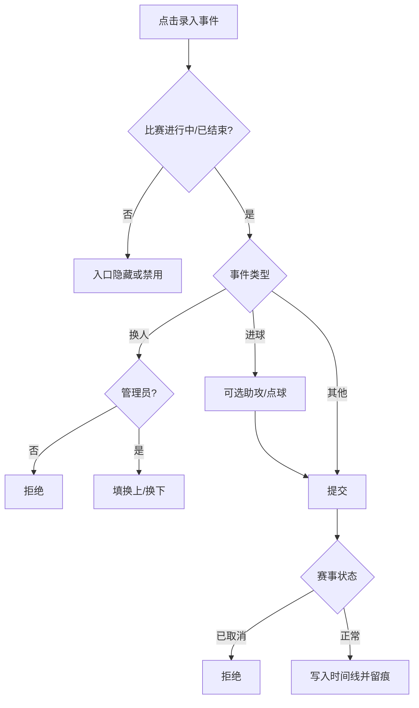
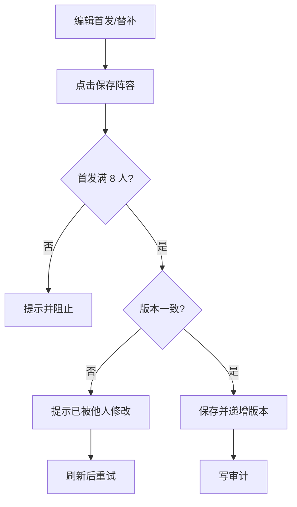
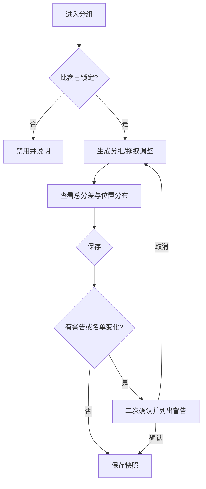
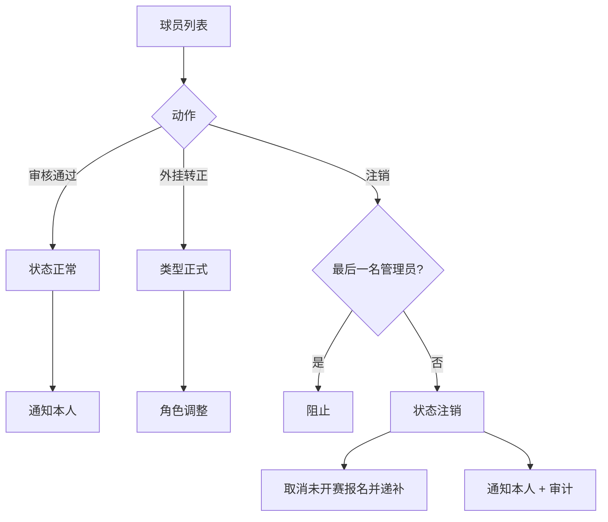

# 云河FC 页面结构与交互设计

- 文档版本：v1.17（P-171 新增《用户服务协议》与《隐私政策》页面、登录/绑定手机号前的协议同意与「我的」页协议入口；v1.16：P-169/P-170 同步补齐：C01 入口不再引用 MP06 同口径，MP06 措辞收敛为沿用 C01 的 Hero 与最近比赛；v1.15：小程序 MP06 首页去除二期能力占位，P-170；v1.14：小程序 MP06 首页去除账本与动态入口，仅保留活动入口，P-169；v1.13：C01 与 MP06 首页「动态」入口移到「账本」下方，入口顺序改为活动/账本/动态，P-166；v1.12：新增 C14/MP14 动态与相册：时间线与相册双视图、比赛/活动详情「照片」入口、C01/MP06「动态与相册」占位卡转正，仅正式球员与管理员可见，P-142~P-162；小程序活动分享封面改为 5:4 图片：动态 Canvas 与静态兜底均使用深绿基底 + 暖琥珀光晕与金色强调，与比赛封面的绿色强调区分；加载活动详情后生成，失败回退静态品牌图，P-141；小程序比赛邀请分享封面改为 5:4 图片：按场次 Canvas 生成，失败回退包内静态品牌图，P-140；小程序比赛详情新增「分享比赛」，复用 INV-03 生成比赛邀请并微信分享小程序卡片，新增 MP13 比赛邀请落地页，P-139；C13/MP12 账本重构为明细/统计双视图，新增月份切换、按日分组小计、关键字搜索与统计趋势，P-138；C13/MP12 账本数据展示改为对账单式汇总与右对齐流水行，P-137；B13 账本流水摘要改为可选，P-136；C13/MP12 账本筛选改为方向/分类/月份/自定义时间，MP12 收进单个「筛选」按钮与底部抽屉，与活动列表同口径，P-135；C01 首页「活动」按钮迁移为入口卡并置于账本入口上方，P-134；用户端 C13 账本入口从「我的」页迁移到 C01 首页「最近比赛」下方，P-132；小程序账本入口从「我的」页迁移到首页「活动」下方，C01/MP06/原型移除账本二期占位卡，P-131；MP10 范围改回页面顶部独立分段控件，筛选抽屉只保留类型/状态/月份/自定义时间，P-130；MP10 筛选改为单个「筛选」按钮与底部抽屉，与 MP02 对齐，P-129；活动列表新增月份与自定义时间筛选，P-128；C11 活动列表移除「历史」范围，P-127；C11/MP10 新增「已结束活动」范围（已结束+已取消），P-126；MP11 hero 元信息改为逐行展示，P-125；小程序支持手机号+密码登录，MP01 双入口，P-124；C11/MP10 活动卡已结束/已取消按钮位与报名中/报名截止对齐，P-123；报名信息文案精简，P-122；活动人数上限必填、默认 50，不提供无上限，P-121；活动取消原因改为可选，P-120；C12/MP11 报名卡显示已报名人数/上限，P-119；C12/MP11 活动详情展示报名队列，P-118；C11/MP10 最近活动改为所有报名中活动，P-117；MP10 活动列表移除「历史」范围，P-116；B12 活动图片批量上传、逐张进度与超限弹窗，P-115；已取消可恢复为报名中/报名截止，P-114；B12 已结束/已取消活动可编辑，编辑按钮不置灰，P-113；B12 行操作拆出「编辑」按钮、「更多」改为「状态」并新增报名中，P-112；报名截止可在 C12/MP11 恢复为报名中，P-111；已结束活动可在 C12/MP11 重新开放为报名中/报名截止，P-110；C12/MP11 场地环境图片增加左右箭头切换，P-109；C12/MP11 支持管理员详情改状态，P-108；活动图片与头像单张上限调整为 5MB，P-107；活动多图最多 10 张，P-106；活动允许携带家属开关控制报名家属选项，P-105；MP10 活动列表缺省筛选改为最近活动，P-104；B13 只读分类改用 LED-12，P-103；B12 支持活动时间范围筛选与编辑/复制图片回填，P-102；账本 B13 汇总随方向/分类/球员/活动筛选变化，P-100；活动状态机、复制新建与最近活动筛选，P-99；澄清球员可进 B 端只读分区，P-98；新增 C11/C12 活动、C13 账本、MP10/MP11 活动、MP12 账本与 B12/B13，P-92~P-94；MP09 排行榜改单行五列表格 P-91；C10 移除 scope=all 直链支持 P-89；C10 旧直链 scope=all 下拉占位项 P-88，已被 P-89 取代；C10/MP09 赛季下拉移除「生涯累计」选项，单赛季窗口列保留，P-87；排行榜新增历史累计固定列，P-85；新增 C10 排行榜页与小程序 MP09，P-84；C 端与小程序「我的」页去除找回密码入口 P-82；小程序首页管理后台入口 P-81；小程序「我的」页对齐 C06 P-80；小程序球队页对齐 C04 P-79；小程序比赛详情对齐 C03 写操作 P-78；小程序比赛页对齐 C02/C03 P-77；小程序补齐四 tab 与个人中心 MP07/MP08 P-76；小程序新增 MP06 首页 P-75；微信登录改为小程序登录：删除 C08，新增小程序页面 MP01–MP05 P-74；C→B 免登录交接 P-42；管理端比赛字段、赛季编辑与场次 P-43；赛季场次编号 Redis 分配 P-44；管理端场次改用 seasonMatchNo P-45；C02 赛程筛选即改即生效 P-47；Home Hero 排除已过结束时间的比赛 P-48；Home Hero 改为展示最近一场比赛 P-49；管理端终态与已延期比赛可编辑 P-50；取消锁定改为开赛当天 01:00 P-51；C01 区块文案改为最近赛程 P-52；C 端展示文案统一改为「比赛」 P-53；C03 比赛头部信息补全 P-54；统计汇总刷新间隔改为 1 分钟 P-55；比分改为计分事件优先、无计分事件用兜底 P-56；C04 球队页默认展示全部球员 P-57；C04 赛季筛选 P-58；管理端比赛选择器筛选、分页与深链 P-59；管理端比赛选择器月份范围筛选 P-60；管理端比赛选择器筛选后校正选中 P-62；操作日志拆分创建时间与操作时间 P-66；C02 卡片展示报名人数与名额 P-67；球员星级改为两位小数与半星展示 P-68；管理端球员支持类型/状态/管理员排序 P-69；管理端分组页报名区展示星级与分值 P-70；分组卡片展示星级图标 P-71；分组按球员星级均衡并移除分组权重设置 P-72；C 端分组行展示星级与位置、B06 卡片合并姓名/号码/位置 P-73）
- 编写日期：2026-11-17
- 依据材料：`docs/云河FC-需求文档.md`（v1.62）、`docs/design/01.功能模块梳理.md`（v0.39）、`prototype/`
- 文档范围：信息架构、页面结构、交互规则与页面状态；不含高保真视觉稿、接口、数据库或代码

## 1. 文档说明

### 1.1 目的

把功能模块落到页面与交互：明确站点地图、导航、每个页面的区域与动作、关键流程和异常状态，作为 UI 设计、前端开发和测试用例的共同依据。

### 1.2 原则

- 沿用原型已验证的信息架构，补齐需求已有但原型缺失的页面，不重新发明流程。
- 每个动作可回溯到权限点与需求编号。
- 权限表现区分三种：不可见、禁用并说明原因、允许操作但服务端拒绝。
- C 端移动优先，以微信内置浏览器为基线；B 端以 PC 为主。
- 本阶段只描述结构与交互，不规定视觉细节。

## 2. 信息架构与导航

### 2.1 C 端站点地图

比赛详情内部按 Tab 组织：概览（含报名）、事件、阵容（有权限时）、分组（队内/训练赛且有权限时）。

### 2.2 B 端站点地图

B 端分区按 `ADMIN_SECTION_PERMISSIONS` 过滤；无权限分区不出现在侧栏，直接访问显示 403。本期不设工作台，`/admin` 进入后落到首个有权限分区。映射固定为：matches=`match:view:any`、registrations=`attendance:view:any`、events=`event:edit:any`、lineup=`lineup:view:any`、grouping=`grouping:view:any`、players=`player:view:any`、roles=`role:view:any`、settings=`settings:view:any`、audit=`audit:view:any`、invites=`invite:manage:any`、activities=`activity:manage:any`、ledger=`ledger:manage:any`。

分区准入只决定能否进入；页面内组合数据与写操作按各自权限码校验。B05/B06 另需报名/分组读权限，模板与写操作另需 `lineup:edit:any`/`grouping:generate:any`；缺少写权限时只读展示并禁用按钮，缺少读权限时对应区块显示无权限提示，不整页 403。

### 2.3 页面与角色可见性

| 页面 | 访客 | 待审核 | 外挂 | 正式 | 管理员 |
|---|---|---|---|---|---|
| 首页 | 公开 | 公开 | 公开 | 公开 | 公开 |
| 赛程 | 公开 | 公开 | 公开 | 公开 | 公开 |
| 比赛详情·概览 | 公开 | 公开 | 公开 | 公开 | 公开 |
| 比赛详情·报名 | 登录引导 | 只读提示 | 本人 | 全队 | 全队 |
| 比赛详情·事件 | 公开 | 公开 | 公开 | 公开 | 公开 |
| 比赛详情·阵容 | 无 | 无 | 无 | 只读 | 只读 |
| 比赛详情·分组 | 无 | 无 | 无 | 只读 | 只读 |
| 球队 | 公开 | 公开 | 公开 | 公开 | 公开 |
| 排行榜 | 公开 | 公开 | 公开 | 公开 | 公开 |
| 登录/注册 | 公开 | 公开 | 公开 | 公开 | 公开 |
| 个人中心 | 登录引导 | 受限 | 本人 | 本人 | 本人 |
| 动态 C14 / MP14 | 登录引导 | 无 | 无 | 可见 | 可见 |
| 相册详情 | 登录引导 | 无 | 无 | 可见 | 可见 |
| 邀请落地 | 公开 | 公开 | 公开 | 公开 | 公开 |
| B 端登录 | 公开 | 公开 | 公开 | 公开 | 公开 |
| B 端各分区 | 无 | 无 | 无 | 按权限 | 按权限 |

说明：外挂不可查看阵容与分组（需求 §7 权限矩阵）；正式球员可查看但不可编辑。动态与相册仅登录的正式球员与管理员可见，待审核与外挂均不可见，不对外公开、不生成分享链接。B 端各分区对正式球员按权限开放：正式球员持有 `attendance:view:any`、`lineup:view:any`、`grouping:view:any`，可进入 `registrations`、`lineup`、`grouping` 三个只读分区，写操作按权限码拒绝（`40301`）；「后台权限」判定见 05 §5.1（P-98）。

### 2.4 导航结构

**C 端**

- 顶部：品牌标识；首页、比赛、球队；管理后台（仅具备后台权限时显示）；右侧为用户入口或登录按钮。点击后台入口先签发一次性票据，随整页跳转进入 B 端；签发失败或票据兑换失败时回退 B 端登录页。
- 移动端：顶部导航 + 底部快捷栏（首页 / 比赛 / 球队 / 我的）；管理后台不进入底栏。
- 比赛详情使用 Tab，不新增一级导航。

**B 端**

- 左侧栏按业务分组：运营（比赛、报名/考勤、事件/比分、活动）、战术（阵容、分组）、球队（球员、角色权限、账本）、系统（邀请、设置、日志）。
- 顶栏：当前分区标题、比赛选择器等上下文、用户与退出。
- URL 保留 `section`、`match`、`side` 参数，刷新可恢复，链接可分享给其他管理员。

## 3. 全局交互规范

### 3.1 反馈层级

| 场景 | 形式 | 规则 |
|---|---|---|
| 操作成功 | Toast | 2–3 秒自动消失，不阻塞 |
| 表单创建/编辑 | 弹窗 | 弹窗内提交，提交中禁用按钮，防重复提交 |
| 不可逆/高影响操作 | 二次确认 | 取消比赛、删除事件、移除报名、注销球员、重新生成分组、离开未保存表单 |
| 持续性状态 | 页面内横幅 | 待审核、比赛已取消、分组名单变化 |
| 字段错误 | 行内提示 | 错误紧贴字段，提交时聚焦第一个错误 |

### 3.2 页面状态

| 状态 | 表现 | 处理 |
|---|---|---|
| 首次加载 | 骨架屏/占位 | 避免整页空白 |
| 空数据 | 空态说明 + 下一步入口 | 赛程空 → 重置筛选；报名空 → 报名 CTA |
| 请求失败 | 错误说明 + 重试 | 保留已输入内容 |
| 无权限 | 403 页/分区守卫 | 说明所需权限，提供返回 |
| 未找到 | 404 页 | 比赛不存在、邀请不存在 |
| 会话过期 | 跳转登录并带 redirect | 登录后回到原页面 |
| 只读/终态 | 禁用操作并说明原因 | 如“已结束的比赛不能编辑阵容” |
| 服务端拒绝 | Toast/横幅 + 刷新数据 | 用于并发、名额已满、版本冲突 |

### 3.3 权限表现规则

- **不可见**：无查看权限的分区、Tab、导航入口直接不渲染。
- **禁用并说明**：有查看权限但当前状态不允许（未锁定不能分组、终态不能编辑阵容），按钮保留但禁用，并给出原因文本。
- **允许但拒绝**：仅在并发或状态已被他人改变时使用；服务端拒绝后必须刷新页面数据，不能只弹提示。
- 禁止仅靠颜色表示禁用；禁用控件需要 `title`/说明文本。

### 3.4 表单规范

- 必填字段有标记；长度、范围、格式在前端即时校验，服务端再次校验。
- 日期时间使用带“确定”的日期时间选择器，避免移动端原生控件不一致。
- 提交中按钮显示进行态并禁用；成功后关闭弹窗并刷新对应区域。
- 有未保存修改时关闭弹窗/离开页面需确认。
- 危险操作确认框默认焦点在“取消”。

### 3.5 响应式与兼容

| 断点 | 规则 |
|---|---|
| ≥1000px | C 端多栏；B 端侧栏展开 |
| 760–1000px | C 端两栏收缩；B 端侧栏折叠为图标/抽屉 |
| <760px | C 端单列；顶部导航横向滚动；表格横向滚动；B 端侧栏变顶部横向导航 |

- C 端以 360–430px 为主，触摸目标不小于 44px。
- 微信内置浏览器：处理底部安全区；不依赖 hover；分享能力后续接 JS-SDK。
- 分组调整等拖拽操作必须提供点击/按钮替代方案。
- B 端表格设置最小宽度并允许横向滚动，操作列固定；行内高频操作直接展示，其余操作收入「更多」下拉，以控制窄屏下的操作列宽度。

### 3.6 可访问性

- 键盘可达，焦点可见；弹窗焦点陷阱，Esc 关闭。
- 尊重 `prefers-reduced-motion`。
- 文字与背景对比度满足常用无障碍标准；状态不能只用颜色区分。
- 表单控件有可读标签，图标按钮有 `aria-label`。

## 4. 页面清单

### 4.1 C 端

| 编号 | 页面 | 路由 | 主要角色 | 目的 | 关键动作 |
|---|---|---|---|---|---|
| C01 | 首页 | `/` | 全部 | 最近一场比赛与快速查看 | 查看比赛、进入详情、进入活动/账本 |
| C02 | 赛程 | `/matches` | 全部 | 浏览与筛选全部比赛 | 筛选、分页、进入详情 |
| C03 | 比赛详情 | `/matches/:id` | 全部 | 查看与参与单场比赛 | 报名、取消、签到、录事件、看阵容/分组 |
| C04 | 球队 | `/team` | 全部 | 展示正式球员、赛季筛选 | 查看球员信息 |
| C05 | 登录/注册 | `/login` | 未登录 | 进入系统 | 登录、注册、找回密码 |
| C06 | 个人中心 | `/profile` | 登录用户 | 管理个人资料与记录 | 编辑资料、通知、我的报名、退出 |
| C07 | 邀请落地 | `/invite/:token` | 全部 | 接受入队/比赛邀请 | 接受邀请、登录/注册、去报名 |
| C09 | 错误页 | `/403`、`/404` | 全部 | 说明与返回 | 返回上一页/首页 |
| C10 | 排行榜 | `/leaderboards` | 全部 | 查看 7 项球员榜单 | 切换榜单、切换赛季 |
| C11 | 活动列表 | `/activities` | 全部 | 浏览聚餐/年会等活动 | 筛选、分页、进入详情 |
| C12 | 活动详情 | `/activities/:id` | 全部（报名需登录） | 查看与报名单场活动 | 报名、取消、携带家属、查看报名队列、复制链接；管理员改状态 |
| C13 | 账本 | `/ledger` | 正式球员、管理员 | 查看球队收支明细与统计 | 月份切换、明细/统计双视图、搜索、筛选、分页 |
| C14 | 动态 | `/posts`、`/posts/albums/:id` | 正式球员、管理员 | 队内时间线与相册归档 | 发布/删除动态、点赞、举报；新建相册、上传/删除照片、设置封面、删除相册 |

### 4.1.1 微信小程序页面

小程序端独立于 Web，覆盖登录、公开浏览、个人中心与 C03 参与/管理写操作（首页、比赛、球队、我的，详见 §5.8）。

| 编号 | 页面 | 目的 | 关键动作 |
|---|---|---|---|
| MP01 | 登录 | `wx.login` 自动登录 / 手机号+密码 | 手机号+密码表单（AUTH-01 + AUTH-04）与「微信一键登录」（AUTH-20）双入口；登录/微信登录前须勾选《用户服务协议》《隐私政策》，冷启动静默登录仅在已同意当前版本时执行；微信已绑定时启动静默登录直接进入首页；未绑定进入 MP02；失败可重试或先浏览 |
| MP02 | 绑定手机号 | 首次登录绑定 | 手机号、验证码（60s）、姓名、位置；发送短信与提交绑定前须勾选《用户服务协议》《隐私政策》；提交 AUTH-21；「先逛逛」进入首页 |
| MP03 | 比赛（赛程） | 浏览与筛选比赛 | 类型/地点/状态/月份/自定义时间筛选、下拉刷新、上拉加载、进入详情 |
| MP04 | 比赛详情 | 查看与参与单场 | 与 C03 同口径：概览（报名/取消/签到/名单与考勤）、事件（录入/本人编辑）、阵容只读、分组只读；管理员可修改比赛状态 |
| MP05 | 球队 | 查看球员 | 赛季筛选、按位置分组、头像/地区/星级、所选赛季出场/进球/助攻 |
| MP06 | 首页 | 最近一场比赛与快速入口 | 沿用 C01 的 Hero 与最近比赛；查看比赛、球队名单、查看详情；报名 CTA 直接报名/加入候补；活动入口（账本与动态入口不在此展示，P-169；不展示二期能力占位，P-170） |
| MP07 | 我的 | 个人中心 | 身份卡（五星半星）、通知（未读为 0 时禁用全部已读）、我的报名（进行中可直接取消）、账号与安全、退出登录；「协议与隐私」入口（未登录可查看 MP15/MP16） |
| MP08 | 编辑资料 | 修改本人档案 | 姓名、地区、主/副位置、头像；保存 PLR-03，头像走 FIL-01 |
| MP09 | 排行榜 | 查看 7 项球员榜单 | 与 C10 同口径：榜单切换、赛季切换、标准竞赛排名展示；单赛季窗口固定展示历史累计与生涯累计列 |
| MP10 | 活动列表 | 浏览聚餐/年会等活动 | 页面顶部范围分段（最近活动/已结束活动/全部，默认最近活动）+ 单个「筛选」按钮（类型/状态/月份/自定义时间抽屉）、下拉刷新、上拉加载、进入详情 |
| MP11 | 活动详情 | 查看与报名单场活动 | 报名/取消、携带家属与备注、查看报名队列、分享卡片；过截止或满员时按钮禁用；管理员可改状态 |
| MP12 | 账本 | 查看球队收支明细与统计 | 月份切换、明细/统计双视图、关键字搜索、单个「筛选」按钮（方向/分类/自定义时间底部抽屉）、分页；只读；仅正式球员与管理员可见 |
| MP13 | 比赛邀请落地 | 接收比赛分享并进入比赛 | 公开查看比赛邀请摘要（报名截止/锁定、赛季场次、场地、名额、邀请人、有效期、剩余次数）；登录后接受 INV-02 并进入 MP04；失效/过期/用尽展示说明 |
| MP14 | 动态 | 队内时间线与相册归档 | 时间线/相册双 Tab；发布/删除动态、点赞、举报；新建相册、上传/删除照片、设置封面、删除相册；照片入口按比赛/活动过滤 |
| MP15 | 用户服务协议 | 告知服务规则与用户权责 | 静态文本；从 MP01/MP02 协议勾选与 MP07「协议与隐私」进入 |
| MP16 | 隐私政策 | 告知个人信息收集、使用、存储与用户权利 | 静态文本；入口同 MP15；与微信后台《小程序用户隐私保护指引》声明一致 |

### 4.2 B 端

| 编号 | 分区 | 路由 | 目的 |
|---|---|---|---|
| B00 | 后台登录 | `/admin/login` | 管理员/有后台权限的用户进入 B 端 |
| B02 | 比赛管理 | `/admin/matches` | 建赛、编辑、状态、延期、重新排期、取消 |
| B03 | 报名/考勤 | `/admin/registrations` | 名单、递补、签到与考勤修正 |
| B04 | 事件/比分 | `/admin/events` | 录事件、改比分、时间线 |
| B05 | 阵容 | `/admin/lineup` | 排阵型、首发、替补、模板 |
| B06 | 队内分组 | `/admin/grouping` | 生成、拖拽调整、保存快照 |
| B07 | 球员 | `/admin/players` | 档案、审核、转正、注销 |
| B08 | 角色权限 | `/admin/roles` | 角色 CRUD、权限分配 |
| B09 | 系统设置 | `/admin/settings` | 报名默认值 |
| B10 | 操作日志 | `/admin/audit` | 查询关键操作 |
| B11 | 邀请管理 | `/admin/invites` | 创建/撤销入队与比赛邀请 |
| B12 | 活动管理 | `/admin/activities` | 创建/编辑活动、状态流转、名单与移除报名、场地环境图片（最多 10 张） |
| B13 | 账本管理 | `/admin/ledger` | 收支流水增删改、汇总与筛选 |

### 4.3 页面与模块/需求对应

| 页面 | 主要模块 | 需求依据 |
|---|---|---|
| C01 首页 | M03、M04、M13 | MATCH-09、REG-02/04 |
| C02 赛程 | M03、M12、M13 | MATCH-09、LIST-01/04 |
| C03 比赛详情 | M03–M08、M13 | MATCH-12、REG、ATT、EVENT、LINEUP、GROUP |
| C04 球队 | M02、M13 | TEAM-01~05 |
| C10 排行榜 | M02、M06、M13 | RANK-01~10 |
| C11 活动列表 | M15、M12、M13 | ACTIVITY-01~11 |
| C12 活动详情 | M15、M13 | ACTIVITY-02~05、07、10、11 |
| C13 账本 | M16、M02 | LEDGER-01~07 |
| C14 动态 | M17、M02、M03、M15 | CONTENT-01~11 |
| MP14 动态 | M17、M02、M03、M15 | CONTENT-01~11 |
| C05 登录/注册 | M01 | AUTH-01、02、04~07 |
| C06 个人中心 | M01、M02、M04、M09 | PLAYER-07、REG-03、REG-11、NOTIFY-03 |
| C07 邀请落地 | M01、M03、M04 | INVITE-01~05 |
| MP01 登录 | M01 | AUTH-03 |
| MP02 绑定手机号 | M01 | AUTH-03 |
| MP03 比赛（赛程） | M03、M12、M13 | MATCH-09、LIST-01/04 |
| MP04 比赛详情 | M03、M04、M07、M08、M13 | MATCH-12、REG-01/02/04/05、ATT-01/03、EVT-01/02/03、LIN-01、GRP-01 |
| MP05 球队 | M02、M13 | TEAM-01~05 |
| MP06 首页 | M03、M04、M13 | MATCH-09、REG-01/02/04 |
| MP07 我的 | M01、M02、M04、M09 | PLAYER-07、REG-02/03、NOTIFY-03 |
| MP08 编辑资料 | M02、M13 | PLAYER-07、FIL-01 |
| MP09 排行榜 | M02、M06、M13 | RANK-01~10 |
| MP10 活动列表 | M15、M12、M13 | ACTIVITY-01~11 |
| MP11 活动详情 | M15、M13 | ACTIVITY-02~05、07、10、11 |
| MP12 账本 | M16、M02 | LEDGER-01~07 |
| MP13 比赛邀请落地 | M01、M03、M04 | INVITE-02/03 |
| C09 错误页 | 全局 | — |
| B02 比赛管理 | M03 | MATCH-01~13、15、16（MATCH-14 为二期） |
| B03 报名/考勤 | M04、M05 | REG、ATT |
| B04 事件/比分 | M06 | EVENT-01~15 |
| B05 阵容 | M07 | LINEUP-01~08 |
| B06 队内分组 | M08 | GROUP-01~12 |
| B07 球员 | M02、M01 | PLAYER、TEAM、RBAC |
| B08 角色权限 | M01 | RBAC-01~07 |
| B09 系统设置 | M11 | CONFIG-01/02 |
| B10 操作日志 | M10 | 审计 |
| B11 邀请管理 | M01、M03 | INVITE-01~05 |
| B12 活动管理 | M15 | ACTIVITY-01~11 |
| B13 账本管理 | M16、M15 | LEDGER-01~09 |

## 5. C 端页面规格

### 5.1 C01 首页

**布局区域**：Hero（最近一场比赛：全部比赛中开赛时间最大的一条，不限状态）、最近比赛（取最近 4 场比赛，排除 Hero 后最多展示 3 场）、活动/账本/动态入口、球队火力（二期占位，不显示数据）、空态。

**组件与动作**

- Hero 卡片：比赛类型、状态、主客队、时间与场地同一行（`M月D日 周X HH:mm · 场地`，时间规则同 C02 列表卡片）、场次（`YYYY赛季第X场（累计X场）`）另起一行居中、报名队列（正式/外挂/候补）。
- Hero 动作区：查看比赛、球队名单；管理后台（仅具备后台权限时显示，经一次性票据跳转 B 端）。
- 报名 CTA 按身份与状态分支：访客 → 登录；待审核 → 提示；已报名 → 查看详情；未满 → 直接报名；正式球员满额 → 加入候补；外挂满额 → 直接拒绝并说明；截止/锁定 → 禁用并说明。
- 最近比赛卡片展示报名人数（已确认 / 名额上限）并进入详情；球队火力仅显示区块标题与“二期上线”说明，不展示具体数据。
- 二期能力卡片网格保留「AI 身价」「投票」「公众号提醒」「资产与荣誉」；动态与相册已上线，不再列入二期卡片；账本已上线，不再列入二期卡片；排行榜已上线，入口在 C04 球队页页头，首页不再放排行榜卡片。
- 「最近比赛」区块之后依次展示「活动」「账本」「动态」入口卡（图标 + 标题 + 箭头）：「活动」进入 C11；「账本」进入 C13，仅具备 `ledger:view:any` 且非待审核的账号可见；「动态」进入 C14，仅登录的正式球员与管理员可见，待审核与外挂不展示（P-142），位于账本下方（P-166）。
- 「活动」入口卡进入 C11，位于账本入口上方；访客可见，不做权限占位（P-134）。
- 登录、非待审核且具备 `ledger:view:any` 时，在活动入口下方展示「账本」入口卡（图标 + 标题 + 箭头），进入 C13；不做未授权占位（P-132）。
- 无比赛（最近比赛区块隐藏）时，活动与账本入口均位于空态之后。

**状态**：无比赛时展示“暂无比赛”并提供去比赛入口；Hero 不按状态过滤，可能为已结束/已锁定/报名中等任意状态的比赛，CTA 按该场状态给出对应文案或禁用原因；最近比赛排除 Hero 后不足 3 场时显示实际数量，0 场时区块隐藏。

**数据来源**：单次 `MAT-02?sort=startAt:desc&pageSize=4`（不限状态）取最近 4 场比赛，Hero 为第 1 条，再以 MAT-03 取 Hero 详情；最近比赛渲染第 2–4 条（按 id 排除 Hero 后最多 3 场），不新增聚合接口；`GET /c/me` 仅登录态调用，访客只读前端会话状态。

**移动端**：单列；Hero 信息优先级为主客队 → 时间地点 → 队列。

### 5.2 C02 赛程

**布局区域**：筛选区、结果列表、分页。

**组件与动作**

- 筛选：比赛类型、地点、状态、月份、自定义时间；条件变更后约 300ms 合并生效（地点连续输入不逐字请求），回车立即生效；不提供“搜索”按钮；“重置”恢复默认态。
- 月份使用年月选择弹层，默认预填当前年月（Asia/Shanghai），但首屏不自动筛选；变更任一条件时预填月份参与查询。清空月份且未设置自定义时间表示全部时间。
- 自定义时间使用区间日历选择，按 Asia/Shanghai 自然日闭区间查询；与月份互斥，选择其一即清空另一项。清空自定义时间不影响已选月份。
- URL 状态：`type/venue/status/month/startDate/endDate/page/pageSize`；`month=all` 表示明确不限月份，无 `month` 参数表示默认态（表单预填当月、查询不筛）；刷新与前进后退按 URL 恢复。
- 默认展示全部比赛（`scope=all`），按开赛时间降序。
- 列表卡片：顶行同一行内，左侧月日、星期与开始时刻（Asia/Shanghai；`M月D日 周X HH:mm`，不显示年份与结束时间），右侧结果标签（胜/负/平，仅对外比赛展示，队内/训练赛不显示）与场次 `YYYY赛季第X场（累计X场）`（最右）；日期与场次同字号次要色，过窄时场次单行省略；其下为主客队与比分或 VS；底行类型标签贴左、场地居中、状态标签贴右，其下为报名人数三栏（正式 / 外挂 / 候补，各显示「已确认 / 名额上限」，不含进度条），三栏左/中/右分别与上方类型/场地/状态对齐，仅展示不可点击；类型标签与状态标签同为 pill 并按类型着色（对外比赛靛蓝、队内赛绿、训练赛蓝、友谊赛琥珀），场地过长时单行省略；有胜方时胜方名称使用红色背景。
- 分页：默认 10 条，可选 20/50/100；空结果显示重置入口。

**移动端**：筛选使用底部抽屉，内含全部筛选项与重置；条件变更即生效，抽屉保持打开（重置同样），点遮罩关闭；月份与自定义时间在抽屉内弹出选择层；卡片顶部保持单行，场次在最右侧，过窄时场次省略而不折行；报名人数固定三列，不折行。

### 5.3 C03 比赛详情

**顶层区域**：比赛头部（类型、状态、主客队、比分、元信息行）；元信息行依次展示带 emoji 的日期（`YYYY/MM/DD 周X`）、起止时刻（同日 `HH:mm–HH:mm`，跨天 `HH:mm–MM/DD HH:mm`）、报名截止与报名锁定（`YYYY/MM/DD HH:mm`）、`YYYY赛季第X场（累计X场）`、场地；取消场次仍展示报名截止/锁定，由作废横幅说明语义（正式球员额外显示“邀请队友”）；管理员额外显示状态下拉，可直接修改比赛状态（不跳转后台）；下拉展示全部状态（含已延期/已取消），选择延期/取消在 C 端弹窗内完成并复用 MAT-07/MAT-08 规则；管理员可将比赛重置为任意状态（含回退/终态恢复），但下拉按后端合法集禁用：普通状态 0–4 在持有 `match:status:any` 时恒可；延期仅在报名中/已截止/锁定/进行中可选且需 `match:edit:any`；取消在已结束/已取消时禁用。有进球/乌龙事件时比分显示事件推导值；只有黄牌/换人等非计分事件或完全无事件时显示已录入的比分。队内/训练赛不展示胜/负/平结果标签。Tab：概览、事件、阵容、分组。

- “邀请队友”弹窗：有效期（默认 7 天）与使用次数（默认不限，可设上限）；创建后仅展示一次邀请链接（INV-03、INVITE-03）。
- 头部动作区提供「照片」入口（仅登录的正式球员与管理员可见）：按 `matchId` 进入 C14 的相册列表；该比赛无相册时自动创建默认相册后进入；同一比赛允许多个相册（CONTENT-03/04）。

**概览（含报名）**

- 报名概况：作废场次显示历史条数与“已作废”横幅，卡片占满内容区。
- 本人报名卡：状态徽标、名额进度、报名/取消/签到按钮及禁用原因。
- 已取消比赛：显示“报名作废”，隐藏取消、签到与名单操作。
- 名单与考勤：正式球员/管理员可见全队；外挂只看本人。名单以本场有效报名为基准，按“正式确认 → 正式候补（带顺序）→ 外挂确认”分段；考勤按 `playerId` 左连接，缺记录显示“未记录”。
- 管理员移除报名同页跳转 B03（带 `matchId` 筛选），C 端名单只读；返回后重载名单并提示真实递补情况。所有 C→B 深链（事件、分组、报名）均携带一次性票据，已登录用户无需再次输入密码；中键/新标签页打开纯链接时由 B 端登录页兜底。
- 不展示事件统计、阵容预览和管理员快捷入口；事件统计移至“事件”Tab。

**事件**

- 顶部为比赛事件统计卡（进球/牌/换人；已结束比赛显示最终比分）。
- 统计卡下方为“录入事件”“去管理后台”按钮；按权限显示，无录入权限或不在窗口内时禁用并通过标题说明原因。
- 按钮下方直接渲染事件时间线，不再显示“事件时间线”标题；统计卡保留事件总数；时间线卡片内不重复显示后台入口。
- 比分卡、事件推导说明和“事件与比分不一致”警告已移除；推导值统一在比赛头部展示，统计卡显示与头部一致的最终比分。
- 选择主队（橙队）时，球员/助攻/换上/换下只显示橙队分组成员；选择客队（兰队）时只显示兰队分组成员；以已保存分组为准（仅草稿不约束），且须为本场 CONFIRMED、账号 ACTIVE 的报名；无已保存分组时显示本场确认报名球员。
- 录入/编辑弹窗字段：类型、球队、球员、助攻（仅进球）、换上/换下（仅换人）、半场、分钟、点球标记；球员端不可录入换人，换人仅管理员。
- 时间线排序：上半场→下半场、分钟升序、同分钟进球优先；主队左侧、客队右侧。
- 时间线支持编辑本人的事件（24h 内）；管理员删除/补录跳转 B04；已取消/已延期比赛隐藏操作。

**阵容**：主/客切换、阵型与首发/替补只读；对手方仅阵型占位。

**分组**：A/B 两列、每名球员展示姓名、号码、位置、星级图标与分值、总分差、位置分布、名单变化警告；管理员可深链到后台分组。

**状态**：比赛不存在 → 404；已取消 → 全局作废提示；已结束 → 阵容不可保存，事件在赛后 24h 内可修改、管理员可补录/删除；无计分事件时比分可修正，有计分事件时只能调整进球/乌龙事件。

**移动端**：Tab 横向滚动；球场按宽度缩放；时间线压缩为单列。

### 5.4 C04 球队

**布局区域**：球队名称、赛季筛选、球员列表。

**组件与动作**

- 页头提供赛季下拉，默认 Asia/Shanghai 当前年份；选项来自 MAT-14（本队有效比赛赛季 ∪ 当前年份，倒序）。切换后写入 URL `?season=YYYY`（默认年份省略参数）并重新请求名单与统计。
- 页头赛季下拉下方提供「排行榜」入口，进入 C10 并沿用当前所选赛季。
- 按前锋/中场/后卫/门将分组；组内按所选赛季（默认当前赛季）出场降序 → 号码升序；展示全部正式球员。
- 球员卡：头像、姓名、号码、位置、星级、地区、所选赛季出场/进球/助攻。星级按半星粒度展示（小数部分 0.00–0.49 显示 N 星，0.50–0.99 显示 N 星半），无障碍标签使用原始两位小数。
- 除赛季筛选外无其他筛选、无球员详情页。
- 出场/进球/助攻为所选赛季数据，来自统计汇总表，允许最多 1 分钟延迟；球员列表由 PLR-01（带 `season`）提供，三项统计由 STA-01（带 `season`）按 playerId 合并。
- URL 直链非法 `season` 静默回退当前年份；MAT-14 失败时下拉至少保留当前年份与已选赛季，不阻塞名单与统计。

**状态**：无球员时显示空态；选项加载失败无错误横幅；注销球员不出现；历史赛季无统计时展示名单与 0 值。

### 5.5 C05 登录/注册

**布局区域**：Tab（登录/注册）、表单、辅助入口。

**登录**

- 手机号 + 密码；错误提示不区分“手机号不存在/密码错误”。
- 注销账号提示联系管理员；待审核账号登录后仍为只读。
- 网站不提供微信登录；微信自动登录仅在小程序内完成，小程序同时支持手机号+密码登录（见 §5.8）。

**注册**

- 手机号、验证码、密码（8–64 位，含字母数字）、姓名、主位置。
- 自助注册进入待审核并默认 GUEST；入队邀请注册免审为 PLAYER；比赛邀请只引导、不改变账号状态。
- 注册成功后展示“账号待审核”提示（不发站内信）；按 `redirect` 白名单跳转，无 redirect 回首页。

**辅助**：找回密码；换绑手机需联系管理员操作；邀请链接进入时在表单上方展示邀请上下文。

### 5.6 C06 个人中心

**布局区域**：身份卡、通知、我的报名、账号与安全。

- 身份卡：头像、姓名、角色、脱敏手机号、号码、位置、星级（按半星粒度展示，无障碍标签使用原始两位小数）；编辑资料弹窗（姓名/地区/主副位置/头像）。
- 头像：弹窗内选图后前端校验并压缩（JPG/PNG/WebP，≤5MiB，长边 1080px），上传成功显示预览；保存时随资料提交。可为空（显示姓名首字母占位），不提供单独「换头像」入口。超限提示「图片不能超过 5MB」，格式错误提示「仅支持 JPG/PNG/WebP」，上传失败提示「上传失败，请稍后重试」；签名 URL 过期时显示占位，不自动刷新。
- 通知：个人中心区块使用 NTF-01/03/04，分页加载；展示未读标记、单条已读、全部已读；点击进入关联比赛/页面（`USER` 类只标记已读）；未读角标由 NTF-02 每 60 秒轮询，并在页面重新可见与路由切换时刷新；MVP 不新增独立通知页。
- 我的报名：分“进行中 / 历史”两组，默认进行中；显示已报名/候补/已作废/已取消；进入比赛详情。
- 账号与安全：微信绑定状态（只读展示 `user.wechatBound`：已绑定小程序 / 未绑定；不提供自助绑定与解绑，解绑仅管理员在 B07 操作）、退出登录。不提供找回密码入口。
- 待审核用户显示横幅，隐藏写操作入口。
- 不提供账本入口（已移至 C01 首页，P-132）。

**移动端**：单列卡片；编辑弹窗全屏化。

### 5.7 C07 邀请落地

**状态判断顺序**：token 不存在 → 404；过期/撤销/次数用尽 → 失效说明；有效 → 展示邀请内容。

**入队邀请**：球队名称、邀请人、加入按钮；未登录先登录/注册，注册免审；已是成员则提示无需重复加入。

**比赛邀请**：日期与起止时段头部，其后为标签值信息列表（报名截止、报名锁定、赛季场次、场地、名额、邀请人、有效期至、剩余次数），信息口径与 C03 比赛详情一致；未登录先登录/注册，之后进入比赛详情报名；自助注册为待审核，审核通过前不能报名；比赛邀请不改变账号状态。比赛已满则提示候补或已截止。

**边界**：比赛邀请不改变账号状态；入队邀请不自动报名比赛。

### 5.8 微信小程序页面（MP01–MP16）

小程序端与 Web 共用后端会话与权限，覆盖登录、公开浏览、个人中心与 C03 参与/管理写操作。

**MP01 登录**

- 启动时 `app.ts` 先恢复本地会话（本地持久化的 `YHFC_C`），无会话再静默调用 `wx.login` → AUTH-20；已绑定 `mp_openid` 直接建立会话，停留在 MP06。
- MP01 提供双入口：手机号+密码表单（缺 CSRF 时先经 AUTH-01 获取，再提交 AUTH-04）与「微信一键登录」（AUTH-20）；密码登录不绑定 `mp_openid`，成功后回到首页。
- 未绑定微信：仅在内存保存 `bindTicket`（不写 storage），保持匿名浏览；用户从首页 CTA 或「我的」页登录入口进入 MP01，可选密码登录，或走微信登录后进入 MP02 绑定。
- 会话凭据只在小程序本地持久化（存不透明会话 ID，不存密码）；冷启动自动恢复，写请求缺 CSRF 时按需经 AUTH-01 获取，退出登录（AUTH-05）或会话失效的 401 即清除（登录凭证错误除外）。
- 微信登录失败（无效 code / 网络 / 未启用）展示可重试提示；两种登录均提供「先逛逛」进入匿名浏览。
- 协议同意：表单下方提供《用户服务协议》《隐私政策》勾选（未同意过当前版本时默认不勾选）；未勾选时手机号密码登录与微信登录均被拦截并提示先阅读同意，勾选后才调用登录接口并在本机记录同意版本。冷启动静默微信登录仅在已同意当前版本时执行；未同意时保持匿名浏览。

**MP02 绑定手机号**

- 手机号（手输）、短信验证码（60 秒倒计时，AUTH-02 `purpose=BIND`）、姓名、主位置；提交 AUTH-21。
- 协议同意：勾选《用户服务协议》《隐私政策》后才能发送短信与提交绑定；未勾选时拦截并提示，同意版本记录在本机。
- 手机号已存在则绑定到已有账号（姓名/位置忽略）；新手机号建待审核 + GUEST。
- 不使用 `getPhoneNumber`（个人主体不可用）。
- 注销账号提示联系管理员；`bindTicket` 过期提示重新登录。
- 已有账号可直接改用手机号+密码登录，返回 MP01（`bindTicket` 作废）。

**MP03 比赛（赛程）/ MP04 比赛详情 / MP05 球队**

- MP03：默认展示全部比赛并按开赛时间降序（`scope=all&sort=startAt:desc`）；筛选含类型、地点、状态、月份、自定义时间与重置，条件变更 300ms 合并生效、地点回车立即生效，不提供搜索按钮；月份默认预填当前年月但首屏不参与查询，任一条件变更后参与；月份与自定义时间互斥，自定义时间用两个原生日期选择器（开始/结束）确认后生效；筛选使用底部抽屉，变更与重置保持抽屉打开，点遮罩关闭；卡片信息与 C02 一致，使用下拉刷新、上拉加载与失败重试，从详情返回保留已加载分页；未登录也可浏览。
- MP04：与 C03 同口径，头部（类型/状态、主客队与事件推导优先的比分、结果标签、取消/延期横幅、日期/时段/报名截止/报名锁定/赛季场次/场地）下分四个 Tab：
  - 概览：报名队列与本人报名卡（报名/加入候补/取消/签到、禁用原因）、全队名单与考勤（正式→候补顺位→外挂；外挂只看本人）、取消比赛作废横幅。
  - 事件：事件统计与单列时间线；进行中/已结束可录入，本人非换人事件赛后 24h 内可编辑；换人仅管理员录入。
  - 阵容：`lineup:view:any` 可看，主客切换、阵型、首发与替补只读；对手方仅占位。
  - 分组：`grouping:view:any` 且队内/训练赛可看，A/B 名单、分值、分差与 warnings 只读。
- MP04 管理员可直接点击头部状态修改（不额外放「改状态」按钮）：全部 7 个状态，0–4 直接提交（0 即开启报名/重置为报名中），5 延期需开始/结束时间，6 取消需原因；普通状态需 `match:status:any`，延期另需 `match:edit:any`。
- MP04 写操作统一要求 CSRF 与 `Idempotency-Key`；状态与事件编辑携带 `version`，冲突后刷新并提示。报名/取消/签到/名单/事件/阵容/分组权限与 C03 一致；不做订阅消息与 B 端专属操作。
- MP04 头部提供「分享比赛」（P-139）：仅具备 `invite:create:match`、非待审核、比赛未取消/延期，且为管理员或本场正式报名球员时显示；点击打开底部面板，填写有效期（默认 7 天，1–30）与使用次数（留空不限）后经 INV-03 创建邀请。创建成功展示「分享给好友」（微信原生分享，路径 `/pages/invite/index?token=<token>`，标题「<比赛标题> · 比赛邀请」）与「复制链接」；关闭面板后仍保留本次 token 直到离开页面。隐藏右上角转发菜单，仅保留页面内分享入口。分享封面为 5:4（500×400）：创建邀请后用隐藏 Canvas 按当前比赛绘制标题、日期/时段、场地、名额、报名截止与邀请有效期，导出 PNG 作为 `imageUrl`；生成期间分享按钮显示「生成分享图中…」并禁用，失败回退包内静态品牌图 `assets/share-match-invite.png`。
- MP05：与 C04 同口径。页头提供赛季下拉，选项来自 MAT-14 并强制包含当前上海年份与已选赛季；页头赛季下拉下方提供「排行榜」入口进入 MP09 并沿用当前赛季；按前锋/中场/后卫/门将分组，组内保持 PLR-01 顺序。球员卡展示头像（签名 URL，失败回落姓名首字）、姓名、号码、位置、地区、五星半星、所选赛季出场/进球/助攻（PLR-01 + STA-01 按 playerId 合并；统计失败降级为出场数与「—」）。无球员空态、加载失败可重试；未登录也可浏览。
- MP04 头部提供「照片」入口（仅登录的正式球员与管理员可见）：按 `matchId` 进入 MP14 相册列表；无相册时自动创建默认相册后进入（CONTENT-03/04）。
- 订阅消息仍不做；比赛邀请与分享仅在 MP04 提供（P-139），个人中心与通知由 P-76 纳入（见 MP07/MP08）。

**MP06 首页**

- tabBar 首项与启动页，沿用 C01 的 Hero（最近一场比赛）与最近比赛（排除 Hero 后最多 3 场），以及空态、加载与失败重试；不展示二期能力占位（P-170）。
- Hero 报名 CTA 的文案、禁用状态与原因提示完全沿用 C01 的身份/状态分支；`报名`/`加入候补` 直接调用 REG-01，成功后提示「报名成功」或「已加入候补」并静默刷新 Hero 队列；`登录后报名` 进入 MP01，`查看详情` 进入 MP04。名额/状态冲突后刷新并提示。
- Hero 动作区与 C01 一致提供「管理后台」，仅具备任一后台权限时显示；个人主体小程序不支持 web-view，点击先签发 AUTH-18 一次性票据，把 `https://<domain>/admin/#ticket=...` 复制到剪贴板并弹窗提示到浏览器打开（票据 60 秒有效）；签发失败复制后台首页链接，由 B 端手机号 + 密码登录。
- 「最近比赛」下方只提供「活动」快捷入口，进入 MP10；不提供账本与动态入口（P-169）。MP12 账本页与 MP14 动态页仍保留：动态可从 MP04/MP11 头部「照片」入口进入相册视图后切换；账本在小程序端暂无可达入口。
- 不展示 Web 的全站页脚。
- 启动静默会话完成后重算 CTA；不重复请求 `/me`。下拉刷新重新加载比赛数据。
- 登录/绑定成功与「先逛逛」均回到首页 tab。

**MP07 我的**

- tabBar 第四项「我的」；未登录展示登录入口（进入 MP01，可选手机号+密码或微信登录）。
- 已登录展示身份卡：头像（签名 URL，失败回落姓名首字）、姓名、角色、手机掩码、号码、位置、五格满/半/空星级；账号待审核时显示提示且不可编辑。移动端身份卡换行展示，编辑资料按钮独占一行。
- 通知：全部/只看未读、加载更多、单条已读、全部已读（未读为 0 时禁用）；`refType=MATCH` 的通知进入 MP04；「我的」tab 显示未读角标（NTF-02，60 秒轮询）。
- 账号与安全：手机号、微信绑定状态、退出登录。
- 我的报名：进行中/历史、加载更多、进入 MP04；进行中记录可直接取消报名/取消候补（先取 MAT-03 校验报名锁定，再 REG-02），成功提示递补结果并刷新列表；待审核不展示列表。
- 列表在已加载后保留分页位置；下拉刷新强制重载。
- 账号与安全：手机号、微信绑定状态、退出登录（AUTH-05）；不提供找回密码入口。
- 不提供账本入口（P-131；MP06 首页入口已于 P-169 移除，小程序端暂无可达入口）。
- 协议与隐私：提供《用户服务协议》（MP15）与《隐私政策》（MP16）入口，未登录也可查看。
- 不提供分享与订阅消息。

**MP08 编辑资料**

- 仅本人可编辑且待审核不可进入；可修改姓名、地区、主位置、副位置（最多 3 个，不能与主位置重复）与头像。
- 打开时用 PLR-01（`all=true`）补齐地区与副位置；头像先经 FIL-01 上传，保存时 `avatarUrl` 只提交 `objectKey`（不是签名 URL）。
- 保存 PLR-03；成功后刷新 MP07 身份卡。

**MP09 排行榜**

- 与 C10 同口径：页头赛季下拉（MAT-14）与 7 个榜单切换，默认出场榜；下拉不提供生涯累计；切换写入页面数据，不用 URL 参数。
- 数据只请求赛季窗口（STA-03，`season`；`scope=all` 仅保留接口兼容），前端按 §5.11 规则排序与算名次；同一行内依次展示名次、头像（失败回落姓名首字）、姓名，以及与表头同列对齐的当前赛季/历史累计/生涯累计数值；副指标不再展示。
- 单赛季窗口使用共享表头 + 单行五列表格（名次/球员/当前赛季/历史累计/生涯累计，§5.11）：表头固定为球员、当前赛季（历史赛季为「YYYY 赛季」）、历史累计、生涯累计，名次表头仅保留列宽、标签不可见；行内五列同一行展示，球员列为 40rpx 头像 + 姓名，长姓名单行省略；三列数值均只显示当前榜单主指标并使用等宽数字；小程序 750rpx 下表头与行严格同列对齐；下拉不提供生涯累计窗口。
- 加载失败可重试；空态与 C10 一致；未登录也可浏览。

**MP10 活动列表**

- 与 C11 同口径：类型/状态、最近活动/已结束活动/全部筛选（不提供「历史」范围，历史活动经「全部」查看，P-116/P-127）、月份与自定义时间筛选（P-128）、下拉刷新、上拉加载；缺省范围「最近活动」（`scope=latest`），非法或缺失筛选码回落同一缺省值；C11 缺省仍为「全部」。
- 范围独立为页面顶部与「筛选」按钮同排的分段控件（最近活动/已结束活动/全部，P-130），点击即切换范围并回到第 1 页；筛选抽屉（P-129）只包含类型、状态、月份与自定义时间，不再提供范围。切换范围不改变已设置的筛选条件，条件在所选范围内生效；「重置」只清空类型、状态、月份与自定义时间，保留当前范围。空态提供「重置筛选」入口。
- 月份使用原生月份选择器（YYYY-MM，2000-01 至 2100-12），自定义时间使用底部弹层选择起止日期（YYYY-MM-DD 成对）；月份与自定义时间互斥，选择任一侧即清空另一侧，均默认不筛选；月份为空时始终展示「本月」快捷入口（包括自定义时间生效时），选择后切回当月并清空自定义时间；时间按活动开始时间的 Asia/Shanghai 自然月/自然日过滤，条件变更即回到第 1 页。
- 「最近活动」展示所有报名中活动（不论是否已过截止或满员），按活动时间倒序分页，不再只取一条（P-117）。
- 「已结束活动」展示已结束与已取消活动（按状态过滤，含活动时间未到的已取消活动），按活动时间倒序分页（P-126）。
- 卡片展示活动名、类型、时间、地址、人数（`signupCount`/`capacity`，不含家属）与状态；有首图时展示缩略图，视觉与比赛卡片一致，时间/地址/人数行的 emoji 与文本成组展示（P-125）；按钮文案与 C11 同一矩阵（已取消/已结束以禁用态占位，与报名/已截止同尺寸，P-123）。
- 加载失败可重试；空态提示；未登录可浏览。

**MP11 活动详情**

- 与 C12 同口径：展示活动名、类型、时间、截止、地址、场地环境图片、说明、人均消费、人数；报名卡展示已报名人数/上限（「已报名 X / Y 人」）与人数进度条，不展示报名时间与家属文案（P-122）；头部沿用比赛详情的深色 hero 样式并提供分享按钮，元信息改为逐字段独占一行（📅 时间、📍 地点、⏰ 报名截止、👥 人数、💰 人均消费），不再与比赛详情横向换行同口径（P-125）；有图时在 hero 下独立「场地环境」卡片轮播 0–10 张，无图不展示该卡片；多图时展示左右箭头，点击或手势滑动均可切换。
- 未报名且可报名时展示「报名」，弹层仅在 `familyAllowed=true` 时勾选「携带家属」并填家属备注，否则以 `withFamily=false` 提交；已报名且未过截止展示「取消报名」；不可报名时按钮禁用，文案按「已截止 / 已满」取首个命中项；已取消/已结束只显示徽标、不显示按钮。
- 与 C12 同口径展示「报名队列」卡片：按报名时间升序，含序号、头像（无头像时显示姓名首字）、姓名、号码、家属标记与备注；仅正式球员与管理员可见，匿名显示「登录后查看报名队列」，待审核/外挂显示「报名队列仅正式球员与管理员可见」；单页取 100 条，`total` 更大时提示截断；加载中、失败可重试、无报名显示空态。
- 管理员（`activity:manage:any`）在任意状态时，头部状态胶囊可点并带 `▾`，弹出底部状态面板：全部状态按 ACT-10 合法集禁用（报名中与报名截止可互转），选择已取消进入取消原因表单（可选、≤255 字）；已结束与已取消均可恢复为报名中/报名截止，但已结束不可取消、已取消不可结束。普通球员只看到状态徽标。
- 头部「分享活动」入口：加载活动详情后用隐藏 Canvas 按当前活动生成 5:4（500×400）封面，绘制活动名、日期/时段、地点、已报名人数/上限、报名截止与人均消费（有则显示）；封面采用深绿基底 + 暖琥珀光晕与金色标题/胶囊/圆点的活动暖金强调色（与比赛封面的绿色强调区分）；封面未就绪时按钮以「准备中…」占位；静默刷新重新生成时保留旧封面直到新图替换，失败回退包内静态品牌图 `assets/share-activity-invite.png`（与比赛封面同版式、同活动暖金强调色）。`onShareAppMessage` 标题为「<活动名> · 活动邀请」，`path` 指向本页并带 `id`，`imageUrl` 使用动态封面或静态兜底；活动分享沿用稳定 URL，不引入邀请 token（P-94/P-141）。
- 头部提供「照片」入口（仅登录的正式球员与管理员可见）：按 `activityId` 进入 MP14 相册列表；无相册时自动创建默认相册后进入（CONTENT-03/04）。
- `refType=ACTIVITY` 的通知进入本页。

**MP12 账本**

- 仅正式球员与管理员可见入口；页面结构同 C13：月份切换与汇总卡、「明细 / 统计」双 Tab，只读（P-138）。
- 月份标题默认当前月，点击月份可切换，左右箭头切换相邻月份；汇总卡同 C13（支出/收入并列、筛选生效时标注「筛选合计」）；月份与自定义时间互斥，选择月份即清空自定义时间，自定义时间生效时标题显示日期区间（P-135、P-138）。
- **明细**：Tab 下方为关键字搜索框；「筛选」按钮与底部抽屉保留方向/分类/自定义时间与重置，条件变更即生效、抽屉保持打开（月份由页面标题承载，不再放入抽屉）。流水按发生日期分组，组头为「M月D日 星期X」与当日「支 x 收 y」，组内行样式与 C13 一致；上拉加载更多、到达末页提示。搜索只匹配摘要，不影响汇总卡（P-138）。
- **统计**：分段控件「按周 / 按月 / 按年 / 自定义时间」，默认按月；周期导航显示周期标签并可前后切换；「支出 / 收入」切换；主数字、笔数与环比、结余与环比两行文案同 C13；趋势图用原生 `view` 柱状渲染，不引入图表库，按日或按月分桶，无数据显示空态；自定义时间复用现有日期范围弹层。统计默认跟随页面月份，切换月份时按周/月/年查看的统计同步到该月（P-138）。

**MP13 比赛邀请落地**

- 路由 `/pages/invite/index?token=<token>`，公开访问；token 缺失或 INV-01 返回 404 时展示「邀请已失效」，不跳错误页。
- 比赛邀请：卡片头部为比赛标题与「比赛邀请」标签，日期（`YYYY/MM/DD 周X`）与时段独占一行；信息列表与 C07 同口径，依次为报名截止、报名锁定、赛季场次、场地、名额（已报名/上限）、邀请人、有效期至、剩余次数（`maxUses=null` 显示「不限」）。
- 比赛详情（MATCH-02）只用于补充报名截止/锁定、赛季场次与名额，失败时保留 INV-01 的标题、时间与场地，其余值显示 `—`；名额已满或报名已截止时展示琥珀色提示，文案与 C07 一致。
- 未登录展示「登录后前往比赛」并进入 MP01；登录/绑定手机号成功后回到本页。已登录点击「去比赛」调用 INV-02 接受邀请，成功后进入 MP04；账号待审核可进入比赛查看，但不能报名。邀请过期、撤销或用尽时展示失效原因，不提供接受操作，可返回首页；接受后若比赛信息不可用，提示并改为「返回首页」，不重复接受。
- 入队邀请（`type=0`）：失效（过期/撤销/用尽）优先展示失效原因；仍有效的入队邀请展示「该邀请类型暂不支持在小程序内打开」，不提供接受操作。
- `onShareAppMessage` 指向本页并携带同一 token，允许接收者继续转发。

**MP14 动态**

- 二级页面，路由 `/pages/posts/index` 与 `/pages/album-detail/index?id=`；与 C14 同口径，顶部「时间线 / 相册」双 Tab。
- 入口：MP04 与 MP11 头部「照片」入口按 `matchId`/`activityId` 过滤，无相册时自动创建默认相册后进入（MP06 首页「动态」快捷入口已于 P-169 移除）。
- 时间线：作者、正文、引用相册封面、点赞数与点赞按钮、举报/删除；发布正文 1–2000 字，可选相册；本人可删自己的动态，管理员可删任意动态；不提供编辑。
- 相册：列表与详情；上传使用 `wx.chooseMedia({ mediaType: ['image'], sizeType: ['compressed'] })` + 客户端压缩长边 2048/JPEG q80，经 `utils/request.ts` 的 `uploadFile` 上传（复用 Cookie/CSRF），单张 ≤5 MiB、单相册 ≤200 张；第 201 张提示相册已满。
- 点赞/取消即时更新；举报后提示已通知管理员；`refType=CONTENT_POST` 的通知进入时间线并定位动态，`refType=CONTENT_PHOTO` 进入对应相册。
- 未登录/待审核/外挂按 §2.3 处理；不提供分享入口与订阅消息。
- 主包体积：MP14 与相册详情默认放入主包；开发者工具「代码依赖分析」确认主包 ≤2MB，超限时迁入分包并配置 `preloadRule`。

**MP15 用户服务协议**

- 二级页面，路由 `/pages/terms/index`；静态文本，无接口。
- 入口：MP01/MP02 协议勾选中的《用户服务协议》、MP07「协议与隐私」。
- 内容覆盖服务内容、账号注册与安全、用户行为规范、用户内容与知识产权、个人信息保护、服务变更与终止、活动风险、账号注销、法律适用与联系方式；运营者名称与联系方式须与小程序备案主体一致。

**MP16 隐私政策**

- 二级页面，路由 `/pages/privacy/index`；静态文本，无接口。
- 入口：MP01/MP02 协议勾选中的《隐私政策》、MP07「协议与隐私」。
- 按「收集哪些个人信息 → 收集目的 → 收集方式与授权 → 存储地点与期限 → 共享/转让/公开披露 → 用户权利 → 未成年人保护 → 信息安全 → 政策更新 → 联系方式」组织；收集项须与微信后台《小程序用户隐私保护指引》声明一致（手机号、选中的照片或视频信息、读取你的剪切板；摄像头可按需补充勾选）。

**会话**：客户端维护 Cookie jar（`Set-Cookie` → 后续请求 `Cookie` 头），会话 Cookie 同时写入本地存储；冷启动先恢复 Cookie，写请求缺 CSRF 时按需经 AUTH-01 获取，失效再回退 `wx.login`；本地不记录独立有效期，服务端 7 天滑动过期兜底；退出登录或会话失效的 401 清除（登录凭证错误除外）。

### 5.9 小程序边界

- 一个 `mp_openid` 只绑定一个账号；换绑需先由管理员在 B07 解绑。
- 待审核与注销状态沿用 Web 规则：待审核只读；注销不可登录。
- 小程序不做通用比赛分享、复制比赛链接、订阅消息、入队邀请与邀请管理；比赛邀请仅通过 MP04「分享比赛」创建并分享（P-139），入口条件与 C03 一致。
- MP13 登录/绑定手机号成功后只按 `inviteToken` 参数回到邀请页；不提供通用 `redirect`、站内深链或 OAuth `state`。
- 管理后台入口仅在首页 Hero 提供，复制带票据链接到浏览器打开（P-81）；不内嵌 web-view，也不在比赛详情等其他页面放后台入口。
- 个人中心提供通知已读、我的报名（进行中可取消）、资料编辑与退出登录。
- 小程序不做站内深链、`redirect` 或 OAuth `state`。

### 5.10 C09 错误页

- 403：说明所需权限与当前身份，提供返回首页/切换账号。
- 404：资源不存在，提供返回上一页/首页。

### 5.11 C10 排行榜

**布局区域**：页头（标题、赛季下拉、返回球队）、榜单 Tab（7 项）、榜单表（共享表头 + 行）。

**组件与动作**

- 榜单顺序：出场、进球、助攻、场均进球、场均助攻、胜率、乌龙；默认「出场」。
- 赛季下拉默认 Asia/Shanghai 当前年份，选项来自 MAT-14，不提供「生涯累计」；切换写入 URL 查询参数 `season=YYYY`；榜单写 `board=<key>`，默认省略；页面不再支持 `scope=all` 直链，URL 中的 `scope` 静默忽略，页面恒为赛季窗口（STA-03 接口保留 `scope=all` 兼容）。
- 数据一次请求 STA-03；切换榜单不重新请求，只在前端重排。
- 榜单使用单个表格式容器与共享表头：表头为球员、当前窗口（当前自然年标「当前赛季」，历史赛季标「YYYY 赛季」）、历史累计、生涯累计，名次表头仅保留占位、标签不可见；行内不再重复标签。
- 表头不展示「名次」标签，行内仍展示名次数字（P-86）；名次列宽度保留（桌面 44px），表头与行内球员列起点一致。
- 视觉层级：当前窗口列用绿色标记为「进行中」，历史累计弱化为灰色，生涯累计加粗；数值统一使用等宽数字。
- 单赛季窗口三列都只展示当前榜单主指标（如出场榜只显示出场数、进球榜只显示进球数）；累计数值不随所选赛季或榜单切换变化；切换榜单不重新请求。
- 桌面表头与行严格同列对齐；≤900px 的响应式两段布局仅适用 Web C10（MP09 见 §5.8）：表头只保留三列统计标签，行内上方为名次/球员、下方为三列统计条。
- 场均进球/场均助攻榜只展示出场 > 0 的球员；胜率榜只展示胜率分母 > 0 的球员；其余榜单展示全部正式且正常状态球员。
- 页面底部以「注：」说明数据口径：出场含临时到场、不含缺勤与取消比赛；乌龙单列且不抵进球；胜率只统计队内赛且仅统计有分组归属的场次，并列采用标准竞赛排名（1、1、3）；生涯累计汇总当前赛季与历史累计（不晚于当前自然年），历史累计只汇总早于当前年份的赛季，两者固定不随所选赛季与榜单变化。C 端与小程序文案一致。

**排序与名次（两端口径唯一事实源）**

| 榜单 | 主指标 | 次级指标 |
|---|---|---|
| 出场 | appearances | goals → assists |
| 进球 | goals | assists → appearances |
| 助攻 | assists | goals → appearances |
| 场均进球 | goals / appearances | goals |
| 场均助攻 | assists / appearances | assists |
| 胜率 | internalWins / internalAppearances | internalWins |
| 乌龙 | ownGoals | appearances |

- 主指标与次级指标均降序；仍相同按号码升序（无号码排最后），再按球员 ID 升序。
- 名次采用标准竞赛排名：与上一名主指标相等则同名次，否则为「已展示人数 + 1」（1、1、3）。并列判定使用原始分数（如 `goals/appearances` 交叉相乘比较），不使用两位小数后的展示值。
- 展示值：胜率百分比保留 1 位小数，场均保留 2 位小数。

**状态**：加载中显示骨架/loading；失败显示可重试提示；无数据时显示空态；赛季无比赛时展示名单与 0 值（场均/胜率榜为空）；累计无数据时两组固定列各项为 0、胜率为「—」、场均为 0.00。

**兼容**：URL 直链非法 `season` 静默回退当前年份，非法 `board` 回退出场榜；MAT-14 失败时下拉至少保留当前年份与已选赛季。

### 5.12 C11 活动列表

- 路由 `/activities`；入口来自首页与球队页。列表按活动时间倒序，支持类型、状态、`scope=latest/finished/all`（最近活动/已结束活动/全部，缺省全部；选项顺序为最近活动、已结束活动、全部；不提供「历史」范围，历史活动经「全部」查看，P-127）筛选与分页；`latest` 返回所有报名中活动（不论是否已过截止或满员，含开始时间已过的报名中活动），按活动时间倒序分页；`finished` 返回已结束与已取消活动（按状态过滤，含活动时间未到的已取消活动），按活动时间倒序分页；`all` 不限。
- 时间筛选（P-128）：月份与自定义时间二选一，默认均为不筛选（「全部月份」/「选择日期范围」）；月份用年月选择器输出 `YYYY-MM`（2000-01 至 2100-12），自定义时间用范围日历输出起止 `YYYY-MM-DD`；选择任一侧即清空另一侧，筛选变化回到第 1 页。时间条件按活动开始时间的 Asia/Shanghai 自然月 / 自然日（起止日均含）过滤，可与范围/类型/状态叠加。
- 卡片展示活动名、类型、时间、地址、人数（`signupCount`/`capacity`，不含家属）与状态徽标；有图时展示 `locationImageUrls` 首图缩略图；卡片视觉与比赛卡片一致；点击进入 C12。
- 列表项携带 `version`（供详情 ACT-13 乐观锁），仅透传、不展示。
- 状态徽标与卡片底部按钮按首个命中项：报名截止或已过截止禁用「已截止」；报名中且满员禁用「已满」；已取消/已结束显示禁用「已取消」/「已结束」占位，与其它按钮同尺寸；其余显示「报名」。
- 状态链：加载中 → 失败（可重试）→ 空态（「暂无活动」）→ 列表；快速切换筛选丢弃过期响应。

### 5.13 C12 活动详情

- 路由 `/activities/:id`；公开可读，未登录可浏览但不能报名。
- 展示活动名、类型、时间、截止时间、地址、场地环境图片、说明、人均消费、人数与状态；头部采用与比赛详情一致的 hero（类型/状态、标题、时间/地点/人数/人均与复制链接），其下为独立「场地环境」卡片，按顺序轮播 `locationImageUrls` 0–10 张，无图或签名 URL 失败时不展示该卡片；多图时展示左右箭头，点击或拖拽/滑动均可切换（桌面端鼠标拖拽松手切换）；报名卡展示已报名人数/上限（「已报名 X / Y 人」）与人数进度条，不展示报名时间与家属文案（P-122）。
- 报名：`signupOpen=true` 时展示「报名」，弹层仅在 `familyAllowed=true` 时勾选「携带家属」并填家属备注，否则不展示家属选项并以 `withFamily=false` 提交；已报名且未过截止展示「取消报名」；不可报名时按钮禁用，文案按「已截止 / 已满」取首个命中项；已取消/已结束只显示徽标、不显示按钮。
- 报名卡下方展示「报名队列」卡片：按报名时间升序（同时间按报名 ID），展示序号、头像（无头像时显示姓名首字）、姓名、号码、家属标记与备注；顶部队列人数取 ACT-05 的 `total`，本人所在行标记「我」。持 `activity:view:any` 的登录用户（正式球员与管理员）在任意活动状态均可查看；单页取 100 条，`total` 更大时提示「仅展示前 100 位报名球员」。匿名显示「登录后查看报名队列」；登录但无权限（待审核/外挂）显示「报名队列仅正式球员与管理员可见」。加载中、加载失败可重试、无报名显示空态。
- 「复制链接」复制 `${origin}/activities/{id}`，成功提示；详情接口 ACT-02 仍不内联名单，报名队列由前端单独调用 ACT-05。
- 头部提供「照片」入口（仅登录的正式球员与管理员可见）：按 `activityId` 进入 C14 相册列表；无相册时自动创建默认相册后进入（CONTENT-03/04）。
- 管理员（`activity:manage:any`）在任意状态活动的 hero 操作区看到状态下拉，选项按 ACT-10 合法集禁用：报名中与报名截止可互转，两者均可到已结束、已取消；已结束与已取消均可恢复为报名中/报名截止，但已结束不可取消、已取消不可结束。直接选择报名截止/已结束/报名中即时提交；选择已取消弹出取消原因表单（可选、≤255 字）。普通球员与非管理员只看到状态徽标。
- 状态修改携带 `version` 与 `Idempotency-Key`；版本或状态冲突后静默重载详情并提示。
- 写操作携带 `Idempotency-Key`；错误按 `describeError` 展示。

### 5.14 C13 账本

- 路由 `/ledger`；入口在 C01 首页「最近比赛」区块之后，仅具备 `ledger:view:any` 且非待审核的账号可见（P-132）。
- 页面自上而下：月份切换与汇总卡、「明细 / 统计」双 Tab。月份默认当前月（Asia/Shanghai），用 ‹ › 或月份选择器切换；汇总卡展示当月支出与收入（支出在左、收入在右，金额使用等宽数字），下方以次级文案给出该口径结余；方向/分类/自定义时间筛选生效时在卡片标注「筛选合计」。月份与自定义时间互斥：选择月份会清空自定义时间，选择自定义时间后月份切换器显示该区间并退出月份口径；均未选时按当前月展示（P-135、P-138）。
- **明细**：关键字搜索位于 Tab 右侧，方向/分类/自定义时间筛选位于 Tab 下方。流水按发生日期分组，组头为「M月D日 星期X」与当日「支 x 收 y」小计（小计随方向/分类/时间/关键字筛选变化）；组内按发生时间倒序，行首为分类图标，首行为摘要（空摘要回退分类名），次行为「HH:mm · 分类 · 归属球员/活动」，金额右对齐、方向由正负号与颜色表达；分页与每页条数不变。关键字只匹配流水摘要，最长 64 字，不影响汇总卡。
- **统计**：周期切换为「按周 / 按月 / 按年 / 自定义时间」，默认按月；周期导航显示当前周期标签（如 `2026年11月`、`11月23日–11月29日`、`2026年`、`11月1日–11月20日`），可前后切换。卡内提供「支出 / 收入」切换，主数字为所选方向合计；下方两行分别给出「支出 N 笔，总计 ¥X，比上月增加/减少 ¥Y」与「本月结余 ¥Z，相比上月增加/减少 ¥W」，措辞随周期变化（比上周/比去年/比上期），差值为 0 显示「持平」，上一周期无数据时按周期显示「上月无数据」等提示。趋势卡按日（周/月/≤62 天自定义）或按月（年/更长区间）展示所选方向的柱状分布；无数据时显示空态。统计不应用方向/分类/关键字筛选，与明细筛选相互独立；统计默认跟随页面月份，切换月份时按周/月/年查看的统计同步到该月，自定义周期不受影响（P-138）。
- 只读，无编辑入口。

### 5.15 C14 动态

- 路由 `/posts` 与 `/posts/albums/:id`；入口在 C01 首页「最近比赛」之后，仅登录的正式球员与管理员可见；未登录显示登录引导，待审核与外挂显示「仅正式球员与管理员可见」。不对外公开、不生成分享链接。
- 页面自上而下：顶部「时间线 / 相册」分段控件；时间线为默认视图。
- **时间线**：按发布时间倒序分页（默认 10，可选 20/50/100）；每条展示作者头像与姓名、正文（保留换行）、引用相册封面缩略图与相册名（可点击进入相册详情）、点赞数与点赞按钮、举报与删除入口。发布区为正文输入（1–2000 字）+ 可选相册选择，纯文字可直接发布。本人可删除自己的动态，管理员可删除任意动态；不提供编辑。
- **相册**：按创建时间倒序分页；卡片展示封面缩略图、相册名、归属比赛/活动摘要与照片数；从 C03 或 C12 进入时按 `matchId`/`activityId` 过滤。提供「新建相册」（名称 1–64 字，可选关联一个比赛或活动，两者不可同时选）；无归属即球队通用相册，同一比赛/活动允许多个相册。
- **相册详情** `/posts/albums/:id`：网格展示照片缩略图（默认 30/页），点击查看原图；上传按钮接受 JPEG/PNG/WebP，客户端压缩长边 2048/JPEG q80，单张 ≤5 MiB，第 201 张提示相册已满；本人可删除自己上传的照片，管理员可删除任意照片；管理员可改相册名称与封面（封面默认第一张，封面照片被删除后自动回退）。删除相册仅管理员，删除后回到相册列表；引用该相册的动态仍可读，相册信息显示为空。
- **互动**：点赞/取消即时更新计数，重复提交幂等；不提供评论；不发送点赞通知。
- **举报**：动态与照片提供举报入口，提交后提示「已通知管理员」；管理员收到站内通知（类型 14），点击进入对应动态或相册。
- **状态**：加载中、加载失败可重试、空态（无动态/无相册/相册无照片）；上传进度与失败提示逐张展示；图片签名 URL 失败时显示占位。
- 删除照片/相册/动态为伪删除，并 best-effort 删除 OSS 对象；OSS 删除失败不阻塞业务结果。

## 6. B 端页面规格

### 6.1 后台壳

- 左侧栏按权限过滤；当前分区高亮。
- 顶栏：分区标题、上下文选择器（比赛/侧）、用户菜单。
- 分区守卫：无权限直接访问显示 403，不渲染页面内容。
- 移动端：侧栏折叠为顶部横向导航；表格横向滚动。

### 6.2 B00 后台登录

- 同一账号体系；登录成功后进入有权限的第一个分区。
- 从 C 端入口进入时携带 60 秒一次性票据：B 端启动后先兑换票据并建立独立 B 会话，随后直接进入目标分区，不展示登录表单；兑换后立即从 URL 清除票据。
- 票据无效、过期或无后台权限时回到登录页并提示“自动登录已失效，请重新登录”；保留原目标路径作为登录后的跳转。
- 直接访问 `/admin/`（收藏夹、新标签页）不携带票据，B 会话过期时仍进入登录页，不回跳 C 端。
- 无后台权限的账号登录后提示“无后台权限”，提供返回 C 端。
- B 端仅支持手机号 + 密码登录。

### 6.3 B01 工作台（二期，本期下线）

- 本期不提供工作台，`/admin` 直接落到首个有权限分区；侧栏与后端 `sections` 均不含 `dashboard`。
- 二期如恢复：指标卡（下一场比赛、已确认报名、待审核用户、今日操作数）由 MAT-09（含 `scope=upcoming`）、PLR-05、AUD-01 组合读取，不新增聚合接口；最近操作 5 条，点击进入日志。

### 6.4 B02 比赛管理

- 列表：ID、赛季、场次、比赛、类型、开始时间、结束时间、状态、报名数、场地、创建时间、操作；分页。“场次”展示 `seasonMatchNo`（MySQL `team_match.season_match_no`，系统分配），不可编辑。
- 筛选与排序：工具栏提供状态、类型、赛季、日期范围（`YYYY-MM-DD` 成对，按 Asia/Shanghai 自然日过滤开始时间）；赛季下拉选项来自 MAT-13（当前球队已有赛季，可搜索，仅能选择接口返回的赛季）；「清空条件」重置筛选与排序并回到第 1 页；赛季、场次、开始时间、结束时间、类型列点击表头排序，默认开始时间倒序；筛选或排序变化即时回到第 1 页查询。
- 创建弹窗：比赛名称、类型、赛制（固定 8 人制）、开始/结束、场地、赛事、主客队、我方主客、赛季、正式名额（总名额=正式+外挂展示）、外挂名额、候补上限、含外挂、比分；默认值由表单预填并随请求显式提交。录入的比分仅在无进球/乌龙事件时作为最终比分。赛季默认当前年份；场次由后端自动分配，表单不提供输入。自动流转不在创建表单中切换，由 MATCH-05 自动流转 + MAT-06 手动覆盖/恢复自动流转管理。
- 编辑弹窗：比赛名称、时间、场地、赛事、赛季、主客队名称、正式/外挂/候补名额、含外挂；类型、我方主客不可改（P-04）；赛季可改（P-43），改赛季按新赛季重算 `seasonMatchNo`（列表“场次”随之变化）、`totalMatchNo` 不变，表单提示该影响；场次不可手工修改；正式/外挂名额分别不得低于对应已确认人数；比分只通过事件/比分入口修改，且仅在无计分事件时允许修改。
- 校验：开始时间必须晚于当天 01:00（P-08，已由 P-51 修订）；时长 2–4 小时；截止/锁定自动推导且只读；赛季四位年份（创建留空默认当前年份，编辑不得为空）。
- 状态：下拉展示全部状态（含已延期/已取消），按后端合法集禁用并说明原因：普通状态 0–4 在持有 `match:status:any` 时恒可（含终态恢复）；延期仅在报名中/已截止/锁定/进行中可选且需 `match:edit:any`；取消在已结束/已取消时禁用；普通状态直接重置并发审计（不产生站内信），选择已延期/已取消分别进入延期/取消流程；管理员可将任意比赛（含终态）重置为任意状态，重置后停止自动流转；任意状态（含已结束/已取消/已延期）均可编辑基本信息，编辑不改变比赛状态、不发站内信，已延期改期后仍为已延期、恢复报名仍走重新排期（P-50）；管理员可提前锁定。
- 延期弹窗：新时间、重算截止/锁定，确认后状态置为“已延期”；新增“重新排期”弹窗，选新时间后回报名中并恢复自动流转。
- 取消比赛为危险操作，需二次确认并说明报名作废。

### 6.5 B03 报名/考勤

- 比赛选择器（B03–B06 共用）：筛选条含赛季、月份范围、状态；月份范围使用自定义 12 个月格子弹层，不显示年份，触发框显示“1月 至 3月”或“开始月份 至 结束月份”，默认全部月份。月份年份跟随赛季：切换赛季时把已选月份重映射到新赛季；选“全部赛季”时清空并禁用月份筛选。public source 单月发 MAT-02 的 `month`，跨月换算为 `startDate/endDate`；admin source（MAT-09）统一换算为 `startDate/endDate`；两种 source 都继续带 `season`，后端按 AND 取交集。赛季默认 Asia/Shanghai 当前年份，可切“全部赛季”；选项按赛季分组，按开赛时间倒序，每页 10 场，下拉底部“上一页 / 第 x/y 页 / 下一页”，筛选或翻页即时生效且筛选变化回到第 1 页。当前赛季无比赛时显示空态，不自动回退其他赛季。
- 默认加载成功后自动选中第 1 场并加载内容。筛选（赛季/月份/状态）变化后按结果校正选中：当前选中仍满足新条件时保留；不满足时自动改选新结果第 1 场并加载内容；结果为空时清空选中并显示空态。翻页保留当前选中，不自动跳场。用户主动切换比赛、筛选引起的自动改选写回 `?match=<id>`，筛选结果为空时移除该参数；首屏自动选中不写 URL。进入时优先读取并选中 `?match=`；下拉选项不展示当前已选比赛，触发框仍显示其场次/标题/时间/状态；选项与触发框文案均为“第N场（累计M场） · 标题 · 时间 · 状态”；同一路由 query 变化需响应。下拉可输入过滤当前页选项（接口无标题关键字筛选）。
- 统计卡：正式/外挂/候补/临时到场；已取消场次显示作废并隐藏临时到场。
- 名单分栏：正式、候补、外挂；行内显示报名状态、考勤状态、考勤来源（自签/管理员/系统）与操作按钮。
- 操作：正常/缺勤、补录临时到场、移除报名（确认 + 真实递补提示）。
- 终态：不可移除；已取消不可考勤。

### 6.6 B04 事件/比分

- 比赛选择器（规则见 §6.5）；列表走 B 端 MAT-09、赛季选项走 MAT-13，保持 `match:view:any` 权限口径。比分展示/录入与事件时间线。
- 录入事件：类型、球员、球队、半场、分钟；助攻仅进球；换上/换下仅换人；换人仅管理员。
- 选人受与 C03 相同的约束：主队/客队只显示对应已保存分组成员，且须为本场 CONFIRMED、账号 ACTIVE 的报名；无已保存分组时显示本场确认报名球员；管理员不豁免；乌龙球按事件所属队校验，比分仍记给对方；后端返回 42203 时在选人器行内提示字段与球员，并引导到 B06 重新生成分组。
- 时间线：管理员可编辑/删除；已取消/已延期比赛只读，录入、编辑、删除均禁用。
- 比分口径：存在进球/乌龙事件时，比分由事件推导自动计算并以只读方式展示，不提供保存入口；只有黄牌/换人等非计分事件或完全无事件时，展示可编辑比分并允许保存，界面不标注额外比分类型。
- 事件创建/编辑/删除后立即刷新比分；删除最后一条进球/乌龙事件后恢复比分录入。

### 6.7 B05 阵容

- 比赛选择器（规则见 §6.5）；主/客切换；阵型选择（8 套预置 + 自定义模板）。队内/训练赛可排主客双方球员；阵容页展示本场报名球员并按分组结果分橙队/兰队两列，点击队伍切换阵容；有分组时橙队阵容只显示橙队分组成员、兰队只显示兰队分组成员，跨队拖拽/保存拒绝。对外比赛对手方仅阵型与占位，不录入球员。
- 可排球员 = 对应分组名单 ∩ 当前本场 CONFIRMED 且账号 ACTIVE 的报名；已取消/注销/未报名球员即使残留在旧分组中也不可排入首发或替补。页面数据由 `REG-06`（本场报名）+ `GRP-02`（分组、未分组与名单差异）+ `LIN-02`（阵容）组合。
- 新建阵容时后端返回默认阵型、空首发、全部可排球员进替补、version=0；首发需管理员从替补拖拽 8 人到位。首发为 0 时页面提示“从替补中拖拽 8 名球员到球场位置”。
- 分组名单与当前报名不一致时，页面顶部显示警告并列出新增/移除球员，引导先到 B06 重新生成并保存分组；未分组球员归入“未分组（无法排入阵容）”，不会进入首发/替补；`includeGuests=false` 的已确认外挂归入“不参与（外挂）”，与未分组分开。
- 球场：拖拽或点击安排首发；替补区支持加入/移出；未分配球员可显式“加入替补”。
- 保存阵容：首发必须 8 人；版本冲突提示“已被他人修改”，要求刷新重试；已延期（POSTPONED）与终态比赛禁用保存。
- 模板管理：可从预置复制新建（LIN-06），或另存当前阵容（LIN-04）；只写模板目录，不改变本场阵容；自定义模板可重命名/删除（LIN-07/08），预置模板不可改/删。
- 权限：分区准入 `lineup:view:any`；本场名单/分组读取另需 `attendance:view:any`/`grouping:view:any`；模板与保存另需 `lineup:edit:any`，无写权限时只读并禁用按钮。
- 终态比赛禁用保存；对手方仅阵型与占位。

### 6.8 B06 队内分组

- 仅队内赛/训练赛；比赛选择器规则见 §6.5，因 MAT-02 的 `type` 为单值，前端在筛选范围内拉取后按 `type ∈ {1,2}` 客户端过滤并每页 10 条分页，范围内比赛超过 100 场时提示缩小筛选。未锁定显示原因并禁用生成/保存/清除。
- 权限：分区准入 `grouping:view:any`；本场名单读取另需 `attendance:view:any`；生成/调整/保存/清除需 `grouping:generate:any`，无写权限时只读。
- 展示本场所有确认报名球员（球队球员/外挂）；有分组时按结果分两列展示，未分组/不参与球员单独列出；提供“清除分组”按钮，确认后清除当前分组并允许重新生成。报名列表每行展示球员星级图标与两位小数分值（如 4.25），辅助手动调整；A/B 队伍卡片按「姓名 #号码 · 位置」展示球员，星级图标位于位置与分值之间（不单独展示星级数值），星级与分值均取分组时的分数快照 `finalScore`，快照缺失时不展示星级。
- 生成前确认覆盖；生成后展示 A/B、总分差、位置分布。球员分数直接取 `player.skill`（两位小数），两队按星级之和尽量均衡；生成算法含随机因子，连续重新生成不应总是同一结果；门将：0/1 名只提示不阻断，≥2 名时校验每队至少 1 名（P-06 已确认）。
- 桌面端拖拽调整；移动端采用“点选球员 → 点选目标队”的点击移动方案。
- 保存前若有名单变化或均衡警告，二次确认并列出警告。
- 保存后写快照；名单变化只提示，不自动重算；生成/调整/保存/清除不回溯校验或改写已有事件。

### 6.9 B07 球员

- 筛选与排序、分页；表格列：号码、头像、姓名、地区、类型、管理员、状态、位置、星级、微信、操作。号码、地区、类型、管理员、状态、位置、星级支持服务端排序。星级筛选为 9 个半星档（1 星、1 星半……5 星），表格以与 C 端一致的半星图标展示；悬停与读屏标签给出两位小数值。
- 编辑弹窗：号码、姓名、地区、位置、副位置、星级、头像；星级为 1.00–5.00、最多两位小数的数值输入，输入框下方以文字说明显示规则（小数部分 0.00–0.49 记为整星、0.50–0.99 记为半星）并给出当前档位，不渲染星形；正式球员号码重复时直接拒绝保存并提示修改。
- 头像：弹窗内选图后经 FIL-02 代传并预览，保存时随 PLR-06 提交；校验、压缩与提示同 C06；表格列直接展示签名 URL 头像，为空时显示姓名首字母占位。
- 审核通过仅对待审核账号可用（只激活，默认 GUEST）；外挂转正仅对 ACTIVE 外挂可用；注销仅对 ACTIVE 账号可用，需确认，自动取消未开赛报名并递补，不可恢复。
- 最后一名管理员不可注销。
- 管理员可换绑手机号、解绑微信（AUTH-11/AUTH-12）；操作需确认并留痕。微信列展示已绑定/未绑定（`wechatBound`）；「解绑微信」入口仅对已绑定球员显示。

### 6.10 B08 角色权限

- 角色列表：默认角色可改名、不可删；有用户占用不可删。
- 权限勾选按分组展示，分组依次为比赛、报名、考勤、事件、阵容/分组、球员/权限、邀请、活动、账本、内容；保存后立即生效。
- 用户角色分配：按姓名/手机号搜索选择用户（`keyword`），搜索生效回第 1 页；至少一个角色；外挂与正式互斥；管理员必须叠加正式；保留至少一个 ACTIVE 用户拥有 `role:manage` 权限。
- 所有变更写审计并通知受影响用户（角色变更）。

### 6.11 B09 系统设置

- 单表单一次保存：报名默认值（正式/外挂/候补上限）同页展示，共用一个「保存」按钮，一次 PATCH 提交全部改动。
- 校验：3 项均为整数；报名三项 `1–99` / `0–99` / `0–99`。前端提示与服务端 40001 一致。
- 生效边界：只影响新建比赛；已创建比赛参数不变。分组直接使用球员星级，不在本页配置。
- 无 `settings:manage:any` 时只读并禁用保存；无 `settings:view:any` 时整页无权限提示。

### 6.12 B10 操作日志

- 筛选：操作时间范围、操作人（姓名或用户ID）、动作、对象类型、对象ID；筛选变更后回到第 1 页。
- 列表：按操作时间倒序、分页（10/20/50/100）；展示操作时间、操作人、动作、对象类型、对象ID、创建时间；操作时间缺失显示「—」；动作与对象类型显示中文标签，未知编码原样显示。
- 展开行或详情抽屉查看变更前后快照（脱敏后 JSON）；无快照显示「无变更快照」。
- 加载中占位、加载失败重试、空态提示；无 `audit:view:any` 不进入该分区。
- 不支持编辑/删除日志，不提供导出入口。

### 6.13 B11 邀请管理

- 列表：类型、关联比赛、邀请人、有效期、已用次数/上限、状态。
- 创建：入队邀请或比赛邀请；比赛邀请需选择比赛；有效期默认 7 天；次数默认不限，可设上限。
- 操作：创建成功弹窗复制链接（`token` 只返回一次）；列表行提供撤销，撤销后链接立即失效。列表不提供复制，token 以哈希存储、无法回读。
- 权限：管理邀请仅管理员；正式球员在比赛详情页创建比赛邀请（C03 增加入口），不进入 B11。

### 6.14 B12 活动管理

- 分区 `activities`，准入 `activity:manage:any`。
- 列表：活动名、类型、活动时间、报名截止、人数、状态；支持类型/状态/时间范围筛选与分页；时间范围按活动时间（`start_at`）的 Asia/Shanghai 自然日过滤。
- 创建/编辑对话框：活动名、类型、活动时间、结束时间、报名截止、总人数上限（必填，默认 50，范围 1–65535，不提供无上限）、是否携带家属、人均消费、地址、说明；场地环境图片最多 10 张、每张 ≤5MB，上传区按上限展示 10 个上传框：已上传的框展示预览与移除，空框点击可一次选择多张，按顺序逐张经 FIL-03 上传（上传中的框覆盖显示百分比进度），超出剩余张数、格式不符或单张超过 5MB 时弹窗提示并整批拒绝；上传成功后表单提交 `locationImageKeys`（顺序即展示顺序）；编辑与复制用 `locationImageKeys` 回填当前图片，未换图时保留原图，显式清空则删除全部图片。是否携带家属默认关闭；开启后 C12/MP11 报名才展示家属选项。
- 行操作：名单、复制、编辑（任意状态，含已结束/已取消；编辑不改变状态）、状态下拉（报名中/报名截止/已结束/取消）；状态下拉按 ACT-10 合法集禁用：报名中与报名截止可互转，已结束与已取消均可恢复为报名中/报名截止（已结束不可取消、已取消不可结束）；取消原因可选（≤255 字）。「复制」对任意状态可用，打开创建对话框并预填源活动字段（含时间、截止与场地环境图片），提交走创建接口且不复制报名名单；新活动为报名中并发送 `ACTIVITY_CREATED` 通知；名单抽屉支持移除报名。
- 写操作携带 `Idempotency-Key`；编辑与状态操作携带 `version`，冲突时提示刷新。

### 6.15 B13 账本管理

- 分区 `ledger`，准入 `ledger:view:any`（正式球员只读可进）；维护操作另需 `ledger:manage:any`。
- 顶部汇总卡片：收入、支出、余额，随方向/分类/球员/活动/日期区间筛选变化。
- 列表：发生时间、方向、分类、金额、摘要、归属球员、关联活动；支持方向/分类/球员/活动/日期区间/关键字筛选。
- 创建/编辑对话框：方向、分类（随方向联动，仅启用分类）、金额、发生时间、摘要（可选，空表示无摘要）、归属球员（可选）、关联活动（可选）；只读球员的筛选分类走 LED-12（B 端只读别名）；编辑历史流水时若原分类已停用，下拉保留该分类并标注「已停用」，仅允许不改分类继续编辑；删除二次确认并携带 `version`。

## 7. 关键交互流程

### 7.1 登录、注册与邀请

小程序登录流程：

### 7.2 报名、候补与递补

### 7.3 签到与缺勤

### 7.4 事件录入与权限

### 7.5 阵容保存与版本冲突

### 7.6 分组生成与保存

### 7.7 管理端审核与注销

## 8. 页面状态矩阵

### 8.1 比赛状态 × 主要动作

| 比赛状态 | 报名 | 取消报名 | 签到 | 录事件 | 编辑阵容 | 分组 |
|---|---|---|---|---|---|---|
| 报名中 | ✓ | ✓ | ✓（窗口内） | — | ✓ | — |
| 报名截止 | — | ✓ | ✓（窗口内） | — | ✓ | — |
| 锁定 | — | 仅管理员 | ✓（窗口内） | — | ✓ | ✓ |
| 进行中 | — | — | ✓（窗口内） | ✓ | ✓ | 只读 |
| 已结束 | — | — | ✓（窗口内，至当天 23:59） | ✓（补录/24h） | — | 只读 |
| 已取消 | —（作废） | — | — | — | — | — |
| 已延期 | — | — | — | — | — | — |

说明：签到由签到窗口驱动，不按比赛状态开关；只要已确认报名、比赛未取消/延期且在窗口内即可签到。阵容在非终态且未延期时可编辑；终态与 POSTPONED 禁用。表中“—”表示入口隐藏或禁用；管理员移除报名在非终态可用。已延期是等待重新排期的稳定状态，重新排期后回报名中（P-02 已确认）。

### 8.2 页面通用状态

| 页面 | 空态 | 错误态 | 权限态 |
|---|---|---|---|
| 首页 | 无比赛 | 加载失败重试 | 报名 CTA 按身份与状态分支 |
| 赛程 | 无匹配比赛 + 重置 | 加载失败重试 | 公开 |
| 比赛详情 | 无报名/无事件 | 比赛不存在 404 | 阵容/分组 Tab 隐藏 |
| 球队 | 无正式球员 | 加载失败重试 | 公开 |
| 个人中心 | 无通知/无报名 | 加载失败重试 | 未登录引导 |
| 动态 C14 / MP14 | 无动态/无相册/相册无照片 | 加载失败重试；图片签名失败占位 | 未登录引导；待审核/外挂不可见 |
| 邀请落地 | — | 失效/过期/撤销 | 公开，接受需登录 |
| B 端分区 | 列表空态 | 加载失败重试 | 无权限 403 |

## 9. 视觉方向（采用原型现有样式）

按审核结论，UI 不再另起视觉方向，直接沿用原型 `prototype/assets/css/style.css` 的设计体系。

**色彩**

- 页面底色 `#f4f6fa`，内容卡片 `#ffffff`。
- 深蓝 `#0b1220` / `#111c33`：首页 Hero、后台侧栏。
- 主绿 `#0f7a4d` / `#16a34a`：主按钮、进行中状态、进度条。
- 辅助色：蓝 `#2563eb`、金 `#f5c451`、红 `#dc2626`，用于徽标与状态。

**字体与形状**

- 字体：Inter、PingFang SC、Microsoft YaHei 系统栈。
- 圆角：卡片 16px，小控件 10px；卡片使用轻阴影，层级靠留白与阴影区分。

**布局**

- C 端：深蓝 Hero + 白色最近一场卡片；最近比赛为三列卡片；球队火力为横向球员卡；二期能力为白色卡片网格。
- 比赛详情：深蓝比分头图 + 白色 Tab 面板 + 两栏卡片。
- B 端：深蓝左侧栏 + 浅灰内容区 + 白色统计卡与列表卡。

**原则**

- 页面结构、间距、组件样式均以原型为准，不新增配色或组件风格。
- 新页面（邀请落地、通知中心等）只复用既有组件与令牌，不引入第二套视觉语言。

试排文件见 `docs/design/ui/`：首页、比赛详情、后台工作台，静态 HTML 直接复用原型样式。

## 10. 审核结论与已确认事项

### 10.1 已确认决策

| 编号 | 结论 |
|---|---|
| PQ-01 | C 端移动端增加底部快捷栏：首页 / 赛程 / 球队 / 我的 |
| PQ-02 | 移动端赛程筛选使用底部抽屉，包含全部筛选项与重置；条件变更即生效，抽屉保持打开 |
| PQ-03 | 比赛邀请落地先展示摘要并进入比赛详情，再按状态报名/候补 |
| PQ-04 | 移动端分组采用“点选球员 → 点选目标队”的点击移动方案；桌面端保留拖拽 |
| PQ-05 | 通知中心放在个人中心区块，MVP 不新增独立通知页 |
| PQ-06 | B 端 URL 保留 `section/match/side`，支持刷新恢复与分享 |
| PQ-07 | UI 采用原型现有视觉体系（深蓝 Hero + 绿色主色 + 白色圆角卡片），不另起视觉方向 |
| PQ-08 | 比赛详情保留 4 个 Tab：概览（含报名）/事件/阵容/分组 |
| PQ-09 | 个人中心“我的报名”分“进行中 / 历史”两组，默认进行中 |
| PQ-10 | B 端侧栏按运营/战术/球队/系统四组分区 |
| PQ-11 | 正式球员在比赛详情页创建比赛邀请，入口位于比赛头部操作区 |
| PQ-12 | 首页“球队火力”保留为二期占位，不展示数据 |
| PQ-13 | C14/MP14 采用「时间线 / 相册」双视图，相册详情为子路由 `/posts/albums/:id`；仅正式球员与管理员可见，不对外公开 |
| PQ-14 | 比赛/活动详情头部设「照片」入口，按所属对象过滤相册；无相册时自动创建默认相册 |

### 10.2 确认状态

P-01~P-162 已确认，见 `docs/design/06.设计方案评审结果.md`；页面结构层无阻塞项。
