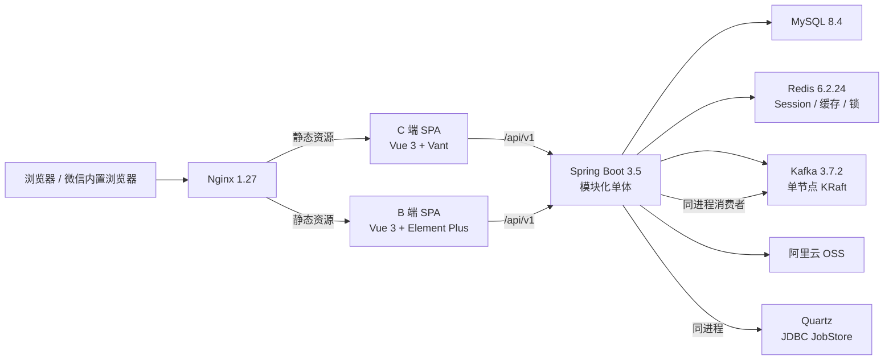
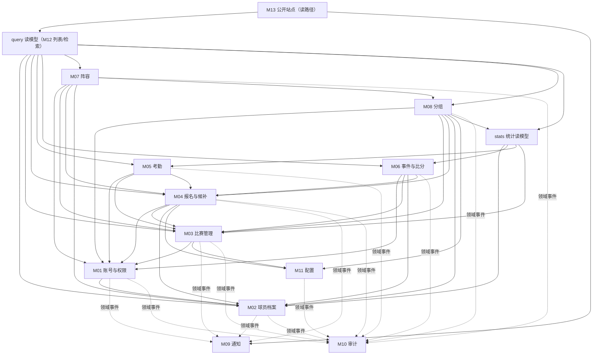
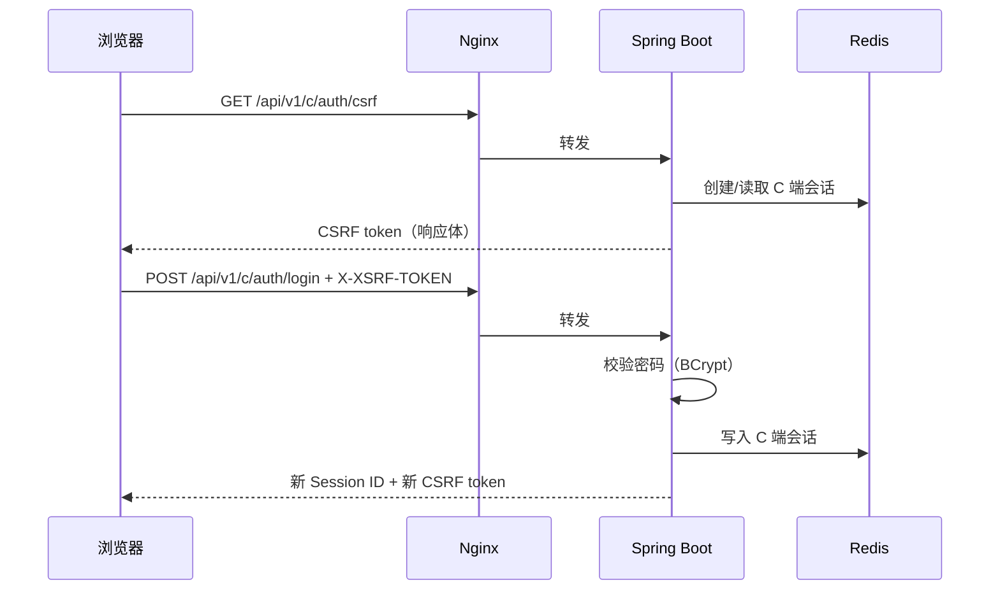
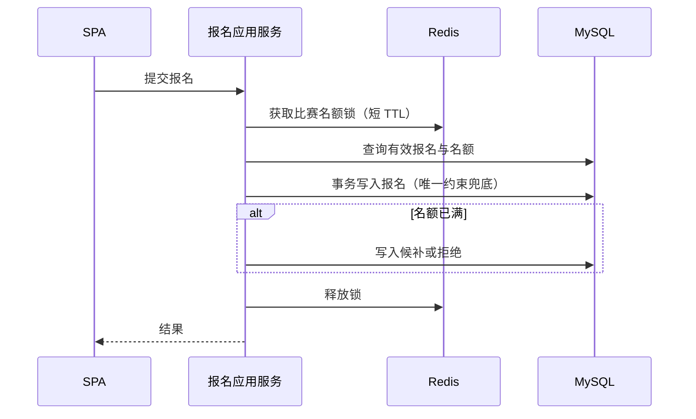
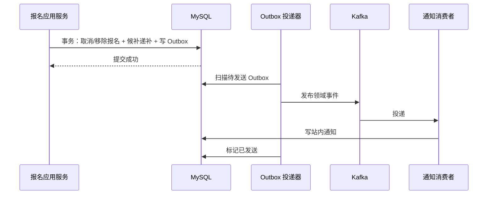
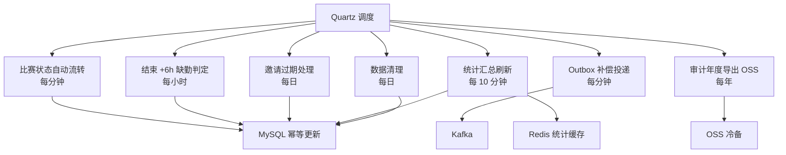
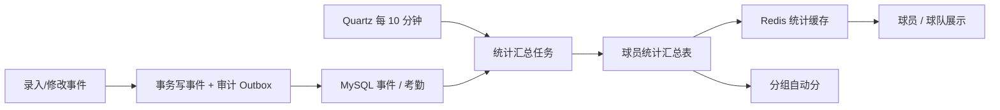

# 云河FC 整体架构设计

- 文档版本：v1.8（第四轮复审修正）
- 编写日期：2026-11-09
- 依据材料：`docs/云河FC-需求文档.md`（v1.15）、`docs/design/01.功能模块梳理.md`（v0.12）、`docs/design/02.页面结构与交互设计.md`（v0.13）、`README.md` 技术约束、`prototype/`
- 文档范围：技术选型、整体架构、模块架构、目录设计与关键决策；不包含表结构、接口定义或业务代码

## 1. 文档说明

### 1.1 目的

在已确认的功能模块与页面结构基础上，确定云河FC 的技术方案与系统骨架，说明各层、各模块在系统中的位置和协作方式，为后续数据库设计、接口设计与编码实现提供依据。

### 1.2 范围与边界

- 只做整体方案：技术栈、分层、模块边界、目录结构、关键流程与风险。
- 不展开数据库表、字段、索引；不定义接口路径与报文；不编写代码。
- 单队、MVP 优先；二期能力只保留扩展点，不进入本期实现。

### 1.3 约束来源

- 项目 README 已记录的后端、前端、消息、部署技术栈。
- 此前 M0 已实现过的登录、RBAC、审计、Outbox/Kafka 等方向。
- 本轮确认：保留 Kafka + Outbox；文件统一使用阿里云 OSS（开发环境同样使用 OSS）；前端统一 TypeScript；部署采用单 ECS + Docker Compose；后端引入 Lombok 与 Hutool。

## 2. 技术选型

### 2.1 选型总表

| 层 | 技术 | 版本/镜像 | 用途与理由 |
|---|---|---|---|
| 语言 | Java | 21（LTS） | 现有约束；虚拟线程与长期支持 |
| 后端框架 | Spring Boot | 3.5.x | 现有约束；Web、Security、Validation、Actuator 一体 |
| 安全 | Spring Security | 6.x | 会话安全、CSRF、方法级权限 |
| 持久层 | MyBatis-Plus | 3.5.x | 现有约束；SQL 可控，适合报表/聚合查询 |
| 迁移 | Flyway | 随 Spring Boot | 版本化数据库迁移，应用启动时执行；禁止手工改表 |
| 辅助库 | Lombok | 由 Spring Boot BOM 管理 | 减少样板代码：getter/setter、构造注入、Builder |
| 辅助库 | Hutool | 5.8.x | 字符串、日期、加解密、HTTP 等通用工具 |
| 数据库 | MySQL | 8.4（`mysql:8.4`） | 现有约束；事务、唯一约束、成熟运维 |
| 缓存/会话 | Redis | 6.2.24（`redis:6.2.24`） | 会话、权限缓存、限流、分布式锁；AOF everysec + RDB |
| 会话管理 | Spring Session | 随 Spring Boot | 会话存 Redis，支持重启不丢登录态 |
| 消息 | Kafka | 3.7.2（`apache/kafka:3.7.2`） | 现有约束；通知/审计异步化，单节点 KRaft；统计由 Quartz 汇总，不走 Kafka |
| 异步可靠性 | Outbox | 自研表 + 定时投递 | 业务事务与消息发送解耦，避免丢消息 |
| 定时任务 | Quartz | JDBC JobStore | 现有约束；比赛状态、缺勤、邀请过期、Outbox 补偿、统计汇总、数据清理、审计导出（见 §5.4） |
| 前端框架 | Vue | 3.x | 现有约束；组件生态成熟 |
| 构建 | Vite | 随前端模板 | 快速开发与构建 |
| 语言 | TypeScript | 5.x | C/B 端统一类型，共享 API 类型与权限码 |
| 包管理 | pnpm workspace | Node 24 | 现有约束；多应用与共享包 |
| C 端组件 | Vant | 4.x | 移动端、微信内置浏览器 |
| B 端组件 | Element Plus | 2.x | PC 后台表格与表单 |
| 状态/路由 | Pinia + Vue Router | 随 Vue 3 | 页面状态与路由 |
| Web 服务器 | Nginx | 1.27（`nginx:1.27-alpine`） | 托管 C/B 端 SPA、反向代理 API、HTTPS |
| API 文档 | springdoc OpenAPI | 随 Spring Boot | 生成 OpenAPI，供联调与前端类型参考 |
| 文件存储 | 阿里云 OSS | 服务 | 头像与后续图片；开发、测试、生产统一使用；私有 Bucket + 签名 URL |
| 短信 | 阿里云云市场短信服务 | 服务 | 注册、重置密码、绑定手机；开发环境固定验证码 mock |
| 部署 | Docker Compose | 服务 | 单 ECS 编排 MySQL、Redis、Kafka、后端、Nginx |

### 2.2 选型依据

- **业务规模**：单队、几十到几百用户，核心操作秒级完成；不需要微服务的独立部署与弹性能力。
- **现有约束优先**：Java/Spring Boot/MySQL/Redis/Kafka/Quartz/Vue 已在项目中形成明确方向，避免重新选型带来的迁移成本。
- **微信内浏览器**：C 端以移动端 Web 为主，Vant + Vue 3 可直接适配；B 端 PC 使用 Element Plus。
- **运维成本**：单 ECS + Docker Compose 可由小团队维护；Kafka 单节点满足 MVP 的通知与审计异步需求。
- **可靠性**：Outbox 保证业务提交与消息投递的一致性；数据库唯一约束与 Redis 锁共同防超卖。

### 2.3 Lombok 与 Hutool 使用边界

- Lombok 只用于消除样板代码：实体/DTO 的 getter/setter、构造注入、Builder、`@Slf4j`。
- Hutool 只用于通用工具：字符串、日期、加解密、HTTP、集合；不得把业务规则放进工具类。
- 两者版本由父 POM 统一锁定；不因小版本升级改变业务行为。

### 2.4 被否决方案

| 方案 | 不采用的原因 |
|---|---|
| 微服务拆分 | 单队规模、单团队维护；拆分带来网关、服务发现、分布式事务成本 |
| JWT 无状态鉴权 | 现有会话方案更适合微信内浏览器；JWT 撤销与权限变更处理复杂 |
| MongoDB | 报名、名额、审计需要强事务与唯一约束，关系库更合适 |
| Elasticsearch | 列表筛选规模小，MySQL 索引足够；避免多一套运维 |
| Kubernetes | 单 ECS 规模不需要编排层；Compose 足够 |
| 本地磁盘存文件 | 备份、迁移、扩容困难；统一 OSS |
| 同步通知/审计 | 会阻塞主流程，违反“状态流转和通知异步”的性能要求 |

### 2.5 镜像版本矩阵

| 组件 | 镜像 |
|---|---|
| Nginx | `nginx:1.27-alpine` |
| Redis | `redis:6.2.24` |
| MySQL | `mysql:8.4` |
| Kafka | `apache/kafka:3.7.2` |

镜像版本固定写在 `deploy/docker-compose.yml`，升级需单独评审。

## 3. 整体架构

### 3.1 架构形态

采用**模块化单体**：

- 一个 Spring Boot 部署单元，内部按业务领域分包，模块间通过应用服务与领域事件协作。
- C 端 Web 与 B 端 Admin 为两个独立 SPA，共用同一后端 API。
- 域名规划：`www.`（C 端）、`admin.`（B 端）、`api.`（后端 API）同属一个主域；证书覆盖对应子域。B 端部署在 admin 子域，02 中的 `/admin/*` 路由在子域下等价于根路径 `/`。
- 会话：API 按客户端路径分区（C 端 `/api/v1/c/**`，B 端 `/api/v1/b/**`）；两套 Session Cookie（`YHFC_C` / `YHFC_B`，Path 指向对应前缀）与 Redis 命名空间；C 端滑动 7 天，B 端滑动 2 小时，同一账号两端互不影响。登录与微信回调使用显式路径/OAuth state 选择命名空间，不依赖 Origin。
- 跨域：C/B 端请求统一发往 `api` 子域；后端 CORS 仅允许 `www` 与 `admin` 两个 Origin，并允许携带凭证；Origin 只用于 CORS 校验。CSRF token 由 `/api/v1/{c|b}/auth/csrf` 响应体返回，前端内存保存并通过 `X-XSRF-TOKEN` 提交；登录成功后轮换 Session 与 CSRF token。
- 接口：REST + JSON，统一 `/api/v1` 前缀；破坏性变更通过新版本，不直接改变现有语义。
- MySQL 为唯一事实源；Redis 负责会话、缓存、限流与锁；Kafka 负责异步消息；Quartz 与 Kafka 消费者运行在同一后端进程内。

### 3.2 容器图



### 3.3 技术分层

| 层 | 职责 | 禁止事项 |
|---|---|---|
| 接入层（Nginx） | TLS、静态资源、反向代理、压缩与缓存头 | 不承载业务逻辑 |
| 接口层（Controller/DTO） | 参数校验、鉴权入口、组装响应 | 不写业务规则、不直接访问数据库 |
| 应用层（Application Service） | 用例编排、事务边界、Outbox 写入、领域事件发布 | 不堆积 SQL、不跨模块直接改数据 |
| 领域层（Domain） | 实体、值对象、状态机、业务规则 | 不依赖 Spring Web、不依赖具体存储 |
| 基础设施层（Infrastructure） | MyBatis-Plus、Redis、Kafka、OSS、Quartz 适配 | 不反向依赖接口层 |

### 3.4 横切能力

- **鉴权与权限**：Spring Security 会话认证 + 方法级权限校验；权限点统一 `资源:动作:范围`。
- **事务**：应用服务内使用本地事务，业务写入与 Outbox 同事务。
- **审计**：关键写操作记录操作人、动作、对象、前后快照；通过应用服务显式调用 + Outbox 异步落库。
- **通知**：业务事件经 Outbox/Kafka 投递到通知消费者，写站内消息。
- **配置**：报名默认值、分组权重等存数据库，读取时缓存；修改后使缓存失效。
- **日志与监控**：Actuator 健康检查、结构化日志、请求耗时与错误率指标。

## 4. 模块架构

### 4.1 模块到代码位置的映射

| 模块 | 后端领域包 | 前端承载 |
|---|---|---|
| M01 账号与权限 | `auth`（含 `rbac`、`invite`） | Web 登录/个人中心/邀请落地/微信回调/比赛详情“邀请队友”；Admin 角色权限、邀请管理 |
| M02 球员档案 | `player` | Web 球队/个人中心；Admin 球员 |
| M03 比赛管理 | `match` | Web 首页/赛程/详情；Admin 比赛 |
| M04 报名与候补 | `registration` | Web 比赛详情/个人中心“我的报名”；Admin 报名/考勤 |
| M05 考勤与签到 | `attendance` | Web 比赛详情；Admin 报名/考勤 |
| M06 事件与比分 | `event` | Web 比赛详情；Admin 事件/比分 |
| M07 阵容与战术 | `lineup` | Web 比赛详情只读；Admin 阵容 |
| M08 队内分组 | `grouping` | Web 比赛详情只读；Admin 分组 |
| M09 通知 | `notification` | Web 个人中心；后端消费者 |
| M10 审计日志 | `audit` | Admin 日志 |
| M11 系统配置 | `settings` | Admin 设置 |
| M12 检索与分页 | `query` + `common` | Web 赛程/详情；Admin 列表 |
| 统计读模型（横切） | `stats` | 分组自动分、球员/球队展示 |
| M13 公开站点与个人中心 | `query` 读模型 + 各领域应用服务（写操作） | `frontend/apps/web` |
| M14 二期能力 | 不建模块 | 不实现 |

### 4.2 模块依赖



说明：实线为同步依赖（依赖方指向被依赖方）；虚线为异步领域事件，由 Outbox → Kafka 投递。注册时 Auth 应用服务同事务调用 Player 创建档案；账号审核/转正/注销按 P-05 确认的第三个事务例外编排（Auth 应用服务同步调用 Registration 应用服务取消报名/递补；图中未画该反向边，避免与横切权限依赖混淆）；比赛创建时从 Config 快照报名默认值，后续配置变更不影响已创建比赛。图中各业务域指向 Auth 的箭头表示“身份/权限读取”；权限注解与校验经 `common` 的安全上下文与 `PermissionChecker`；账号状态/身份读取经 `contracts` 定义的 auth 只读 port（实现由 `auth` 提供），业务域不直接依赖 `auth` 的领域实现；`player` 只依赖该 port，不依赖 `auth` 包。图中 Web 只画读路径，其写操作经 API 调用对应领域应用服务，不直接依赖业务包。查询与统计读模型只读依赖业务域，不反向写入；`contracts`、`infra`、`common` 为横切基础包，未在图中展开。Lineup 的名单来源经 Registration/Grouping 提供的 roster read port 读取，避免直接耦合具体查询实现。

### 4.3 模块边界规则

- 跨模块只调用对方应用服务或消费领域事件，不直接访问对方数据表。
- 跨域只读组合查询（如比赛详情聚合报名/事件/阵容）统一放 `query` 读模型包，通过各域 read port 获取数据；`query` 只读，不写业务表，也不被业务域反向依赖。
- 领域事件 DTO 放 `contracts` 包；生产方与消费方都依赖 contracts，避免消费方反向依赖生产方业务包。
- 默认一个本地事务只修改一个聚合；三个显式例外：报名生命周期（Match + Registration，含新建/取消/递补）、注册建档（User + PlayerProfile）与账号生命周期编排（审核/转正/注销：User + Player + UserRole + Registration），例外集中在应用服务层，不得扩散。其他跨域一致性通过领域事件与 Outbox 实现，不引入分布式事务。账号生命周期例外的范围仅限审核、转正、注销三个用例（P-05 已确认）；INV-02 接受入队邀请复用审核/转正编排，不新增第四类例外。
- 公共能力（鉴权、权限点、异常、分页、时间）放 `common`；共享技术适配放 `infra`；领域持久化放各域 `infrastructure`。
- 模块内保持 controller → application → domain → infrastructure 的依赖方向。

### 4.4 支撑模块位置

- **通知**：独立领域包；消费 Kafka 的领域事件，写站内通知；不反向调用业务服务。
- **审计**：独立领域包；应用服务显式记录，异步落库；查询走独立接口。
- **配置**：独立领域包；提供读取接口与缓存失效。
- **检索分页**：作为 `query` 读模型包与前端公共组件存在；`query` 只读依赖各域 read port。
- **统计读模型**：独立 `stats` 包，承载汇总任务、汇总表查询与缓存；只读依赖考勤、事件、球员、比赛（赛季与取消状态），不反向写业务数据。`query` 与 `grouping` 可通过 stats 的只读接口读取汇总；其他业务域不得依赖 stats。
- **事件与跨域契约**：`contracts` 包只放领域事件 DTO、事件类型常量与跨模块只读 port 接口，不依赖任何业务域实现。

## 5. 关键运行流程

### 5.1 登录、会话与 CSRF



- 路径前缀决定命名空间：`/api/v1/c/**` 使用 `YHFC_C`，`/api/v1/b/**` 使用 `YHFC_B`；不使用 Origin 判断。
- Session Cookie 使用 HttpOnly、SameSite，生产环境 Secure，Path 指向对应前缀。
- CSRF token 只通过响应体返回并在前端内存保存，不使用跨子域 CSRF Cookie，避免同名覆盖；请求通过 `X-XSRF-TOKEN` 提交。
- 登录成功后轮换 Session ID 并重新签发 CSRF token；登出或过期后重新获取。
- 微信授权回调走 `/api/v1/c/auth/wechat/callback`，用 OAuth state 关联 C 端命名空间；openid 唯一，解绑仅管理员可操作并留痕。

### 5.2 报名并发控制



- Redis 锁只用于削峰；获取失败快速返回“请重试”，不能把锁当作正确性保证。
- 名额判断与写入在同一事务内完成：报名域经 Match 域提供的容量端口（实现内对 `team_match` 行做条件更新/行锁）校验并占用名额，再写入报名；数据库唯一约束兜底。报名域不直接访问 Match 的 Mapper/表。
- “同一用户同一比赛仅一条有效报名”由数据库唯一约束兜底；取消后可重新报名，不删除历史记录。
- 场次编号在同一球队行的行锁（`SELECT ... FOR UPDATE`）内取 `MAX+1` 并写入；`(team_id,total_match_no)` 与 `(team_id,season,season_match_no)` 唯一约束兜底，冲突时重试。

### 5.3 递补与通知（Outbox → Kafka）



- 业务提交与消息发送解耦；投递失败可重试。
- 消费者按事件 ID 去重，保证通知不重复。

### 5.4 Quartz 定时任务



- 自动流转只推进不后退：跳过手动覆盖、已取消、已延期与已结束；锁定后不回退报名中。管理员手动重置（MATCH-06/MAT-12）可回退或恢复终态，重置后停止自动流转。POSTPONED 为稳定等待状态，自动流转跳过；重新排期（MAT-11）后回 SIGNUP_OPEN 并恢复自动流转（P-02 已确认）。
- 缺勤判定跳过已取消/已延期比赛，只处理已确认报名且无考勤记录的球员；管理员提前结束时以 `status_updated_at` 作为实际结束时间计算 +6h。
- 统计汇总只统计未取消比赛；乌龙不计个人进球，临时到场计入出场，赛季窗口按汇总定义执行。
- 审计年度导出到 OSS 作为冷备；在线数据不删除。
- 任务按主键幂等；Outbox 投递使用租约/批次避免重复发送。单节点 Quartz 即可；多实例时使用 JDBC JobStore 集群模式。

### 5.5 事件写入与统计汇总



- MVP 维护**球员统计汇总表**：Quartz 每 10 分钟全量扫描**本赛季**未取消比赛的考勤与事件，按球员重算出场、进球、助攻后批量 upsert 汇总表，并刷新 Redis 缓存；汇总任务通过各域 read port 读取，不直读业务表。
- 口径：乌龙不计个人进球；取消比赛不计出场/进球/助攻；临时到场计出场；赛季以比赛赛季字段为准，未填写时按开赛年份。
- 分组自动分通过 stats 只读接口读取汇总结果，不直读汇总表；随后在**本场候选池内**再做归一化，汇总表本身不产出最终分组分数。出场率的分母为本赛季已结束且未取消的球队比赛数，由比赛 read port 提供，不在汇总表重复存储（P-09 已确认）。
- 球员/球队页读取汇总表/缓存展示，允许最多 10 分钟延迟；首页“球队火力”仍为二期占位。
- 汇总任务失败保留上一次结果并告警；重复执行按球员主键覆盖，保证幂等。
- 后续如需更实时，可缩短调度间隔或改为事件驱动增量更新，不改变读模型接口。

## 6. 项目目录设计

### 6.1 仓库结构

```text
yunhefc/
├── backend/                 Spring Boot 后端（单部署单元）
├── frontend/                pnpm workspace（C 端 + B 端 + 共享包）
├── deploy/                  Docker Compose、Nginx、环境变量、备份脚本
├── docs/                    需求、设计文档
├── scripts/                 SQL 基线、测试数据与运维脚本
├── prototype/               静态可交互原型
└── README.md
```

### 6.2 后端目录

```text
backend/
├── pom.xml
├── src/main/java/com/yunhefc/
│   ├── YunhefcApplication.java
│   ├── common/              通用响应、异常、分页、时间、权限注解
│   ├── contracts/           领域事件 DTO、事件类型常量、跨模块只读 port
│   ├── infra/               共享技术适配（Kafka/Redis/OSS/Quartz 网关）
│   ├── query/               跨域只读组合查询与列表读模型
│   ├── auth/                账号、角色权限、邀请
│   ├── player/              球员档案
│   ├── match/               比赛与状态机
│   ├── registration/        报名与候补
│   ├── attendance/          签到与考勤
│   ├── event/               事件与比分
│   ├── lineup/              阵容与模板
│   ├── grouping/            队内分组
│   ├── notification/        站内通知
│   ├── audit/               操作日志
│   ├── stats/               球员统计汇总读模型
│   └── settings/            系统配置
└── src/main/resources/
    ├── application.yml
    ├── db/migration/        Flyway 迁移脚本
    └── mapper/              MyBatis XML（复杂查询）
```

- 每个领域包内部再分 `controller / application / domain / infrastructure / dto`。
- 全局 `infra` 只暴露深网关：`MessagePublisher`、`OssGateway`、`IdempotencyStore`、`CacheStore` 等，禁止把 KafkaTemplate/RedisTemplate 直接泄漏给领域；领域 `infrastructure` 放本域持久化、Mapper 与外部适配。
- `common` 只放无业务语义的技术契约（响应、异常、分页、时间、权限注解）；禁止业务实体与跨域业务逻辑进入。
- `contracts` 只放事件 DTO、事件类型常量与跨模块只读 port 接口，生产方与消费方共同依赖，不依赖业务实现。
- 模块边界由 ArchUnit 在 CI 固化包依赖：controller 不访问 mapper、领域不跨域访问 infrastructure、common/contracts 不依赖业务域、query 不被业务域依赖；stats 只依赖各域 read port，且仅允许 query 与 grouping 通过其只读接口依赖。SQL 级只读约束由数据库账号与评审保证，ArchUnit 不校验 SQL。
- 复杂 SQL 放 XML，简单查询可用 MyBatis-Plus。

### 6.3 前端目录

```text
frontend/
├── package.json
├── pnpm-workspace.yaml
├── apps/
│   ├── web/                 C 端（Vue 3 + Vant）
│   │   └── src/{pages,components,router,stores,styles}
│   └── admin/               B 端（Vue 3 + Element Plus）
│       └── src/{pages,components,router,stores,styles}
└── packages/
    ├── api-client/          统一请求封装、CSRF、错误处理
    ├── permissions/         权限码与前端判断
    └── shared/              共享类型、常量、工具
```

### 6.4 部署目录

```text
deploy/
├── docker-compose.yml       固定镜像版本的服务编排
├── nginx/                   站点配置、反代与静态资源
├── env/.env.example         数据库、Redis、Kafka、OSS、微信、短信配置
└── scripts/                 备份、恢复、初始化脚本
```

- `docker-compose.yml` 使用 `nginx:1.27-alpine`、`redis:6.2.24`、`mysql:8.4`、`apache/kafka:3.7.2`。
- CI/CD：GitHub Actions 构建后端镜像并推送阿里云 ACR，前端产物随发布包交付；通过 SSH 在 ECS 执行 compose 更新；服务器地址、SSH 密钥、ACR 凭证与 OSS/微信/短信凭证放仓库 Secrets 或服务器环境变量。
- 真实密钥只放服务器环境变量或密钥管理，不入库。

### 6.5 文档目录

```text
docs/
├── 云河FC-需求文档.md
├── design/
│   ├── 01.功能模块梳理.md
│   ├── 02.页面结构与交互设计.md
│   ├── 03.整体架构设计.md
│   ├── 04.数据库设计.md
│   ├── 05.API接口设计.md
│   ├── 06.设计方案评审结果.md
│   └── ui/                  关键页视觉试排
└── rules/                   database/api/kafka/logging/java 规范
```

## 7. 数据与运行约定

- **事实源**：MySQL 唯一事实源；Redis 不作为事实源。
- **Redis 用途**：会话、权限缓存、短信/接口限流、名额锁、幂等键缓存、Kafka 消费标记（`kafka::{topic}::{group}::{partition}::{offset}` 两阶段标记）。幂等结果以 MySQL `idempotency_key` 为持久事实源，Redis 只做快速命中与并发占位；消费标记不可用时不阻塞业务，降级为事件 ID 去重表。
- **认证状态**：短信验证码 `auth:sms:{purpose}:{phone}`、登录失败计数 `auth:login-fail:{phone}`（5 次/15 分钟）、微信 OAuth state `auth:wechat:state:{state}` 存 Redis，TTL 可配置；验证码与 state 一次性使用，不新增数据库表。
- **Kafka 用途**：领域事件异步投递（通知、审计；统计走 Quartz 汇总，不依赖 Kafka）；Outbox 与业务同事务。
- **Kafka 拆分**：按业务域拆分 topic，消息按聚合 ID 分区保证顺序；通知与审计各自独立消费组；topic 命名、分区数与保留期在详细设计阶段落地。
- **Quartz**：比赛状态、缺勤、邀请过期、Outbox 补偿、统计汇总、数据清理、审计导出（完整清单见 §5.4）；任务幂等。
- **时间**：数据库存 UTC，接口返回 UTC，前端按 Asia/Shanghai 展示。报名截止（当天 00:00）、锁定（当天 10:00）、签到窗口与缺勤 +6h 等业务边界先在 Asia/Shanghai 推导，再转换为 UTC 存储。
- **枚举与删除**：数据库枚举字段存 `TINYINT` 数字；API 响应返回数字 code 与 `*Label` 大写字符串，请求只接受数字 code；27 张业务表统一 `is_deleted` 伪删除，查询默认过滤 `is_deleted=0`。
- **文件**：前端压缩后以 multipart 上传到后端；后端校验类型/大小（头像上限 2MB）并写入 OSS，只在业务表存 URL；开发环境同样连接 OSS，使用独立 Bucket 或前缀；Bucket 私有，展示时由后端签发短期 URL。
- **统计**：MySQL 汇总表 + Redis 缓存，由 Quartz 每 10 分钟刷新；展示与分组读取汇总结果，允许最多 10 分钟延迟。
- **事务**：默认一个本地事务只修改一个聚合；例外为报名生命周期（Match + Registration，含新建/取消/递补）、注册建档（User + PlayerProfile）与账号生命周期编排（审核/转正/注销：User + Player + UserRole + Registration，P-05 已确认；INV-02 复用审核/转正编排）。其他跨模块通过事件最终一致，不引入分布式事务。
- **幂等**：数据库唯一约束、Outbox 事件 ID、消费者去重表、定时任务主键更新；报名、录事件、保存阵容等写接口支持 `Idempotency-Key`。
- **并发与版本**：阵容、比赛状态与事件修改均使用 `version` 条件更新，冲突返回 409；报名名额通过数据库条件更新/行锁，Redis 锁只削峰。
- **分组权重**：手动 70% / 自动 30%；自动分子权重默认 50/25/25，可在系统设置调整；自动分在本场候选池内归一化。
- **API 错误模型**：统一错误码 + HTTP 状态 + `requestId`；参数校验错误定位到字段；不把内部异常直接返回前端。
- **Outbox**：relay 使用租约与批量拉取，按聚合 ID 保持顺序；失败重试并监控积压。
- **迁移兼容**：采用 expand/contract，先加兼容字段再切读写；回滚优先仅回代码，仅当迁移不向后兼容时按备份/PITR 恢复，不做逆向迁移。
- **会话**：C/B 端使用两套独立 Session Cookie 与 Redis 命名空间（`YHFC_C` / `YHFC_B`），由路径前缀 `/api/v1/c/**`、`/api/v1/b/**` 决定；C 端滑动 7 天，B 端滑动 2 小时；登录成功后轮换 Session ID；Cookie 设父域、HttpOnly、SameSite=Lax，Path 指向对应前缀。
- **CSRF**：登录前从 `/api/v1/{c|b}/auth/csrf` 获取 token，前端内存保存；请求通过 `X-XSRF-TOKEN` 提交；不使用 CSRF Cookie；登录/登出/过期后重新获取。
- **登录保护**：账号连续 5 次失败锁定 15 分钟，IP 侧做基础限流；经由 Nginx 时只信任其写入的 `X-Forwarded-For`，避免伪造 IP 锁定他人。
- **限流**：短信、登录、报名等关键接口设严格阈值；其余接口按 IP/用户做基础限流；超限返回明确提示。
- **数据保留**：通知保留 90 天，已投递 Outbox 保留 7 天，失效邀请保留 30 天后清理；审计日志在线永久保留，每年导出一次到 OSS 作为冷备。
- **可观测性**：Actuator 健康检查、结构化日志、慢查询与错误日志、关键业务指标；MVP 不引入 Prometheus/Grafana，后续按需补充。
- **测试**：后端 JUnit 5 + Testcontainers（MySQL/Redis/Kafka）；前端 Vitest 组件/工具测试 + Playwright 关键流程 E2E；ArchUnit 校验模块依赖；CI 需要 Docker 能力。
- **API 文档**：springdoc 生成 OpenAPI，开发环境开放，生产环境按需鉴权。
- **消息失败处理**：Kafka 消费者失败按重试策略处理，超过阈值进入死信队列/表；Outbox 投递失败保留待重试。
- **发布与回滚**：镜像使用不可变 tag；保留上一个 compose 版本与镜像，回滚时切回上一版本代码；数据库仅在迁移不兼容时按备份/PITR 恢复。
- **前端接入**：`api-client` 统一处理 401/403、CSRF 重取与错误提示；Vue Router 做登录与权限守卫；OpenAPI 生成共享 TypeScript 类型。
- **本地开发**：CORS 额外允许 `localhost` 开发端口；Nginx 上传大小上限与后端 2MB 限制一致。
- **容量基线**：Compose 为 JVM、MySQL、Redis、Kafka 设置内存上限与 Kafka 磁盘保留；单 ECS 需预留系统与备份空间。
- **环境**：local 与 prod 两套；通过 Spring profile + 环境变量区分，生产凭证不入库；本地连接开发 OSS，短信使用固定验证码 mock。
- **迁移**：Flyway 在应用启动时执行；迁移脚本保持小步、向后兼容，长迁移拆分为多次发布；启动健康检查覆盖迁移结果。
- **日志保留**：应用日志保留 14 天；每季度做一次数据库恢复演练并记录结果。
- **备份**：mysqldump 每日全量 + binlog 持续归档，备份与 binlog 上传 OSS 并保留本地副本，保留 7 天，可恢复到时间点。
- **Redis 持久化**：AOF everysec + RDB；监控内存使用，避免缓存把会话挤出。
- **静态资源**：Nginx 托管 SPA；带 hash 的静态资源长缓存，`index.html` 不缓存；前端路由回退到对应 `index.html`；开启 gzip。

## 8. 安全与非功能映射

| 需求 | 架构措施 |
|---|---|
| 密码安全 | BCrypt 哈希；日志与接口脱敏 |
| 会话安全 | 两套 Session Cookie + Redis；HttpOnly/Secure/SameSite；CSRF token；C 端 7 天 / B 端 2 小时滑动过期 |
| 登录保护 | 账号 + IP 计数，连续 5 次失败锁定 15 分钟 |
| 接口限流 | 关键接口严格阈值，其余接口基础限流 |
| 数据清理 | 通知 90 天、Outbox 7 天、失效邀请 30 天；审计长期保留 |
| 短信验证码 | Redis 存储、有效期、尝试次数、按手机号/IP 限流 |
| 邀请链接 | 随机 token、有效期、次数、撤销；服务端校验 |
| 权限校验 | Spring Security + 方法级权限；不依赖前端隐藏 |
| 公开接口脱敏 | 响应 DTO 裁剪手机号与敏感字段 |
| 管理员保护 | 服务端校验最后管理员、默认角色与自锁 |
| 审计 | 关键写操作留痕，前后快照异步落库 |
| 性能 | 分页查询、覆盖索引、统计汇总表 + Redis 缓存、异步通知 |
| 并发 | Redis 锁 + 数据库唯一约束 + 事务 |
| 兼容性 | C 端移动优先，适配微信内置浏览器；B 端 PC |
| 可用性 | Quartz 补偿、Outbox 重试、幂等任务、备份 |

## 9. 关键设计决策

> 本节只列影响架构形态的关键决策；§7 为运行约定明细，二者重复处以 §7 为准。

| 决策 | 选择 | 理由 | 备选与代价 |
|---|---|---|---|
| 系统形态 | 模块化单体 | 单队规模、单团队维护，降低分布式复杂度 | 微服务：部署与治理成本高 |
| 鉴权 | Session + Redis | 微信内浏览器、可撤销、权限变更即时 | JWT：撤销与改权复杂 |
| 异步 | Kafka + Outbox | 业务与通知解耦，可靠投递 | 同步处理：阻塞主流程 |
| 定时任务 | Quartz JDBC | 现有约束、持久化、可补偿 | 读取时惰性计算：状态不一致窗口 |
| 统计 | 汇总表 + 10 分钟定时刷新 + 缓存 | 查询稳定、实现可控；允许最多 10 分钟延迟 | 查询时聚合：实时但压力大 |
| 并发控制 | Redis 锁 + DB 唯一约束 | 锁降低冲突，数据库兜底 | 纯锁：故障时不可靠 |
| 文件上传 | 前端 → 后端 → OSS 代理 | 校验集中、私有 Bucket 可控 | 前端直传：省带宽但需签发策略 |
| API 风格 | REST + `/api/v1` | 资源语义清晰、版本可控 | RPC/GraphQL：治理成本更高 |
| 审计写入 | Outbox → Kafka → 异步落库 | 不阻塞主流程、可重试 | 同步写：强一致但写放大 |
| 统计计算 | 全量重算 + 批量 upsert | 单队数据量小、避免漏算 | 增量：需变更标记与补偿 |
| 统计归属 | 独立 `stats` 读模型包 | 汇总任务与查询内聚，不污染业务域 | 放 player/event：跨域职责混杂 |
| 基础设施层 | 全局 `infra` + 领域 `infrastructure` | 共享适配与领域适配分离 | 全部放 infra：浅模块 |
| 边界约束 | ArchUnit | CI 固化依赖方向 | 仅代码评审：易漂移 |
| API 文档 | springdoc OpenAPI | 联调与前端类型参考 | 手写文档：易不一致 |
| 前端测试 | Vitest + Playwright | 单测反馈快，关键流程有 E2E | 仅手工：回归风险 |
| 双端会话 | 两套 Session Cookie + Redis 命名空间 | 两端生命周期独立，同账号可同时登录 | 单会话：无法差异化过期 |
| 跨域读模型 | 新增 `query` 包 | 组合查询集中、只读可约束 | 各域 read port：组合逻辑分散 |
| 统计消费 | 分组自动分 + 球员/球队展示 | 汇总表复用，展示范围明确 | 仅分组：展示仍缺数据 |
| 注册建档 | Auth 编排、同事务调用 Player | 注册原子，无短暂无档案 | 事件建档：最终一致但延迟可见 |
| 前端 | TypeScript + pnpm workspace | 类型共享、权限码统一 | JS：类型漂移 |
| 部署 | 单 ECS + Compose | 成本低、运维简单 | 云托管/K8s：成本或复杂度高 |
| 镜像 | 固定版本 | 可复现构建，避免漂移 | latest：不可控 |
| CI/CD | GitHub Actions + SSH | 自动构建、部署可追溯 | 手动脚本：易漏步骤 |
| 域名 | 同一主域子域 www/admin/api | 隔离清晰，Cookie 统一父域 | 独立域名：证书与成本更高 |
| OSS 访问 | 私有 + 签名 URL | 资源不可枚举与转发 | 公开读：泄露风险 |
| HTTPS | 通配符证书 | 一张证书覆盖 www/admin/api | 分域证书：续期与配置繁琐 |
| 备份 | 每日全量 + binlog 归档，保留 7 天 | 可恢复到时间点，成本可控 | 仅全量：最多丢一天 |
| Redis 持久化 | AOF everysec + RDB | 重启保留会话与缓存 | 仅 RDB/不持久化：重启踢下线 |
| 静态托管 | Nginx 托管 SPA | 部署简单、缓存可控 | OSS/CDN：更快但多一套流程 |
| 密钥 | GitHub Secrets + 服务器环境变量 | 实现简单、与 CI/CD 一致 | KMS：额外云产品与接入成本 |
| API 访问 | `api` 子域 + CORS 白名单 | 统一入口、Cookie 父域 | 同源反向代理：两套配置 |
| 测试 | JUnit 5 + Testcontainers | 贴近生产，覆盖真实依赖 | H2/Mock：SQL 与消息行为失真 |
| 可观测性 | Actuator + 结构化日志 | 成本低，先保证可排障 | Prometheus/Grafana：额外运维 |
| 镜像仓库 | 阿里云 ACR | 与 ECS 同区域，拉取快 | GHCR：跨网较慢 |
| 短信 | 阿里云云市场短信服务 | 与现有云资源一致 | 其他供应商：额外接入与合规 |
| 会话时长 | C 端 7 天 / B 端 2 小时滑动 | 体验与后台安全平衡 | 统一时长：一端体验差 |
| 登录锁定 | 5 次失败 / 15 分钟 | 防撞库，成本低 | 强制验证码：短信成本 |
| 限流 | 关键接口 + 全站基础 | 关键路径优先保护 | 统一阈值：无法区分风险 |
| 数据保留 | 通知 90 天 / Outbox 7 天 / 邀请 30 天 | 控制体积，保留排障窗口 | 永久保留：持续膨胀 |
| 环境 | local + prod | MVP 简化，减少资源与配置 | 增加 staging：更稳但多一套成本 |
| 迁移时机 | 应用启动时 Flyway | 实现简单，部署即迁移 | 流水线迁移：更可控但多一步 |
| 日志与演练 | 日志 14 天 + 季度恢复演练 | 排障与恢复能力平衡 | 更长保留/更高频演练：成本增加 |

## 10. 风险

| 风险 | 影响 | 缓解 |
|---|---|---|
| Kafka 单节点 | 消息丢失或不可用 | Outbox 持久化 + 重试 + 积压监控；通知延迟但不阻塞主流程 |
| 通知降级 | 同步通知会阻塞主流程 | 不做同步降级；依赖 Outbox 重试与补偿 |
| 单 ECS 故障 | 全站不可用 | 定期备份、快照、恢复演练；后续可迁移托管 |
| 启动时迁移失败 | 应用无法启动 | 迁移小步、向后兼容；发布前在本地/备份库验证；保留上一版本镜像与数据库恢复脚本（非逆向迁移） |
| Redis 故障 | 登录态丢失、锁失效 | 会话可重建；数据库约束兜底报名 |
| OSS 依赖 | 开发环境需要网络与凭证 | 独立 Bucket/前缀；上传失败明确提示 |
| 代理上传带宽 | 大文件占用后端带宽与内存 | 限制 2MB、流式转发、拒绝超限请求 |
| Quartz 单节点 | 任务延迟 | 幂等任务 + Outbox 补偿；后续集群模式 |
| 统计延迟 | 展示与分组最多延迟 10 分钟 | 调度间隔可调；任务失败保留上次结果并告警 |
| 备份保留仅 7 天 | 跨周误删难以恢复 | binlog 归档 + 重要节点手动快照 |
| Redis 内存不足 | 会话被驱逐，用户被踢下线 | 监控内存、设置合理 maxmemory 与 TTL，避免缓存挤占会话 |
| Kafka 消费失败 | 通知/审计延迟或丢失 | 重试 + 死信队列/表，监控消费延迟 |
| 发布版本异常 | 线上故障 | 不可变镜像 tag，保留上一版本 compose，支持快速回滚 |
| 审计数据增长 | 存储与查询压力 | 在线永久保留 + 每年导出 OSS 冷备，监控表体积与查询耗时 |
| 时区处理错误 | 截止/签到时间偏差 | 统一 UTC 存储，边界转换集中处理 |

## 11. 审核结论与已确认事项

### 11.1 已确认决策

> 编号按决策历史保留，存在空号表示已合并：AQ-07 合并到 AQ-25，AQ-34 合并到 AQ-18；AQ-08 已于 v1.4 回写确认。

| 编号 | 结论 |
|---|---|
| AQ-01 | CI/CD 使用 GitHub Actions 构建，SSH 到 ECS 执行 Compose 更新 |
| AQ-02 | 同一主域不同子域：`www`（C 端）、`admin`（B 端）、`api`（后端）；Cookie 设父域 |
| AQ-03 | 短信使用阿里云云市场短信服务；开发环境保留固定验证码 mock |
| AQ-04 | OSS Bucket 私有，使用后端签发的短期签名 URL；开发/生产独立 Bucket 或前缀 |
| AQ-05 | Lombok 版本由 Spring Boot BOM 管理；Hutool 固定 5.8.x |
| AQ-06 | MVP 维护球员统计汇总表，Quartz 每 10 分钟刷新并更新 Redis 缓存 |
| AQ-08 | Kafka 按业务域拆 topic，聚合 ID 分区，通知/审计独立消费组 |
| AQ-09 | 使用通配符 HTTPS 证书覆盖 `www` / `admin` / `api` 子域 |
| AQ-10 | 密钥：CI 使用 GitHub Secrets，运行时使用服务器环境变量；不入库 |
| AQ-11 | 镜像推送阿里云 ACR，与 ECS 同区域 |
| AQ-12 | 域名与 DNS 使用阿里云域名 + 云解析；`www`/`admin`/`api` 在该 DNS 下解析 |
| AQ-13 | 项目负责人持有短信/微信凭证；CI 用 GitHub Secrets，运行时用服务器环境变量；建议 90 天轮换 AccessKey |
| AQ-14 | 文件上传走“前端 → 后端 → OSS”代理，后端校验类型/大小并写 OSS |
| AQ-15 | 接口采用 REST 风格，统一 `/api/v1` 前缀 |
| AQ-16 | 审计日志经 Outbox → Kafka 异步落库，消费者按事件 ID 去重 |
| AQ-17 | 统计汇总每次全量重算并按球员批量 upsert，失败保留上次结果 |
| AQ-18 | 会话：路径前缀 `/api/v1/c/**`、`/api/v1/b/**` 决定两套 Cookie 与 Redis 命名空间；C 端滑动 7 天，B 端滑动 2 小时 |
| AQ-19 | 密码连续失败 5 次锁定 15 分钟，按账号 + IP 计数 |
| AQ-20 | 限流：短信/登录/报名等关键接口 + 全站基础限流 |
| AQ-21 | 数据保留：通知 90 天、已投递 Outbox 7 天、失效邀请 30 天；审计长期 |
| AQ-22 | 运行环境：local + prod 两套，profile + 环境变量区分 |
| AQ-23 | Flyway 在应用启动时执行，迁移保持小步与向后兼容 |
| AQ-24 | 应用日志保留 14 天，每季度做一次数据库恢复演练 |
| AQ-25 | MySQL 每日全量 + binlog 归档，保留 7 天，可恢复到时间点 |
| AQ-26 | Redis 采用 AOF everysec + RDB，重启保留会话 |
| AQ-27 | 前端静态资源由 Nginx 托管，hash 长缓存、index 不缓存、SPA 路由回退 |
| AQ-28 | 统计汇总任务与查询放入独立 `stats` 读模型包，只读依赖业务域 |
| AQ-29 | 全局 `infra` 只放共享技术适配；领域 `infrastructure` 放本域持久化与外部适配 |
| AQ-30 | 使用 ArchUnit 在 CI 固化模块依赖边界 |
| AQ-31 | 引入 springdoc OpenAPI 生成接口文档 |
| AQ-32 | 前端测试采用 Vitest + Playwright，覆盖关键流程 |
| AQ-33 | 统计汇总窗口为本赛季；赛季取比赛赛季字段，未填按开赛年份 |
| AQ-35 | 跨域只读查询集中到 `query` 读模型包，只读依赖各域 read port |
| AQ-36 | MVP 统计汇总供分组自动分与球员/球队展示；首页球队火力仍为二期占位 |
| AQ-37 | 注册由 Auth 应用服务编排，同事务调用 Player 创建 1:1 档案 |
| AQ-38 | 微信解绑仅管理员可操作并留痕；openid 唯一，用户重新授权绑定 |
| AQ-39 | Session Cookie 为 HttpOnly；CSRF token 由响应体返回、不使用 Cookie；命名空间由路径前缀决定；登录后轮换 Session 与 CSRF token |
| AQ-40 | 审计日志在线永久保留，每年导出一次到 OSS 作为冷备 |

### 11.2 确认状态

P-01~P-22 已确认，见 `docs/design/06.设计方案评审结果.md` §8。具体 topic 命名、分区数、账号凭证值与证书签发操作留到详细设计与上线阶段执行。


## 12. 验证与后续

- 本文档的模块编号与 `01.功能模块梳理.md` 一致，页面承载与 `02.页面结构与交互设计.md` 一致，表结构与 `04.数据库设计.md` 一致，接口与 `05.API接口设计.md` 一致。
- 已完成：数据库与表结构设计（04）、接口设计（05）、本次整体评审（06）。
- 后续阶段：后端/前端工程初始化、Flyway 基线、接口实现、CI/CD 与环境搭建；本次评审阶段不产出业务代码。
