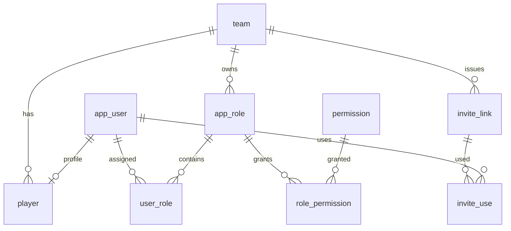
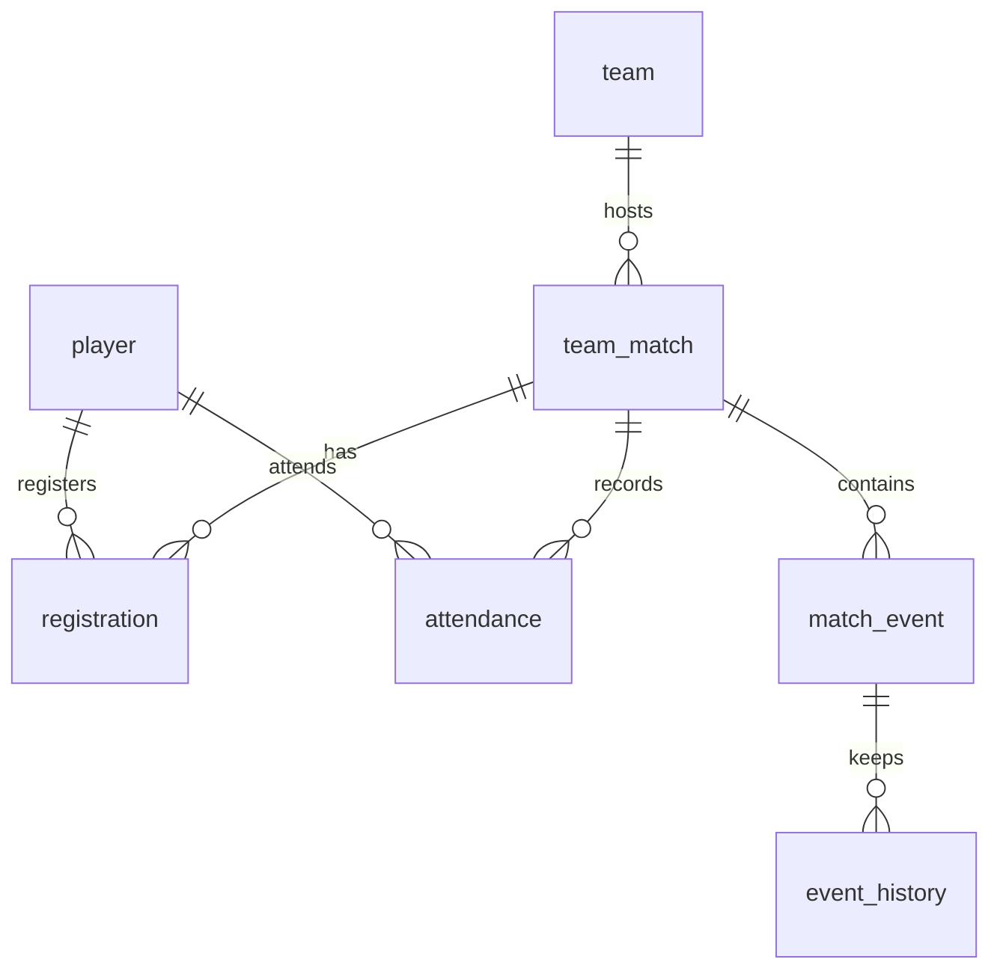
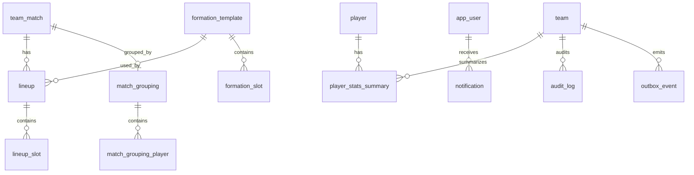

# 云河FC 数据库设计

- 文档版本：v0.9（枚举 TINYINT、全字段 COMMENT、伪删除、active 0/1、索引复核与 API code+label）
- 编写日期：2026-11-09
- 依据材料：`docs/云河FC-需求文档.md`（v1.15）、`docs/design/01~03`、`docs/rules/database-rules.md`、`docs/rules/kafka-rules.md`、`prototype/`
- 对应脚本：`scripts/sql/schema.sql`（业务表）、`scripts/sql/quartz.sql`（Quartz 表）

## 1. 文档说明

### 1.1 目的

把领域模型落成 MySQL 8.4 逻辑/物理表结构，明确字段、类型、主键、唯一约束、检查约束、索引与删除策略，作为后端开发、迁移脚本和测试的依据。

### 1.2 范围

- 本期只服务云河FC 单队；以 `team_id` 预留多队隔离。
- 不建物理外键；应用层维护关联完整性，数据库以唯一约束、CHECK 与索引兜底。
- 仅建表结构；球队、角色、权限点、系统配置等种子数据由 Flyway 种子脚本初始化。
- Quartz 表独立文件，保留官方 `QRTZ_` 表名。

## 2. 设计约定

### 2.1 命名与标识

| 项 | 约定 |
|---|---|
| 表名 | 单数 `snake_case`；避开保留字：`team_match`、`app_user`、`app_role`、`match_grouping` |
| 字段名 | `snake_case`；关联字段 `<entity>_id`，如 `user_id`、`match_id` |
| 主键 | 单表主键 `id BIGINT UNSIGNED AUTO_INCREMENT`；`user_role`、`role_permission` 使用复合主键 |
| 逻辑关联 | 不建物理外键；关联字段建普通索引，应用服务校验 |
| 多队预留 | `team_id` 放在聚合根与独立根表：`player`、`team_match`、`app_role`、`invite_link`、`formation_template`、`system_setting`、`player_stats_summary`、`audit_log`；基础设施 `outbox_event` 也带可空 `team_id`；子表通过父表归属 |

### 2.2 类型与默认值

- 所有字段必须带中文 `COMMENT`；枚举/布尔字段的 `COMMENT` 同时写明数字与含义。
- 字符串：`VARCHAR` 按业务长度收紧；标识/哈希用 `CHAR` + `ascii_bin`。
- 布尔：`TINYINT(1)`，`0/1`，字段注释标明含义。
- 时间：`DATETIME(3)`，统一 UTC；`created_at` 默认当前时间，`updated_at` 自动更新。
- 枚举：状态/类型/位置等有限集合字段统一 `TINYINT UNSIGNED`，用列 `COMMENT` 写明数字与枚举映射；不使用枚举取值范围 CHECK，枚举合法性由应用层校验；跨字段业务规则 CHECK 保留。
- JSON：仅用于结构化快照/配置/副位置；不使用逗号或分号拼接多值。
- 金额：本期无账本表，二期再引入 `DECIMAL`。

### 2.3 删除与保留总则

- 所有业务表统一包含 `is_deleted TINYINT UNSIGNED NOT NULL DEFAULT 0 COMMENT '0-未删除;1-伪删除'`；查询默认过滤 `is_deleted=0`。
- 账号、球员、比赛、报名、考勤、事件不做物理删除；用状态、`is_deleted` 或 `deleted_at`。
- 事件软删除并写 `event_history`；审计日志不删除。
- 通知 90 天、已发送 Outbox 7 天、过期邀请 30 天、过期幂等键与消费去重记录定期清理。
- 无物理外键，清理按聚合顺序由应用服务执行。
- 伪删除不自动释放唯一约束；需要在删除后复用编号/手机号等唯一值时，由应用层恢复记录或显式处理。

### 2.4 枚举编码与 API 映射

数据库存数字；API 响应返回数字 code 与 `<field>Label` 字符串，请求只接受数字 code，由应用层映射。`is_deleted` 不在下表重复；布尔字段（如 `registration.active`）不生成 Label；内部生成列（如 `active_unique`）不对外返回。

| 字段 | 数字 → 枚举 |
|---|---|
| `app_user.status` | 0-PENDING；1-ACTIVE；2-DISABLED |
| `player.type` | 0-GUEST；1-PLAYER |
| `player.position` | 0-GOALKEEPER；1-DEFENDER；2-MIDFIELDER；3-FORWARD |
| `player.secondary_positions` JSON | 数组元素使用同一位置编码 0–3 |
| `invite_link.type` | 0-TEAM；1-MATCH |
| `invite_link.status` | 0-ACTIVE；1-REVOKED；2-EXPIRED |
| `team_match.type` | 0-OFFICIAL；1-INTERNAL；2-TRAINING；3-FRIENDLY |
| `team_match.our_side` | 0-HOME；1-AWAY；NULL 仅队内/训练 |
| `team_match.status` | 0-SIGNUP_OPEN；1-SIGNUP_CLOSED；2-LOCKED；3-IN_PROGRESS；4-FINISHED；5-POSTPONED；6-CANCELLED |
| `registration.type` | 0-PLAYER；1-GUEST |
| `registration.status` | 0-CONFIRMED；1-WAITLISTED；2-CANCELLED；3-REMOVED |
| `registration.active` | 1-有效（CONFIRMED/WAITLISTED）；0-无效 |
| `registration.active_unique` | 1-有效；NULL-无效（内部生成列，仅用于唯一键，不对外返回） |
| `attendance.status` | 0-PRESENT；1-ABSENT；2-TEMP_PRESENT |
| `attendance.source` | 0-SELF；1-ADMIN；2-SYSTEM |
| `match_event.team` | 0-HOME；1-AWAY |
| `match_event.type` | 0-GOAL；1-OWN_GOAL；2-SUBSTITUTION；3-YELLOW_CARD；4-RED_CARD |
| `match_event.half` | 0-FIRST；1-SECOND |
| `event_history.action` | 0-CREATE；1-UPDATE；2-DELETE |
| `formation_slot.role` | 0-GOALKEEPER；1-DEFENDER；2-MIDFIELDER；3-FORWARD |
| `lineup.side` | 0-HOME；1-AWAY |
| `lineup_slot.slot_type` | 0-STARTER；1-BENCH |
| `match_grouping_player.team` | 0-A；1-B |
| `notification.type` | 0-REGISTRATION_CONFIRMED；1-WAITLIST_PROMOTED；2-MATCH_CREATED；3-MATCH_SIGNUP_CLOSED；4-MATCH_LOCKED；5-MATCH_STARTED；6-MATCH_FINISHED；7-MATCH_POSTPONED；8-MATCH_CANCELLED；9-ROLE_CHANGED；10-ACCOUNT_APPROVED；11-ACCOUNT_DISABLED |
| `outbox_event.status` | 0-PENDING；1-SENT；2-FAILED |

`team_match.format`、`notification.ref_type`、`audit_log.action/target_type`、`outbox_event.aggregate_type/event_type`、`system_setting.value_type` 为可扩展字符串，不做固定编码。

## 3. 实体关系

### 3.1 账号、角色与邀请

### 3.2 比赛、报名与赛况

### 3.3 阵容、分组与支撑

## 4. 表清单

| 分组 | 表 | 用途 |
|---|---|---|
| 球队/账号 | `team` | 球队基础信息 |
| 球队/账号 | `app_user` | 登录账号、手机号、openid、状态 |
| 球队/账号 | `player` | 球员档案与展示数据 |
| 球队/账号 | `app_role` | 球队内角色 |
| 球队/账号 | `permission` | 全局权限点 |
| 球队/账号 | `user_role` | 用户-角色 |
| 球队/账号 | `role_permission` | 角色-权限 |
| 邀请 | `invite_link` | 入队/比赛邀请 |
| 邀请 | `invite_use` | 邀请使用记录 |
| 比赛 | `team_match` | 比赛、状态、名额、场次编号 |
| 比赛 | `registration` | 报名与候补 |
| 比赛 | `attendance` | 签到与考勤 |
| 赛况 | `match_event` | 进球/换人/牌等事件 |
| 赛况 | `event_history` | 事件创建/修改/删除快照 |
| 战术 | `formation_template` | 预置与自定义阵型 |
| 战术 | `formation_slot` | 阵型槽位坐标 |
| 战术 | `lineup` | 某场某方阵容版本 |
| 战术 | `lineup_slot` | 首发/替补槽位 |
| 战术 | `match_grouping` | 队内分组主表 |
| 战术 | `match_grouping_player` | 分组球员与评分快照 |
| 统计 | `player_stats_summary` | 本赛季出场/进球/助攻汇总 |
| 通知 | `notification` | 站内通知 |
| 审计 | `audit_log` | 操作审计 |
| 基础设施 | `outbox_event` | 事务性 Outbox |
| 基础设施 | `consumed_event` | Kafka 消费去重 |
| 基础设施 | `idempotency_key` | 写接口幂等 |
| 配置 | `system_setting` | 按球队的键值配置 |

## 5. 表结构详设

> 以下各表字段表统一省略 `is_deleted` 行；27 张业务表均包含 §2.3 定义的 `is_deleted` 列，枚举字段编码见 §2.4。

### 5.1 team

| 字段 | 类型 | 空 | 默认 | 说明 |
|---|---|---|---|---|
| id | BIGINT UNSIGNED | 否 | 自增 | 主键 |
| name | VARCHAR(64) | 否 | — | 球队名称 |
| short_name | VARCHAR(32) | 否 | — | 简称 |
| created_at | DATETIME(3) | 否 | 当前时间 | 创建时间 |
| updated_at | DATETIME(3) | 否 | 当前时间 | 更新时间 |

约束与索引：PK(id)；UK(uk_team_name: name)。

### 5.2 app_user

| 字段 | 类型 | 空 | 默认 | 说明 |
|---|---|---|---|---|
| id | BIGINT UNSIGNED | 否 | 自增 | 主键 |
| phone | VARCHAR(20) | 否 | — | 登录手机号，唯一 |
| password_hash | VARCHAR(100) | 是 | NULL | BCrypt 哈希；纯微信账号可为空 |
| openid | VARCHAR(64) ascii_bin | 是 | NULL | 微信 openid，唯一；大小写敏感 |
| status | TINYINT UNSIGNED | 否 | 0 | 0-PENDING/1-ACTIVE/2-DISABLED |
| last_login_at | DATETIME(3) | 是 | NULL | 最近登录 |
| created_at / updated_at | DATETIME(3) | 否 | 当前时间 | 时间戳 |

约束与索引：UK(phone)、UK(openid)（MySQL 允许多个 NULL）；INDEX(status)。枚举由应用层校验；`is_deleted` 统一按 §2.3 处理。

### 5.3 player

| 字段 | 类型 | 空 | 默认 | 说明 |
|---|---|---|---|---|
| id | BIGINT UNSIGNED | 否 | 自增 | 主键 |
| team_id | BIGINT UNSIGNED | 否 | — | 球队 |
| user_id | BIGINT UNSIGNED | 否 | — | 账号；1:1 |
| name | VARCHAR(32) | 否 | — | 展示姓名 |
| jersey | SMALLINT UNSIGNED | 是 | NULL | 球衣号，待审可为空 |
| formal_jersey | SMALLINT UNSIGNED 生成列 | 是 | 计算 | 正式球员号码；GUEST 为 NULL |
| type | TINYINT UNSIGNED | 否 | 0 | 0-GUEST/1-PLAYER |
| position | TINYINT UNSIGNED | 否 | — | 0-门将/1-后卫/2-中场/3-前锋 |
| secondary_positions | JSON | 是 | NULL | 副位置数组 |
| region | VARCHAR(64) | 是 | NULL | 地区 |
| avatar_url | VARCHAR(512) | 是 | NULL | OSS URL |
| skill | TINYINT UNSIGNED | 否 | 3 | 1–5 星 |
| created_at / updated_at | DATETIME(3) | 否 | 当前时间 | 时间戳 |

约束与索引：UK(team_id,user_id)、UK(team_id,formal_jersey)（正式球员号码唯一，外挂不约束）；INDEX(team_id,type)、(team_id,jersey)、(team_id,position)；CHECK(skill)。类型/位置枚举由应用层校验；账号状态统一由 `app_user.status` 表达，不在 player 重复；注销即 `app_user.status=2`，球员档案保留。

### 5.4 app_role

| 字段 | 类型 | 空 | 默认 | 说明 |
|---|---|---|---|---|
| id | BIGINT UNSIGNED | 否 | 自增 | 主键 |
| team_id | BIGINT UNSIGNED | 否 | — | 所属球队 |
| code | VARCHAR(32) | 否 | — | GUEST/PLAYER/ADMIN/自定义 |
| name | VARCHAR(64) | 否 | — | 显示名 |
| is_default | TINYINT(1) | 否 | 0 | 0-自定义/1-默认角色 |
| created_at / updated_at | DATETIME(3) | 否 | 当前时间 | 时间戳 |

约束与索引：UK(team_id,code)。

### 5.5 permission

| 字段 | 类型 | 空 | 默认 | 说明 |
|---|---|---|---|---|
| id | BIGINT UNSIGNED | 否 | 自增 | 主键 |
| code | VARCHAR(64) | 否 | — | `资源:动作:范围` |
| name | VARCHAR(64) | 否 | — | 显示名 |
| resource / action / scope | VARCHAR(32/32/16) | 否 | — | 权限码拆解 |
| created_at | DATETIME(3) | 否 | 当前时间 | 创建时间 |

约束与索引：UK(code)。权限点全局共享，不按球队拆分。

### 5.6 user_role

| 字段 | 类型 | 空 | 默认 | 说明 |
|---|---|---|---|---|
| user_id | BIGINT UNSIGNED | 否 | — | 用户 |
| role_id | BIGINT UNSIGNED | 否 | — | 角色 |
| created_at | DATETIME(3) | 否 | 当前时间 | 分配时间 |

约束与索引：PK(user_id,role_id)；INDEX(role_id)。

### 5.7 role_permission

| 字段 | 类型 | 空 | 默认 | 说明 |
|---|---|---|---|---|
| role_id | BIGINT UNSIGNED | 否 | — | 角色 |
| permission_id | BIGINT UNSIGNED | 否 | — | 权限点 |
| created_at | DATETIME(3) | 否 | 当前时间 | 授权时间 |

约束与索引：PK(role_id,permission_id)；INDEX(permission_id)。

### 5.8 invite_link

| 字段 | 类型 | 空 | 默认 | 说明 |
|---|---|---|---|---|
| id | BIGINT UNSIGNED | 否 | 自增 | 主键 |
| team_id | BIGINT UNSIGNED | 否 | — | 球队 |
| type | TINYINT UNSIGNED | 否 | — | 0-TEAM/1-MATCH |
| token_hash | CHAR(64) ascii_bin | 否 | — | token SHA-256，唯一 |
| match_id | BIGINT UNSIGNED | 是 | NULL | 比赛邀请关联比赛 |
| inviter_user_id | BIGINT UNSIGNED | 否 | — | 邀请人 |
| expires_at | DATETIME(3) | 否 | — | 过期时间 |
| max_uses | INT UNSIGNED | 是 | NULL | NULL 表示不限 |
| used_count | INT UNSIGNED | 否 | 0 | 已使用次数 |
| status | TINYINT UNSIGNED | 否 | 0 | 0-ACTIVE/1-REVOKED/2-EXPIRED |
| revoked_at | DATETIME(3) | 是 | NULL | 撤销时间 |
| created_at / updated_at | DATETIME(3) | 否 | 当前时间 | 时间戳 |

约束与索引：UK(token_hash)；INDEX(team_id,status,expires_at)、(match_id)；CHECK(关联比赛/使用次数上限)。type/status 枚举由应用层校验。

### 5.9 invite_use

| 字段 | 类型 | 空 | 默认 | 说明 |
|---|---|---|---|---|
| id | BIGINT UNSIGNED | 否 | 自增 | 主键 |
| invite_id | BIGINT UNSIGNED | 否 | — | 邀请 |
| user_id | BIGINT UNSIGNED | 否 | — | 使用者 |
| used_at | DATETIME(3) | 否 | 当前时间 | 使用时间 |

约束与索引：UK(invite_id,user_id)；INDEX(user_id)。

### 5.10 team_match

| 字段 | 类型 | 空 | 默认 | 说明 |
|---|---|---|---|---|
| id | BIGINT UNSIGNED | 否 | 自增 | 主键 |
| team_id | BIGINT UNSIGNED | 否 | — | 球队 |
| title | VARCHAR(128) | 否 | — | 比赛名称 |
| type | TINYINT UNSIGNED | 否 | — | 0-OFFICIAL/1-INTERNAL/2-TRAINING/3-FRIENDLY |
| format | VARCHAR(16) | 否 | 8人制 | 赛制 |
| start_at / end_at | DATETIME(3) | 否 | — | 开始/结束（UTC） |
| signup_deadline | DATETIME(3) | 否 | — | 当天 00:00 |
| cancel_lock | DATETIME(3) | 否 | — | 当天 10:00 |
| venue | VARCHAR(128) | 否 | — | 场地 |
| competition | VARCHAR(64) | 是 | NULL | 赛事名称 |
| season | CHAR(4) | 否 | — | 四位年份 |
| round | SMALLINT UNSIGNED | 是 | NULL | 轮次 |
| home_team_name / away_team_name | VARCHAR(64) | 否 | — | 主/客队名称 |
| our_side | TINYINT UNSIGNED | 是 | NULL | 0-HOME/1-AWAY；队内/训练为空 |
| status | TINYINT UNSIGNED | 否 | 0 | 0-SIGNUP_OPEN/1-SIGNUP_CLOSED/2-LOCKED/3-IN_PROGRESS/4-FINISHED/5-POSTPONED/6-CANCELLED |
| manual_status | TINYINT(1) | 否 | 0 | 0-自动/1-手动 |
| capacity | SMALLINT UNSIGNED | 否 | — | 正式球员名额；总名额=capacity+guest_capacity，仅展示 |
| guest_capacity | SMALLINT UNSIGNED | 否 | 0 | 外挂名额 |
| waitlist_capacity | SMALLINT UNSIGNED | 否 | 2 | 候补上限，仅正式球员、全场合计 |
| include_guests | TINYINT(1) | 否 | 1 | 0-不含外挂/1-含外挂 |
| score_home / score_away | TINYINT UNSIGNED | 是 | NULL | 比分；创建未传时服务端写 0:0，历史未录入可空 |
| season_match_no / total_match_no | INT UNSIGNED | 否 | — | 场次编号 |
| version | INT UNSIGNED | 否 | 0 | 状态条件更新版本 |
| status_updated_at / status_updated_by | DATETIME(3) / BIGINT UNSIGNED | 是 | NULL | 状态变更信息；管理员提前结束时作为实际结束时间 |
| created_by | BIGINT UNSIGNED | 否 | — | 创建人 |
| created_at / updated_at | DATETIME(3) | 否 | 当前时间 | 时间戳 |

约束与索引：UK(team_id,total_match_no)、UK(team_id,season,season_match_no)；INDEX(team_id,status,start_at)、(team_id,start_at)、(team_id,type,season)、(team_id,venue)；CHECK(时间/比分成对/容量>0/赛季四位数字/截止≤锁定<开赛/队内训练赛 our_side 为空、对外比赛非空)。type/status/our_side 枚举由应用层校验。数据库默认值仅为兜底；创建比赛时由系统配置带入正式 30、外挂 4、候补 2。`cancel_lock` 必须早于 `start_at`；开赛时间必须晚于当天 10:00（P-08 已确认），因此 `cancel_lock=当天10:00` 始终早于 `start_at`。`POSTPONED` 为等待重新排期的稳定状态，重新排期后回 `SIGNUP_OPEN`（P-02 已确认）。

### 5.11 registration

| 字段 | 类型 | 空 | 默认 | 说明 |
|---|---|---|---|---|
| id | BIGINT UNSIGNED | 否 | 自增 | 主键 |
| match_id | BIGINT UNSIGNED | 否 | — | 比赛 |
| player_id | BIGINT UNSIGNED | 否 | — | 球员 |
| type | TINYINT UNSIGNED | 否 | — | 0-PLAYER/1-GUEST |
| status | TINYINT UNSIGNED | 否 | — | 0-CONFIRMED/1-WAITLISTED/2-CANCELLED/3-REMOVED |
| registered_at | DATETIME(3) | 否 | 当前时间 | 报名时间，候补排序 |
| cancelled_at | DATETIME(3) | 是 | NULL | 取消时间 |
| cancelled_by | BIGINT UNSIGNED | 是 | NULL | 取消人 |
| active | TINYINT 生成列 | 是 | 计算 | 1-有效（CONFIRMED/WAITLISTED）；0-无效 |
| active_unique | TINYINT 生成列 | 是 | 计算 | 内部唯一键：1-有效；NULL-无效（允许保留多条取消/移除记录） |
| updated_at | DATETIME(3) | 否 | 当前时间 | 更新时间 |

约束与索引：UK(match_id,player_id,active_unique) 保证同一用户同一比赛仅一条有效报名，同时允许多条取消/移除历史；INDEX(match_id,type,status,registered_at) 支持候补排序、INDEX(player_id,status)；CHECK(外挂不得候补)。type/status 枚举由应用层校验。取消后可重新报名，历史保留。

### 5.12 attendance

| 字段 | 类型 | 空 | 默认 | 说明 |
|---|---|---|---|---|
| id | BIGINT UNSIGNED | 否 | 自增 | 主键 |
| match_id | BIGINT UNSIGNED | 否 | — | 比赛 |
| player_id | BIGINT UNSIGNED | 否 | — | 球员 |
| status | TINYINT UNSIGNED | 否 | — | 0-PRESENT/1-ABSENT/2-TEMP_PRESENT |
| source | TINYINT UNSIGNED | 否 | — | 0-SELF/1-ADMIN/2-SYSTEM |
| recorded_by | BIGINT UNSIGNED | 是 | NULL | 操作人，系统为空 |
| recorded_at / updated_at | DATETIME(3) | 否 | 当前时间 | 时间戳 |

约束与索引：UK(match_id,player_id)；INDEX(match_id,status)。status/source 枚举由应用层校验。

### 5.13 match_event

| 字段 | 类型 | 空 | 默认 | 说明 |
|---|---|---|---|---|
| id | BIGINT UNSIGNED | 否 | 自增 | 主键 |
| match_id | BIGINT UNSIGNED | 否 | — | 比赛 |
| team | TINYINT UNSIGNED | 否 | — | 0-HOME/1-AWAY |
| type | TINYINT UNSIGNED | 否 | — | 0-GOAL/1-OWN_GOAL/2-SUBSTITUTION/3-YELLOW_CARD/4-RED_CARD |
| player_id | BIGINT UNSIGNED | 是 | NULL | 主体球员（换人为空） |
| assist_player_id | BIGINT UNSIGNED | 是 | NULL | 助攻 |
| in_player_id / out_player_id | BIGINT UNSIGNED | 是 | NULL | 换上/换下 |
| minute | TINYINT UNSIGNED | 否 | — | 1–120 |
| half | TINYINT UNSIGNED | 否 | — | 0-FIRST/1-SECOND |
| penalty | TINYINT(1) | 否 | 0 | 0-非点球/1-点球 |
| created_by / updated_by / deleted_by | BIGINT UNSIGNED | 否/是/是 | —/NULL/NULL | 操作人 |
| created_at / updated_at / deleted_at | DATETIME(3) | 否/否/是 | 当前时间/当前时间/NULL | 时间戳 |
| version | INT UNSIGNED | 否 | 0 | 条件更新 |

约束与索引：INDEX(match_id,deleted_at,half,minute) 支持时间线；INDEX(player_id)、INDEX(assist_player_id)；CHECK(minute/换人字段完整；换人事件不得填写 player_id；助攻与点球仅进球；非换人不得填写换上/换下)。team/type/half 枚举由应用层校验。

### 5.14 event_history

| 字段 | 类型 | 空 | 默认 | 说明 |
|---|---|---|---|---|
| id | BIGINT UNSIGNED | 否 | 自增 | 主键 |
| event_id | BIGINT UNSIGNED | 否 | — | 事件 |
| action | TINYINT UNSIGNED | 否 | — | 0-CREATE/1-UPDATE/2-DELETE |
| before_json / after_json | JSON | 是 | NULL | 前后快照 |
| actor_user_id | BIGINT UNSIGNED | 是 | NULL | 操作人 |
| request_id | VARCHAR(64) | 是 | NULL | 请求链路 |
| created_at | DATETIME(3) | 否 | 当前时间 | 时间 |

约束与索引：INDEX(event_id,created_at)。action 枚举由应用层校验。

### 5.15 formation_template

| 字段 | 类型 | 空 | 默认 | 说明 |
|---|---|---|---|---|
| id | BIGINT UNSIGNED | 否 | 自增 | 主键 |
| team_id | BIGINT UNSIGNED | 是 | NULL | 预置为空 |
| name | VARCHAR(64) | 否 | — | 模板名 |
| is_preset | TINYINT(1) | 否 | 0 | 0-自定义/1-预置 |
| base_template_id | BIGINT UNSIGNED | 是 | NULL | 复制来源 |
| created_by | BIGINT UNSIGNED | 是 | NULL | 创建人 |
| created_at / updated_at | DATETIME(3) | 否 | 当前时间 | 时间戳 |

约束与索引：INDEX(team_id,is_preset)；CHECK(预置时 team_id 为空，自定义时不为空)。

### 5.16 formation_slot

| 字段 | 类型 | 空 | 默认 | 说明 |
|---|---|---|---|---|
| id | BIGINT UNSIGNED | 否 | 自增 | 主键 |
| template_id | BIGINT UNSIGNED | 否 | — | 模板 |
| slot_key | VARCHAR(16) | 否 | — | 槽位标识 |
| role | TINYINT UNSIGNED | 否 | — | 0-门将/1-后卫/2-中场/3-前锋 |
| x / y | DECIMAL(5,2) | 否 | — | 坐标 0–100 |
| sort_order | SMALLINT UNSIGNED | 否 | 0 | 排序 |

约束与索引：UK(template_id,slot_key)；CHECK(坐标)。role 枚举由应用层校验。

### 5.17 lineup

| 字段 | 类型 | 空 | 默认 | 说明 |
|---|---|---|---|---|
| id | BIGINT UNSIGNED | 否 | 自增 | 主键 |
| match_id | BIGINT UNSIGNED | 否 | — | 比赛 |
| side | TINYINT UNSIGNED | 否 | — | 0-HOME/1-AWAY |
| formation_template_id | BIGINT UNSIGNED | 否 | — | 阵型 |
| version | INT UNSIGNED | 否 | 0 | 乐观锁 |
| updated_by | BIGINT UNSIGNED | 是 | NULL | 最后编辑人 |
| created_at / updated_at | DATETIME(3) | 否 | 当前时间 | 时间戳 |

约束与索引：UK(match_id,side)。side 枚举由应用层校验。

### 5.18 lineup_slot

| 字段 | 类型 | 空 | 默认 | 说明 |
|---|---|---|---|---|
| id | BIGINT UNSIGNED | 否 | 自增 | 主键 |
| lineup_id | BIGINT UNSIGNED | 否 | — | 阵容 |
| slot_key | VARCHAR(16) | 否 | — | 槽位 |
| slot_type | TINYINT UNSIGNED | 否 | — | 0-STARTER/1-BENCH |
| player_id | BIGINT UNSIGNED | 是 | NULL | 球员；对手方占位为空 |
| sort_order | SMALLINT UNSIGNED | 否 | 0 | 排序 |

约束与索引：UK(lineup_id,slot_key)、UK(lineup_id,player_id)（NULL 可重复，用于对手方占位）；INDEX(lineup_id,slot_type)。slot_type 枚举由应用层校验。

### 5.19 match_grouping

| 字段 | 类型 | 空 | 默认 | 说明 |
|---|---|---|---|---|
| id | BIGINT UNSIGNED | 否 | 自增 | 主键 |
| match_id | BIGINT UNSIGNED | 否 | — | 比赛；1:1 |
| manual_weight / auto_weight | DECIMAL(5,2) | 否 | — | 生成时权重快照 |
| roster_fingerprint | CHAR(64) ascii_bin | 否 | — | 名单 SHA-256 |
| generated_at | DATETIME(3) | 否 | — | 生成时间 |
| saved_at | DATETIME(3) | 是 | NULL | 保存时间 |
| created_by | BIGINT UNSIGNED | 否 | — | 生成人 |
| created_at / updated_at | DATETIME(3) | 否 | 当前时间 | 时间戳 |

约束与索引：UK(match_id)；CHECK(manual_weight BETWEEN 0 AND 100 AND auto_weight BETWEEN 0 AND 100 AND manual_weight + auto_weight = 100)。权重单位为百分比，默认 70/30。

### 5.20 match_grouping_player

| 字段 | 类型 | 空 | 默认 | 说明 |
|---|---|---|---|---|
| id | BIGINT UNSIGNED | 否 | 自增 | 主键 |
| grouping_id | BIGINT UNSIGNED | 否 | — | 分组 |
| player_id | BIGINT UNSIGNED | 否 | — | 球员 |
| team | TINYINT UNSIGNED | 否 | — | 0-A/1-B |
| manual_score | DECIMAL(3,1) | 是 | NULL | 手动分 |
| auto_score / final_score | DECIMAL(6,2) | 是 | NULL | 自动/综合分 |
| created_at | DATETIME(3) | 否 | 当前时间 | 时间 |

约束与索引：UK(grouping_id,player_id)；INDEX(grouping_id,team)；CHECK(manual_score 为空或 1–5)。team 枚举由应用层校验。

### 5.21 player_stats_summary

| 字段 | 类型 | 空 | 默认 | 说明 |
|---|---|---|---|---|
| id | BIGINT UNSIGNED | 否 | 自增 | 主键 |
| team_id | BIGINT UNSIGNED | 否 | — | 球队 |
| player_id | BIGINT UNSIGNED | 否 | — | 球员 |
| season | CHAR(4) | 否 | — | 赛季 |
| appearances / goals / assists | INT UNSIGNED | 否 | 0 | 本赛季汇总 |
| updated_at / created_at | DATETIME(3) | 否 | 当前时间 | 时间戳 |

约束与索引：UK(team_id,player_id,season)；INDEX(team_id,season)；CHECK(season 四位数字)。汇总表只存出场/进球/助攻；出场率分母（本赛季已结束且未取消的球队比赛数）由比赛领域 read port 提供，不在此表重复存储（P-09 已确认）。

### 5.22 notification

| 字段 | 类型 | 空 | 默认 | 说明 |
|---|---|---|---|---|
| id | BIGINT UNSIGNED | 否 | 自增 | 主键 |
| user_id | BIGINT UNSIGNED | 否 | — | 接收人 |
| type | TINYINT UNSIGNED | 否 | — | 0-报名成功/1-候补递补/2-比赛创建/3-报名截止/4-名单锁定/5-比赛开始/6-比赛结束/7-比赛延期/8-比赛取消/9-角色变更/10-审核通过/11-注销 |
| title / body | VARCHAR(128/512) | 否 | — | 标题/内容 |
| ref_type / ref_id | VARCHAR(32) / BIGINT UNSIGNED | 是 | NULL | 关联对象 |
| read_at | DATETIME(3) | 是 | NULL | 已读时间 |
| created_at | DATETIME(3) | 否 | 当前时间 | 创建时间 |

约束与索引：INDEX(user_id,read_at,created_at)、(ref_type,ref_id)。`type` 编码见 §2.4；新增类型时同步更新编码表，应用层校验。

### 5.23 audit_log

| 字段 | 类型 | 空 | 默认 | 说明 |
|---|---|---|---|---|
| id | BIGINT UNSIGNED | 否 | 自增 | 主键 |
| team_id | BIGINT UNSIGNED | 是 | NULL | 球队，系统操作可空 |
| actor_user_id | BIGINT UNSIGNED | 是 | NULL | 操作人 |
| actor_name | VARCHAR(64) | 是 | NULL | 操作人快照 |
| action | VARCHAR(64) | 否 | — | 动作 |
| target_type | VARCHAR(32) | 否 | — | 对象类型 |
| target_id | BIGINT UNSIGNED | 是 | NULL | 对象 ID |
| before_json / after_json | JSON | 是 | NULL | 前后快照 |
| request_id | VARCHAR(64) | 是 | NULL | 请求链路 |
| ip | VARCHAR(45) | 是 | NULL | 客户端 IP |
| created_at | DATETIME(3) | 否 | 当前时间 | 时间 |

约束与索引：INDEX(team_id,created_at)、(target_type,target_id)、(actor_user_id,created_at)。

### 5.24 outbox_event

| 字段 | 类型 | 空 | 默认 | 说明 |
|---|---|---|---|---|
| id | BIGINT UNSIGNED | 否 | 自增 | 主键 |
| event_id | CHAR(36) ascii_bin | 否 | — | 事件 UUID，唯一 |
| team_id | BIGINT UNSIGNED | 是 | NULL | 球队 |
| aggregate_type | VARCHAR(32) | 否 | — | 聚合类型 |
| aggregate_id | BIGINT UNSIGNED | 否 | — | 聚合 ID，分区键来源 |
| event_type | VARCHAR(64) | 否 | — | 事件类型 |
| payload_json | JSON | 否 | — | 事件载荷 |
| status | TINYINT UNSIGNED | 否 | 0 | 0-PENDING/1-SENT/2-FAILED |
| attempts | SMALLINT UNSIGNED | 否 | 0 | 重试次数 |
| next_retry_at | DATETIME(3) | 是 | NULL | 下次重试 |
| last_error | VARCHAR(512) | 是 | NULL | 最近错误 |
| created_at / sent_at | DATETIME(3) | 否/是 | 当前/NULL | 时间 |

约束与索引：UK(event_id)；INDEX(status,next_retry_at)、(aggregate_type,aggregate_id)。status 枚举由应用层校验。

### 5.25 consumed_event

| 字段 | 类型 | 空 | 默认 | 说明 |
|---|---|---|---|---|
| id | BIGINT UNSIGNED | 否 | 自增 | 主键 |
| consumer_group | VARCHAR(64) | 否 | — | 消费组 |
| event_id | CHAR(36) ascii_bin | 否 | — | 事件 ID |
| topic | VARCHAR(128) | 否 | — | topic |
| partition_no | INT UNSIGNED | 否 | — | 分区 |
| offset_no | BIGINT UNSIGNED | 否 | — | offset |
| processed_at | DATETIME(3) | 否 | 当前时间 | 处理时间 |

约束与索引：UK(consumer_group,event_id)、UK(topic,consumer_group,partition_no,offset_no)；INDEX(processed_at)。与 Kafka 规范的 Redis 两阶段标记并存，业务幂等仍由唯一约束兜底。

### 5.26 idempotency_key

| 字段 | 类型 | 空 | 默认 | 说明 |
|---|---|---|---|---|
| id | BIGINT UNSIGNED | 否 | 自增 | 主键 |
| user_id | BIGINT UNSIGNED | 否 | — | 用户 |
| endpoint | VARCHAR(128) | 否 | — | 接口标识 |
| idem_key | VARCHAR(64) | 否 | — | Idempotency-Key |
| request_hash | CHAR(64) ascii_bin | 否 | — | 请求体哈希 |
| response_status | SMALLINT UNSIGNED | 是 | NULL | 响应状态 |
| response_body | JSON | 是 | NULL | 响应快照 |
| created_at / expires_at | DATETIME(3) | 否/否 | 当前/— | 时间 |

约束与索引：UK(user_id,endpoint,idem_key)；INDEX(expires_at)。

### 5.27 system_setting

| 字段 | 类型 | 空 | 默认 | 说明 |
|---|---|---|---|---|
| id | BIGINT UNSIGNED | 否 | 自增 | 主键 |
| team_id | BIGINT UNSIGNED | 否 | — | 球队 |
| setting_key | VARCHAR(64) | 否 | — | 配置键 |
| setting_value | JSON | 否 | — | 配置值 |
| value_type | VARCHAR(16) | 否 | JSON | 值类型 |
| updated_by | BIGINT UNSIGNED | 是 | NULL | 修改人 |
| created_at / updated_at | DATETIME(3) | 否 | 当前时间 | 时间戳 |

约束与索引：UK(team_id,setting_key)。配置键固定为：`registration.maxPlayers`（默认 30）、`registration.maxGuests`（4）、`registration.maxWaitlist`（2）、`grouping.manualWeight`（70）、`grouping.autoWeight`（30）、`grouping.appearanceWeight`（50）、`grouping.goalWeight`（25）、`grouping.assistWeight`（25）、`grouping.minAppearances`（3）。`value_type` 列默认 `JSON` 仅作通用兜底；当前数字配置由种子显式写 `NUMBER`。

## 6. 关联与删除策略

### 6.1 逻辑关联（无物理外键）

| 子表字段 | 父表 | 删除/变更策略 |
|---|---|---|
| player.team_id / user_id | team / app_user | 账号注销只改状态；球员档案保留 |
| app_role.team_id | team | 球队不删除；角色默认保护在应用层 |
| user_role.user_id / role_id | app_user / app_role | 解除分配后再删角色；应用层校验 |
| role_permission.* | app_role / permission | 权限点由种子维护；角色删除前清理 |
| invite_link.team_id / match_id / inviter_user_id | team / team_match / app_user | 过期/撤销 30 天后清理；邀请使用记录一并清理 |
| registration.match_id / player_id | team_match / player | 取消/移除只改状态；比赛不删除 |
| attendance.match_id / player_id | team_match / player | 考勤记录保留 |
| match_event.match_id | team_match | 事件软删除；历史保留 |
| event_history.event_id | match_event | 永久保留 |
| lineup.match_id / formation_template_id | team_match / formation_template | 阵容随比赛保留；模板删除前检查引用 |
| lineup_slot.lineup_id / player_id | lineup / player | 随阵容覆盖；不单独删除 |
| match_grouping.match_id | team_match | 重新生成覆盖；保存快照 |
| match_grouping_player.grouping_id / player_id | match_grouping / player | 随分组覆盖 |
| player_stats_summary.team_id / player_id | team / player | 汇总覆盖；不删除历史 |
| notification.user_id | app_user | 90 天后清理 |
| audit_log.team_id / actor_user_id | team / app_user | 永久保留；年度 OSS 导出 |
| outbox_event.team_id | team | SENT 7 天后清理；FAILED 保留排查 |
| consumed_event.* | — | 7 天后清理 |
| idempotency_key.user_id | app_user | 过期后清理 |
| system_setting.team_id | team | 不删除 |

补充：`created_by`、`updated_by`、`cancelled_by`、`recorded_by`、`deleted_by`、`actor_user_id` 等操作人字段按 `app_user` 逻辑关联；`notification.ref_type/ref_id`、`outbox_event.aggregate_type/aggregate_id` 为多态引用，由应用层解析，不建物理外键。

### 6.2 删除策略汇总

| 对象 | 策略 |
|---|---|
| 伪删除 | 置 `is_deleted=1`；查询默认过滤，不物理删除；唯一约束不自动释放 |
| 账号 | `app_user.status=2`（DISABLED）；不可登录、历史保留 |
| 球员 | 随账号状态；不进入球队页/报名名单 |
| 比赛 | `status=6`（CANCELLED）；不物理删除 |
| 报名 | `status=2/3`（CANCELLED/REMOVED）；有效唯一约束释放 |
| 考勤 | 覆盖记录；不删除 |
| 事件 | `deleted_at` 软删除；`event_history` 永久保留 |
| 阵容/分组 | 覆盖式更新；历史版本仅保留当前版本 |
| 审计 | 不删除；年度 OSS 冷备 |
| 通知 | 90 天清理 |
| Outbox | SENT 7 天清理；FAILED 保留 |
| 消费去重/幂等 | 按 TTL/过期时间清理 |

## 7. 索引与查询支撑

| 查询 | 支撑索引 |
|---|---|
| 赛程列表：球队 + 状态 + 时间排序 | `idx_match_team_status_start` |
| 赛程筛选：类型/赛季/地点 | `idx_match_team_type_season`、`idx_match_team_venue` |
| 报名名单与候补排序 | `idx_registration_match_pool` |
| 我的报名 | `idx_registration_player` |
| 事件时间线 | `idx_event_timeline` |
| 审计按球队/对象/人查询 | `idx_audit_team_created`、`idx_audit_target`、`idx_audit_actor` |
| 通知列表 | `idx_notification_user_read` |
| Outbox 投递扫描 | `idx_outbox_status_retry` |
| 统计展示 | `uk_stats_team_player_season`、`idx_stats_team_season` |

分页查询以 `(过滤列, 排序列)` 组合索引为主；避免为低选择性字段单独建冗余索引。本轮复核现有联合索引：没有完全重复或前缀覆盖的索引，保留各查询路径所需索引；`is_deleted` 作为通用过滤条件，不单独建低选择性索引，查询默认附加 `is_deleted=0`。

## 8. 规范符合性检查

| 规范 | 落实 |
|---|---|
| 表/字段 snake_case、表名单数 | 全部采用；保留字改用 `team_match`、`app_user`、`app_role`、`match_grouping` |
| 明确业务含义 | 字段名对应领域概念；关联字段 `*_id`；所有字段带中文 `COMMENT` |
| 主键 | 单表主键 `BIGINT UNSIGNED AUTO_INCREMENT`；`user_role`、`role_permission` 为复合主键 |
| NOT NULL 与默认值 | 必填字段 NOT NULL；默认值有业务含义 |
| 时间 UTC | 全部 `DATETIME(3)`，应用层按 UTC 写入 |
| 状态/枚举 | 状态/类型/位置等枚举字段统一 `TINYINT UNSIGNED`，列 `COMMENT` 写数字与枚举映射，不使用枚举取值范围的 CHECK；跨字段业务规则 CHECK（换人字段、外挂候补、容量、时间、赛季、权重、坐标等）保留。`team_match.format`、`system_setting.value_type`、`notification.ref_type`、`audit_log.action/target_type`、`outbox_event.aggregate_type/event_type` 为可扩展字符串；`system_setting.value_type` 默认 `JSON`，数字配置种子显式写 `NUMBER` |
| 伪删除 | 27 张业务表均有 `is_deleted TINYINT UNSIGNED NOT NULL DEFAULT 0`，查询默认过滤 `is_deleted=0`；伪删除不自动释放唯一约束 |
| 不拼接多值 | 副位置用 JSON；无逗号拼接字段 |
| 唯一约束 | 手机号、openid、token_hash、场次编号、有效报名（`active_unique` 生成列）、阵容/分组等由唯一索引保证 |
| 逻辑关联 | 业务表无物理外键；高频查询与关联字段建索引，操作人/多态引用按需建索引，应用层校验。Quartz 官方表自带框架外键，属框架例外 |
| 冻结字段 | 无逗号/分号拼接；副位置等少量多值使用 JSON |
| 索引 | 高频查询/分页/关联字段均有索引；见第 7 节 |
| Flyway | 表结构以迁移脚本管理；`schema.sql` 为基线，Quartz 独立脚本 |

## 9. 迁移与种子数据

- `scripts/sql/schema.sql`：27 张业务表基线 DDL；不包含数据。
- `scripts/sql/quartz.sql`：Quartz 2.3.2 官方 11 张表，保留 `QRTZ_` 前缀；与业务表分开，显式使用 `utf8mb4_0900_ai_ci`。Quartz 表之间的外键属框架官方结构，不适用于业务表的“无物理外键”约定。
- Flyway 建议：
  - `V1__baseline_schema.sql`（对应 schema.sql）
  - `V2__quartz_schema.sql`（对应 quartz.sql）
  - `V3__seed_team_roles_permissions_settings.sql`（球队、GUEST/PLAYER/ADMIN 默认角色、28 个权限点、角色授权、默认配置）
  - `V4__seed_formation_templates.sql`（8 套预置阵型与槽位；坐标以原型预置阵型为参照，编码阶段创建）
- 迁移遵循 expand/contract：先加兼容字段，再切读写，最后清理；不做逆向迁移。
- 本次评审阶段只维护 DDL/设计文档，不执行 SQL、不创建迁移文件。

## 10. 设计假设与确认状态

以下为设计假设，已按文档落表；如需调整，在进入编码前确认。P-01~P-15 已确认，见 `docs/design/06.设计方案评审结果.md` §8。

| 编号 | 假设 | 影响 |
|---|---|---|
| DB-01 | 手机号明文存储，仅密码哈希与 openid 唯一；日志脱敏 | 账号表 |
| DB-02 | 正式球员球衣号在球队内唯一；冲突直接拒绝保存；外挂不参与唯一约束 | player |
| DB-03 | 角色按球队隔离，权限点全局共享 | app_role/permission |
| DB-04 | 账号全局、球员档案按球队；未来多队时一个账号可对应多个 player | app_user/player |
| DB-05 | 事件修改历史独立 event_history，不依赖 audit_log | event_history |
| DB-06 | 统计汇总按赛季覆盖写；不保留历史版本 | player_stats_summary |
| DB-07 | Quartz 表保留官方大写命名，不纳入业务表命名规范 | quartz.sql |
| DB-08 | `user_role` 不带 team_id；角色与球员的跨队一致性由权限服务校验 | user_role/app_role |
| DB-09 | `capacity` 为正式名额；总名额为 `capacity + guest_capacity`，仅用于展示 | team_match |
| DB-10 | `openid` 使用 ascii_bin，大小写敏感 | app_user |
| DB-11 | 8 套预置阵型与槽位由 Flyway V4 种子写入；本次评审不创建迁移文件 | formation_template/formation_slot |
| DB-12 | 枚举字段存 TINYINT 数字；API 响应返回 code + `*Label`，请求只接受数字 code | 全部枚举字段 |
| DB-13 | 27 张业务表统一 `is_deleted` 伪删除；查询默认过滤，伪删除不自动释放唯一约束 | 全部业务表 |
| DB-14 | `registration.active` 严格 0/1；另设生成列 `active_unique`（1/NULL）承担“仅一条有效报名”唯一键 | registration |
| DB-15 | 开放集合字段保留 VARCHAR；固定枚举字段使用 TINYINT | 通知/审计/Outbox/配置 |
