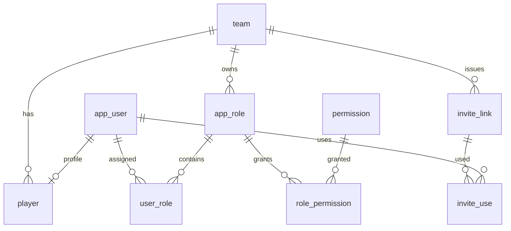
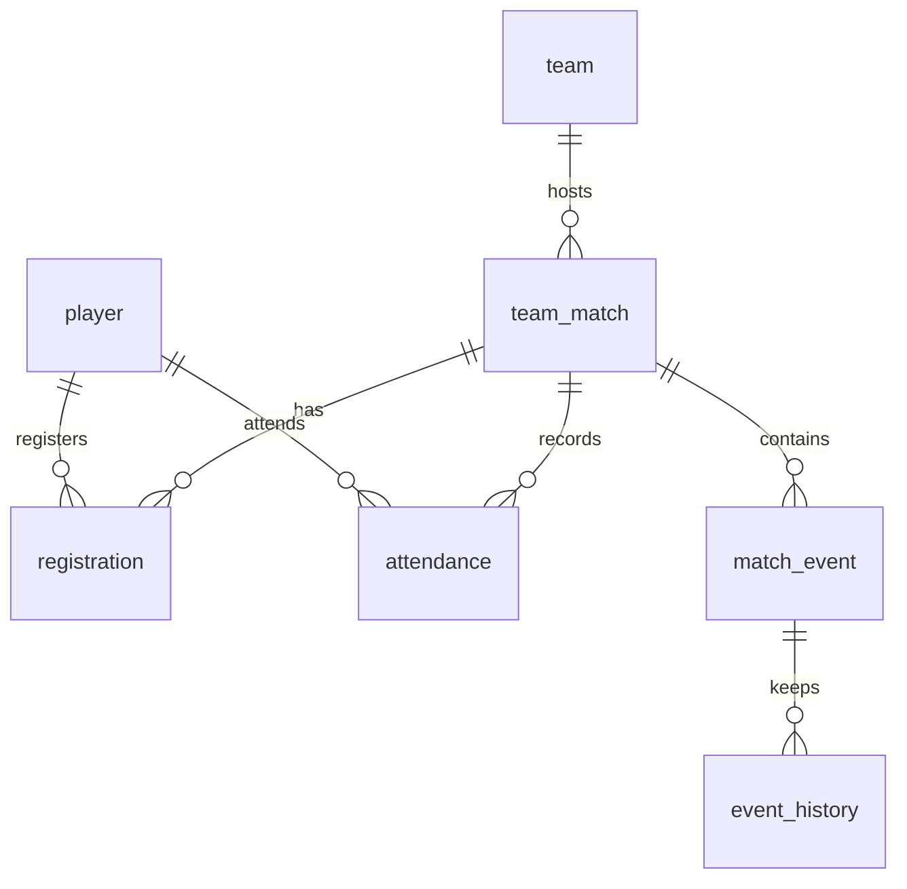
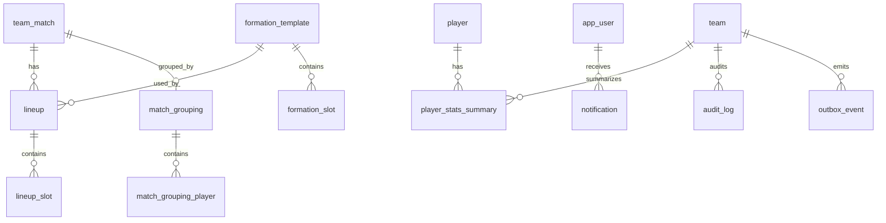

# 云河FC 数据库设计

- 文档版本：v0.41（活动人数上限改为必填、默认 50，V19 回填并改 NOT NULL，P-121；已取消可恢复为报名中/报名截止，状态机增加 `3→0`、`3→1`，P-114；活动字段编辑不再限制状态，任意状态均可编辑，P-113；活动状态机增加 `1→0`，报名截止可恢复为报名中，P-111；活动状态机增加 `2→0`、`2→1`，已结束可重新开放，P-110；活动图片与头像单张上限调整为 5MiB，P-107；V18 新增 activity_image 与 team_activity.family_allowed，活动图片改多图且单张 ≤5MiB，表数 31→32，P-105/P-106；V16 补 notification.type 注释迁移，P-99；活动状态机收敛与报名并发约束明确；新增 team_activity/activity_signup/ledger_category/team_ledger_entry，表数 27→31，Flyway V16/V17，P-92~P-94；排行榜生涯/历史累计由读取层按赛季汇总，无表结构变更，P-85；排行榜纳入本批：`player_stats_summary` 新增 `internal_appearances`/`internal_wins`/`own_goals`，V14；openid 清理顺延 V15，P-84；微信登录改为小程序登录，`app_user` 新增独立 `mp_openid`，P-74；`openid` 转为历史只读；备份与数据保留；取消锁定改为开赛当天 01:00 P-51；比分改为计分事件优先、无计分事件用兜底 P-56；统计汇总改为按全部赛季重算 P-58；时区统一改为 Asia/Shanghai +08:00 P-63；操作日志拆分创建时间与操作时间 P-66；球员星级改为两位小数 P-68；分组改为按球员星级均衡并移除分组权重配置 P-72）
- 编写日期：2026-11-09
- 依据材料：`docs/云河FC-需求文档.md`（v1.15）、`docs/design/01~03`、`docs/rules/database-rules.md`、`docs/rules/kafka-rules.md`、`prototype/`
- 对应脚本：`scripts/sql/schema.sql`（业务表）、`scripts/sql/quartz.sql`（Quartz 表）

## 1. 文档说明

### 1.1 目的

把领域模型落成 MySQL 8.4 逻辑/物理表结构，明确字段、类型、主键、唯一约束、索引与删除策略，作为后端开发、迁移脚本和测试的依据。

### 1.2 范围

- 本期只服务云河FC 单队；以 `team_id` 预留多队隔离。
- 不建物理外键；应用层维护关联完整性，数据库以主键、唯一约束、生成列与索引兜底。
- 仅建表结构；球队、角色、权限点、系统配置等种子数据由 Flyway 种子脚本初始化。
- Quartz 表独立文件，保留官方 `QRTZ_` 表名。

## 2. 设计约定

### 2.1 命名与标识

| 项 | 约定 |
|---|---|
| 表名 | 单数 `snake_case`；避开保留字：`team_match`、`app_user`、`app_role`、`match_grouping` |
| 字段名 | `snake_case`；关联字段 `<entity>_id`，如 `user_id`、`match_id` |
| 主键 | 单表主键 `id BIGINT UNSIGNED AUTO_INCREMENT`；`user_role`、`role_permission` 使用复合主键 |
| 逻辑关联 | 不建物理外键；关联字段建普通索引，应用服务校验 |
| 多队预留 | `team_id` 放在聚合根与独立根表：`player`、`team_match`、`app_role`、`invite_link`、`formation_template`、`system_setting`、`player_stats_summary`、`audit_log`；基础设施 `outbox_event` 也带可空 `team_id`；子表通过父表归属 |

### 2.2 类型与默认值

- 所有字段必须带中文 `COMMENT`；枚举/布尔字段的 `COMMENT` 同时写明数字与含义。
- 字符串：`VARCHAR` 按业务长度收紧；标识/哈希用 `CHAR` + `ascii_bin`。
- 布尔：`TINYINT(1)`，`0/1`，字段注释标明含义。
- 时间：`DATETIME(3)`，统一 Asia/Shanghai（+08:00）墙钟；`created_at` 默认当前时间，`updated_at` 自动更新。
- 枚举：状态/类型/位置等有限集合字段统一 `TINYINT UNSIGNED`，用列 `COMMENT` 写明数字与枚举映射；**数据库永久禁用 CHECK**，枚举合法性与跨字段业务规则全部由应用层强校验。
- JSON：仅用于结构化快照/配置/副位置；不使用逗号或分号拼接多值。
- 金额：本期无账本表，二期再引入 `DECIMAL`。

### 2.3 删除与保留总则

- 所有业务表统一包含 `is_deleted TINYINT UNSIGNED NOT NULL DEFAULT 0 COMMENT '0-未删除;1-伪删除'`；查询默认过滤 `is_deleted=0`。
- 账号、球员、比赛、报名、考勤、事件不做物理删除；用状态、`is_deleted` 或 `deleted_at`。
- 事件软删除并写 `event_history`；审计日志不删除。
- 到期清理：通知按 `created_at` 满 90 天物理删除；失效邀请满 30 天物理删除（`status=2` 且 `expires_at < now-30d`，或 `status=1` 且 `revoked_at < now-30d`；先删 `invite_use` 再删 `invite_link`）；Outbox SENT 按 `sent_at`、FAILED 按 `created_at` 均满 7 天物理删除（删 FAILED 前 WARN 计数），PENDING 不清理；`consumed_event` 按 `processed_at` 满 7 天；`idempotency_key` 按 `expires_at`；均不新增索引，接受必要的扫描。
- 物理删除必须自定义 `@Delete` 或绕过 `@TableLogic`，禁止用默认 `delete(wrapper)` 触发伪删除。
- 无物理外键，清理按聚合顺序由应用服务执行。
- 伪删除不自动释放唯一约束；需要在删除后复用编号/手机号等唯一值时，由应用层恢复记录或显式处理。
- 物理删除例外：`match_grouping` / `match_grouping_player` 采用覆盖写与物理删除；其唯一键不含 `is_deleted`，伪删除会阻塞同场重新生成。两表保留 `is_deleted` 列，但分组查询不依赖它。通知、失效邀请、Outbox、`consumed_event`、`idempotency_key` 的到期清理也是物理删除；其余业务表仍为伪删除。

### 2.4 枚举编码与 API 映射

数据库存数字；API 响应返回数字 code 与 `<field>Label` 字符串，请求只接受数字 code，由应用层映射。`is_deleted` 不在下表重复；布尔字段（如 `registration.active`）不生成 Label；内部生成列（如 `active_unique`）不对外返回。

| 字段 | 数字 → 枚举 |
|---|---|
| `app_user.status` | 0-PENDING；1-ACTIVE；2-DISABLED |
| `player.type` | 0-GUEST；1-PLAYER |
| `player.position` | 0-GOALKEEPER；1-DEFENDER；2-MIDFIELDER；3-FORWARD |
| `player.secondary_positions` JSON | 数组元素使用同一位置编码 0–3 |
| `invite_link.type` | 0-TEAM；1-MATCH |
| `invite_link.status` | 0-ACTIVE；1-REVOKED；2-EXPIRED |
| `team_match.type` | 0-OFFICIAL；1-INTERNAL；2-TRAINING；3-FRIENDLY |
| `team_match.our_side` | 0-HOME；1-AWAY；NULL 仅队内/训练 |
| `team_match.status` | 0-SIGNUP_OPEN；1-SIGNUP_CLOSED；2-LOCKED；3-IN_PROGRESS；4-FINISHED；5-POSTPONED；6-CANCELLED |
| `registration.type` | 0-GUEST；1-PLAYER |
| `registration.status` | 0-CONFIRMED；1-WAITLISTED；2-CANCELLED；3-REMOVED |
| `registration.active` | 1-有效（CONFIRMED/WAITLISTED）；0-无效 |
| `registration.active_unique` | 1-有效；NULL-无效（内部生成列，仅用于唯一键，不对外返回） |
| `attendance.status` | 0-PRESENT；1-ABSENT；2-TEMP_PRESENT |
| `attendance.source` | 0-SELF；1-ADMIN；2-SYSTEM |
| `match_event.team` | 0-HOME；1-AWAY |
| `match_event.type` | 0-GOAL；1-OWN_GOAL；2-SUBSTITUTION；3-YELLOW_CARD；4-RED_CARD |
| `match_event.half` | 0-FIRST；1-SECOND |
| `event_history.action` | 0-CREATE；1-UPDATE；2-DELETE |
| `formation_slot.role` | 0-GOALKEEPER；1-DEFENDER；2-MIDFIELDER；3-FORWARD |
| `lineup.side` | 0-HOME；1-AWAY |
| `lineup_slot.slot_type` | 0-STARTER；1-BENCH |
| `match_grouping_player.team` | 0-A；1-B |
| `team_activity.type` | 0-DINNER；1-ANNUAL_MEETING；2-OTHER |
| `team_activity.status` | 0-SIGNUP_OPEN；1-SIGNUP_CLOSED；2-FINISHED；3-CANCELLED |
| `activity_signup.status` | 0-CONFIRMED；1-CANCELLED |
| `team_ledger_entry.type` | 0-INCOME；1-EXPENSE |
| `ledger_category.direction` | 0-INCOME；1-EXPENSE；NULL-通用 |
| `ledger_category.is_active` | 1-启用；0-停用（停用后不出现在新建与筛选下拉） |
| `notification.type` | 0-REGISTRATION_CONFIRMED；1-WAITLIST_PROMOTED；2-MATCH_CREATED；3-MATCH_SIGNUP_CLOSED；4-MATCH_LOCKED；5-MATCH_STARTED；6-MATCH_FINISHED；7-MATCH_POSTPONED；8-MATCH_CANCELLED；9-ROLE_CHANGED；10-ACCOUNT_APPROVED；11-ACCOUNT_DISABLED；12-ACTIVITY_CREATED；13-ACTIVITY_CANCELLED（2–6 为预留编码，MVP 不触发；P-99 起不再有 14-恢复） |
| `outbox_event.status` | 0-PENDING；1-SENT；2-FAILED |

`team_match.format`、`notification.ref_type`、`audit_log.action/target_type`、`outbox_event.aggregate_type/event_type`、`system_setting.value_type` 为可扩展字符串，不做固定编码。

`player.type` 与 `registration.type` 统一使用 0-GUEST/1-PLAYER；实现仍应分别使用 `PlayerType` / `RegistrationType` 枚举，API 响应同时返回 `type` 与 `typeLabel`。

## 3. 实体关系

### 3.1 账号、角色与邀请

### 3.2 比赛、报名与赛况

### 3.3 阵容、分组与支撑

## 4. 表清单

| 分组 | 表 | 用途 |
|---|---|---|
| 球队/账号 | `team` | 球队基础信息 |
| 球队/账号 | `app_user` | 登录账号、手机号、mp_openid、状态 |
| 球队/账号 | `player` | 球员档案与展示数据 |
| 球队/账号 | `app_role` | 球队内角色 |
| 球队/账号 | `permission` | 全局权限点 |
| 球队/账号 | `user_role` | 用户-角色 |
| 球队/账号 | `role_permission` | 角色-权限 |
| 邀请 | `invite_link` | 入队/比赛邀请 |
| 邀请 | `invite_use` | 邀请使用记录 |
| 比赛 | `team_match` | 比赛、状态、名额、场次编号 |
| 比赛 | `registration` | 报名与候补 |
| 比赛 | `attendance` | 签到与考勤 |
| 赛况 | `match_event` | 进球/换人/牌等事件 |
| 赛况 | `event_history` | 事件创建/修改/删除快照 |
| 战术 | `formation_template` | 预置与自定义阵型 |
| 战术 | `formation_slot` | 阵型槽位坐标 |
| 战术 | `lineup` | 某场某方阵容版本 |
| 战术 | `lineup_slot` | 首发/替补槽位 |
| 战术 | `match_grouping` | 队内分组主表 |
| 战术 | `match_grouping_player` | 分组球员与评分快照 |
| 活动 | `team_activity` | 队内活动、状态、截止、人数上限、是否允许携带家属 |
| 活动 | `activity_signup` | 活动报名与家属信息 |
| 活动 | `activity_image` | 场地环境图片（最多 10 张，按排序号展示） |
| 账本 | `ledger_category` | 收支分类（内置 7 个，可自定义） |
| 账本 | `team_ledger_entry` | 球队收支流水 |
| 统计 | `player_stats_summary` | 按赛季的出场/进球/助攻/乌龙/队内赛出场与胜场汇总 |
| 通知 | `notification` | 站内通知 |
| 审计 | `audit_log` | 操作审计 |
| 基础设施 | `outbox_event` | 事务性 Outbox |
| 基础设施 | `consumed_event` | Kafka 消费去重 |
| 基础设施 | `idempotency_key` | 写接口幂等 |
| 配置 | `system_setting` | 按球队的键值配置 |

## 5. 表结构详设

> 以下各表字段表统一省略 `is_deleted` 行；32 张业务表均包含 §2.3 定义的 `is_deleted` 列，枚举字段编码见 §2.4。

### 5.1 team

| 字段 | 类型 | 空 | 默认 | 说明 |
|---|---|---|---|---|
| id | BIGINT UNSIGNED | 否 | 自增 | 主键 |
| name | VARCHAR(64) | 否 | — | 球队名称 |
| short_name | VARCHAR(32) | 否 | — | 简称 |
| created_at | DATETIME(3) | 否 | 当前时间 | 创建时间 |
| updated_at | DATETIME(3) | 否 | 当前时间 | 更新时间 |

约束与索引：PK(id)；UK(uk_team_name: name)。

### 5.2 app_user

| 字段 | 类型 | 空 | 默认 | 说明 |
|---|---|---|---|---|
| id | BIGINT UNSIGNED | 否 | 自增 | 主键 |
| phone | VARCHAR(20) | 否 | — | 登录手机号，唯一 |
| password_hash | VARCHAR(100) | 是 | NULL | BCrypt 哈希；小程序快捷登录创建的账号可为空 |
| openid | VARCHAR(64) ascii_bin | 是 | NULL | 历史公众号 openid；只读，V15 删除 |
| mp_openid | VARCHAR(64) ascii_bin | 是 | NULL | 微信小程序 openid，唯一；大小写敏感 |
| status | TINYINT UNSIGNED | 否 | 0 | 0-PENDING/1-ACTIVE/2-DISABLED |
| last_login_at | DATETIME(3) | 是 | NULL | 最近登录 |
| created_at / updated_at | DATETIME(3) | 否 | 当前时间 | 时间戳 |

约束与索引：UK(phone)、UK(mp_openid)、UK(openid)（历史，保留到 V15；MySQL 允许多个 NULL）；INDEX(status)。枚举由应用层校验；`is_deleted` 统一按 §2.3 处理。

### 5.3 player

| 字段 | 类型 | 空 | 默认 | 说明 |
|---|---|---|---|---|
| id | BIGINT UNSIGNED | 否 | 自增 | 主键 |
| team_id | BIGINT UNSIGNED | 否 | — | 球队 |
| user_id | BIGINT UNSIGNED | 否 | — | 账号；1:1 |
| name | VARCHAR(32) | 否 | — | 展示姓名 |
| jersey | SMALLINT UNSIGNED | 是 | NULL | 球衣号，待审可为空 |
| formal_jersey | SMALLINT UNSIGNED 生成列 | 是 | 计算 | 正式球员号码；GUEST 为 NULL |
| type | TINYINT UNSIGNED | 否 | 0 | 0-GUEST/1-PLAYER |
| position | TINYINT UNSIGNED | 否 | — | 0-门将/1-后卫/2-中场/3-前锋 |
| secondary_positions | JSON | 是 | NULL | 副位置数组 |
| region | VARCHAR(64) | 是 | NULL | 地区 |
| avatar_url | VARCHAR(512) | 是 | NULL | 私有 OSS 对象键（`avatar/{userId}/{ulid}.{ext}`，不含签名参数） |
| skill | DECIMAL(3,2) | 否 | 3.00 | 星级 1.00–5.00，两位小数 |
| created_at / updated_at | DATETIME(3) | 否 | 当前时间 | 时间戳 |

约束与索引：UK(team_id,user_id)、UK(team_id,formal_jersey)（正式球员号码唯一，外挂不约束）；INDEX(team_id,type)、(team_id,jersey)、(team_id,position)。`skill` 1.00–5.00 且最多两位小数、类型/位置枚举由应用层校验；账号状态统一由 `app_user.status` 表达，不在 player 重复；注销即 `app_user.status=2`，球员档案保留。

### 5.4 app_role

| 字段 | 类型 | 空 | 默认 | 说明 |
|---|---|---|---|---|
| id | BIGINT UNSIGNED | 否 | 自增 | 主键 |
| team_id | BIGINT UNSIGNED | 否 | — | 所属球队 |
| code | VARCHAR(32) | 否 | — | GUEST/PLAYER/ADMIN/自定义 |
| name | VARCHAR(64) | 否 | — | 显示名 |
| is_default | TINYINT(1) | 否 | 0 | 0-自定义/1-默认角色 |
| created_at / updated_at | DATETIME(3) | 否 | 当前时间 | 时间戳 |

约束与索引：UK(team_id,code)。

### 5.5 permission

| 字段 | 类型 | 空 | 默认 | 说明 |
|---|---|---|---|---|
| id | BIGINT UNSIGNED | 否 | 自增 | 主键 |
| code | VARCHAR(64) | 否 | — | `资源:动作:范围` |
| name | VARCHAR(64) | 否 | — | 显示名 |
| resource / action / scope | VARCHAR(32/32/16) | 否 | — | 权限码拆解 |
| created_at | DATETIME(3) | 否 | 当前时间 | 创建时间 |

约束与索引：UK(code)。权限点全局共享，不按球队拆分。

### 5.6 user_role

| 字段 | 类型 | 空 | 默认 | 说明 |
|---|---|---|---|---|
| user_id | BIGINT UNSIGNED | 否 | — | 用户 |
| role_id | BIGINT UNSIGNED | 否 | — | 角色 |
| created_at | DATETIME(3) | 否 | 当前时间 | 分配时间 |

约束与索引：PK(user_id,role_id)；INDEX(role_id)。

### 5.7 role_permission

| 字段 | 类型 | 空 | 默认 | 说明 |
|---|---|---|---|---|
| role_id | BIGINT UNSIGNED | 否 | — | 角色 |
| permission_id | BIGINT UNSIGNED | 否 | — | 权限点 |
| created_at | DATETIME(3) | 否 | 当前时间 | 授权时间 |

约束与索引：PK(role_id,permission_id)；INDEX(permission_id)。

### 5.8 invite_link

| 字段 | 类型 | 空 | 默认 | 说明 |
|---|---|---|---|---|
| id | BIGINT UNSIGNED | 否 | 自增 | 主键 |
| team_id | BIGINT UNSIGNED | 否 | — | 球队 |
| type | TINYINT UNSIGNED | 否 | — | 0-TEAM/1-MATCH |
| token_hash | CHAR(64) ascii_bin | 否 | — | token SHA-256，唯一 |
| match_id | BIGINT UNSIGNED | 是 | NULL | 比赛邀请关联比赛 |
| inviter_user_id | BIGINT UNSIGNED | 否 | — | 邀请人 |
| expires_at | DATETIME(3) | 否 | — | 过期时间 |
| max_uses | INT UNSIGNED | 是 | NULL | NULL 表示不限 |
| used_count | INT UNSIGNED | 否 | 0 | 已使用次数 |
| status | TINYINT UNSIGNED | 否 | 0 | 0-ACTIVE/1-REVOKED/2-EXPIRED |
| revoked_at | DATETIME(3) | 是 | NULL | 撤销时间 |
| created_at / updated_at | DATETIME(3) | 否 | 当前时间 | 时间戳 |

约束与索引：UK(token_hash)；INDEX(team_id,status,expires_at)、(match_id)。`match_id` 关联、`used_count <= max_uses`、type/status 枚举由应用层校验。

### 5.9 invite_use

| 字段 | 类型 | 空 | 默认 | 说明 |
|---|---|---|---|---|
| id | BIGINT UNSIGNED | 否 | 自增 | 主键 |
| invite_id | BIGINT UNSIGNED | 否 | — | 邀请 |
| user_id | BIGINT UNSIGNED | 否 | — | 使用者 |
| used_at | DATETIME(3) | 否 | 当前时间 | 使用时间 |

约束与索引：UK(invite_id,user_id)；INDEX(user_id)。

### 5.10 team_match

| 字段 | 类型 | 空 | 默认 | 说明 |
|---|---|---|---|---|
| id | BIGINT UNSIGNED | 否 | 自增 | 主键 |
| team_id | BIGINT UNSIGNED | 否 | — | 球队 |
| title | VARCHAR(128) | 否 | — | 比赛名称 |
| type | TINYINT UNSIGNED | 否 | — | 0-OFFICIAL/1-INTERNAL/2-TRAINING/3-FRIENDLY |
| format | VARCHAR(16) | 否 | 8人制 | 赛制 |
| start_at / end_at | DATETIME(3) | 否 | — | 开始/结束（+08:00 墙钟） |
| signup_deadline | DATETIME(3) | 否 | — | 当天 00:00 |
| cancel_lock | DATETIME(3) | 否 | — | 当天 01:00 |
| venue | VARCHAR(128) | 否 | — | 场地 |
| competition | VARCHAR(64) | 是 | NULL | 赛事名称 |
| season | CHAR(4) | 否 | — | 四位年份 |
| round | SMALLINT UNSIGNED | 是 | NULL | 轮次 |
| home_team_name / away_team_name | VARCHAR(64) | 否 | — | 主/客队名称 |
| our_side | TINYINT UNSIGNED | 是 | NULL | 0-HOME/1-AWAY；队内/训练为空 |
| status | TINYINT UNSIGNED | 否 | 0 | 0-SIGNUP_OPEN/1-SIGNUP_CLOSED/2-LOCKED/3-IN_PROGRESS/4-FINISHED/5-POSTPONED/6-CANCELLED |
| manual_status | TINYINT(1) | 否 | 0 | 0-自动/1-手动 |
| capacity | SMALLINT UNSIGNED | 否 | — | 正式球员名额；总名额=capacity+guest_capacity，仅展示 |
| guest_capacity | SMALLINT UNSIGNED | 否 | 0 | 外挂名额 |
| waitlist_capacity | SMALLINT UNSIGNED | 否 | 2 | 候补上限，仅正式球员、全场合计 |
| include_guests | TINYINT(1) | 否 | 1 | 0-不含外挂/1-含外挂 |
| score_home / score_away | TINYINT UNSIGNED | 是 | NULL | 兜底比分；仅存在进球/乌龙事件之外的场景（非计分事件或无事件）作为最终比分；创建未传时服务端写 0:0，历史未录入可空；事件不物理回写该字段 |
| season_match_no / total_match_no | INT UNSIGNED | 否 | — | 场次编号 |
| version | INT UNSIGNED | 否 | 0 | 状态条件更新版本 |
| status_updated_at / status_updated_by | DATETIME(3) / BIGINT UNSIGNED | 是 | NULL | 状态变更信息；管理员提前结束时作为实际结束时间 |
| created_by | BIGINT UNSIGNED | 否 | — | 创建人 |
| created_at / updated_at | DATETIME(3) | 否 | 当前时间 | 时间戳 |

约束与索引：UK(team_id,total_match_no)、UK(team_id,season,season_match_no)；INDEX(team_id,status,start_at)、(team_id,start_at)、(team_id,type,season)、(team_id,venue)。时间先后与 2–4 小时时长、开赛晚于当天 01:00、比分成对、容量>0、外挂/候补容量≥0、赛季四位数字、`signup_deadline <= cancel_lock < start_at`、队内训练赛 `our_side` 为空/对外比赛非空、type/status/our_side 枚举由应用层校验。数据库默认值仅为兜底；创建比赛时由系统配置带入正式 30、外挂 4、候补 2。`cancel_lock` 必须早于 `start_at`；开赛时间必须晚于当天 01:00（P-51 已确认），因此 `cancel_lock=当天01:00` 始终早于 `start_at`。`POSTPONED` 为等待重新排期的稳定状态，重新排期后回 `SIGNUP_OPEN`（P-02 已确认）。

### 5.11 registration

| 字段 | 类型 | 空 | 默认 | 说明 |
|---|---|---|---|---|
| id | BIGINT UNSIGNED | 否 | 自增 | 主键 |
| match_id | BIGINT UNSIGNED | 否 | — | 比赛 |
| player_id | BIGINT UNSIGNED | 否 | — | 球员 |
| type | TINYINT UNSIGNED | 否 | — | 0-GUEST/1-PLAYER |
| status | TINYINT UNSIGNED | 否 | — | 0-CONFIRMED/1-WAITLISTED/2-CANCELLED/3-REMOVED |
| registered_at | DATETIME(3) | 否 | 当前时间 | 报名时间，候补排序 |
| cancelled_at | DATETIME(3) | 是 | NULL | 取消时间 |
| cancelled_by | BIGINT UNSIGNED | 是 | NULL | 取消人 |
| active | TINYINT UNSIGNED 生成列 | 是 | 计算 | 1-有效（CONFIRMED/WAITLISTED）；0-无效 |
| active_unique | TINYINT UNSIGNED 生成列 | 是 | 计算 | 内部唯一键：1-有效；NULL-无效（允许保留多条取消/移除记录） |
| updated_at | DATETIME(3) | 否 | 当前时间 | 更新时间 |

约束与索引：UK(match_id,player_id,active_unique) 保证同一用户同一比赛仅一条有效报名，同时允许多条取消/移除历史；INDEX(match_id,type,status,registered_at) 支持候补排序、INDEX(player_id,status)。外挂不得候补、type/status 枚举由应用层校验。取消后可重新报名，历史保留。

### 5.12 attendance

| 字段 | 类型 | 空 | 默认 | 说明 |
|---|---|---|---|---|
| id | BIGINT UNSIGNED | 否 | 自增 | 主键 |
| match_id | BIGINT UNSIGNED | 否 | — | 比赛 |
| player_id | BIGINT UNSIGNED | 否 | — | 球员 |
| status | TINYINT UNSIGNED | 否 | — | 0-PRESENT/1-ABSENT/2-TEMP_PRESENT |
| source | TINYINT UNSIGNED | 否 | — | 0-SELF/1-ADMIN/2-SYSTEM |
| recorded_by | BIGINT UNSIGNED | 是 | NULL | 操作人，系统为空 |
| recorded_at / updated_at | DATETIME(3) | 否 | 当前时间 | 时间戳 |

约束与索引：UK(match_id,player_id)；INDEX(match_id,status)。status/source 枚举由应用层校验。

### 5.13 match_event

| 字段 | 类型 | 空 | 默认 | 说明 |
|---|---|---|---|---|
| id | BIGINT UNSIGNED | 否 | 自增 | 主键 |
| match_id | BIGINT UNSIGNED | 否 | — | 比赛 |
| team | TINYINT UNSIGNED | 否 | — | 0-HOME/1-AWAY |
| type | TINYINT UNSIGNED | 否 | — | 0-GOAL/1-OWN_GOAL/2-SUBSTITUTION/3-YELLOW_CARD/4-RED_CARD |
| player_id | BIGINT UNSIGNED | 是 | NULL | 主体球员（换人为空） |
| assist_player_id | BIGINT UNSIGNED | 是 | NULL | 助攻 |
| in_player_id / out_player_id | BIGINT UNSIGNED | 是 | NULL | 换上/换下 |
| minute | TINYINT UNSIGNED | 否 | — | 1–120 |
| half | TINYINT UNSIGNED | 否 | — | 0-FIRST/1-SECOND |
| penalty | TINYINT(1) | 否 | 0 | 0-非点球/1-点球 |
| created_by / updated_by / deleted_by | BIGINT UNSIGNED | 否/是/是 | —/NULL/NULL | 操作人 |
| created_at / updated_at / deleted_at | DATETIME(3) | 否/否/是 | 当前时间/当前时间/NULL | 时间戳 |
| version | INT UNSIGNED | 否 | 0 | 条件更新 |

约束与索引：INDEX(match_id,deleted_at,half,minute) 支持时间线；INDEX(player_id)、INDEX(assist_player_id)。`minute` 1–120、换人字段完整性、换人事件不得填写 `player_id`、助攻与点球仅进球、非换人不得填写换上/换下、team/type/half 枚举由应用层校验。

### 5.14 event_history

| 字段 | 类型 | 空 | 默认 | 说明 |
|---|---|---|---|---|
| id | BIGINT UNSIGNED | 否 | 自增 | 主键 |
| event_id | BIGINT UNSIGNED | 否 | — | 事件 |
| action | TINYINT UNSIGNED | 否 | — | 0-CREATE/1-UPDATE/2-DELETE |
| before_json / after_json | JSON | 是 | NULL | 前后快照 |
| actor_user_id | BIGINT UNSIGNED | 是 | NULL | 操作人 |
| request_id | VARCHAR(64) | 是 | NULL | 请求链路 |
| created_at | DATETIME(3) | 否 | 当前时间 | 时间 |

约束与索引：INDEX(event_id,created_at)。action 枚举由应用层校验。

### 5.15 formation_template

| 字段 | 类型 | 空 | 默认 | 说明 |
|---|---|---|---|---|
| id | BIGINT UNSIGNED | 否 | 自增 | 主键 |
| team_id | BIGINT UNSIGNED | 是 | NULL | 预置为空 |
| name | VARCHAR(64) | 否 | — | 模板名 |
| is_preset | TINYINT(1) | 否 | 0 | 0-自定义/1-预置 |
| base_template_id | BIGINT UNSIGNED | 是 | NULL | 复制来源 |
| created_by | BIGINT UNSIGNED | 是 | NULL | 创建人 |
| created_at / updated_at | DATETIME(3) | 否 | 当前时间 | 时间戳 |

约束与索引：INDEX(team_id,is_preset)。预置时 `team_id` 为空、自定义时不为空由应用层校验；自定义模板删除为软删除，保留历史阵容引用。

### 5.16 formation_slot

| 字段 | 类型 | 空 | 默认 | 说明 |
|---|---|---|---|---|
| id | BIGINT UNSIGNED | 否 | 自增 | 主键 |
| template_id | BIGINT UNSIGNED | 否 | — | 模板 |
| slot_key | VARCHAR(16) | 否 | — | 槽位标识 |
| role | TINYINT UNSIGNED | 否 | — | 0-门将/1-后卫/2-中场/3-前锋 |
| x / y | DECIMAL(5,2) | 否 | — | 坐标 0–100 |
| sort_order | SMALLINT UNSIGNED | 否 | 0 | 排序 |

约束与索引：UK(template_id,slot_key)。坐标 0–100、role 枚举由应用层校验。

### 5.17 lineup

| 字段 | 类型 | 空 | 默认 | 说明 |
|---|---|---|---|---|
| id | BIGINT UNSIGNED | 否 | 自增 | 主键 |
| match_id | BIGINT UNSIGNED | 否 | — | 比赛 |
| side | TINYINT UNSIGNED | 否 | — | 0-HOME/1-AWAY |
| formation_template_id | BIGINT UNSIGNED | 否 | — | 阵型 |
| version | INT UNSIGNED | 否 | 0 | 乐观锁 |
| updated_by | BIGINT UNSIGNED | 是 | NULL | 最后编辑人 |
| created_at / updated_at | DATETIME(3) | 否 | 当前时间 | 时间戳 |

约束与索引：UK(match_id,side)。side 枚举由应用层校验。

### 5.18 lineup_slot

| 字段 | 类型 | 空 | 默认 | 说明 |
|---|---|---|---|---|
| id | BIGINT UNSIGNED | 否 | 自增 | 主键 |
| lineup_id | BIGINT UNSIGNED | 否 | — | 阵容 |
| slot_key | VARCHAR(16) | 否 | — | 槽位 |
| slot_type | TINYINT UNSIGNED | 否 | — | 0-STARTER/1-BENCH |
| player_id | BIGINT UNSIGNED | 是 | NULL | 球员；对手方占位为空 |
| sort_order | SMALLINT UNSIGNED | 否 | 0 | 排序 |

约束与索引：UK(lineup_id,slot_key)、UK(lineup_id,player_id)（NULL 可重复，用于对手方占位）；INDEX(lineup_id,slot_type)。slot_type 枚举由应用层校验。

### 5.19 match_grouping

| 字段 | 类型 | 空 | 默认 | 说明 |
|---|---|---|---|---|
| id | BIGINT UNSIGNED | 否 | 自增 | 主键 |
| match_id | BIGINT UNSIGNED | 否 | — | 比赛；1:1 |
| manual_weight / auto_weight | DECIMAL(5,2) | 否 | — | 历史权重列；P-72 起固定写入 100.00 / 0.00 |
| roster_fingerprint | CHAR(64) ascii_bin | 否 | — | 名单 SHA-256 |
| generated_at | DATETIME(3) | 否 | — | 生成时间 |
| saved_at | DATETIME(3) | 是 | NULL | 保存时间 |
| created_by | BIGINT UNSIGNED | 否 | — | 生成人 |
| created_at / updated_at | DATETIME(3) | 否 | 当前时间 | 时间戳 |

约束与索引：UK(match_id)。分组已改为按球员星级均衡（P-72），`manual_weight/auto_weight` 保留为历史快照列，新生成固定写 100.00/0.00，不再由应用层校验 0–100 或合计。生成/重新生成对该行覆盖写；GRP-06 清除时物理删除本行，避免 `UK(match_id)` 被伪删除占用。

### 5.20 match_grouping_player

| 字段 | 类型 | 空 | 默认 | 说明 |
|---|---|---|---|---|
| id | BIGINT UNSIGNED | 否 | 自增 | 主键 |
| grouping_id | BIGINT UNSIGNED | 否 | — | 分组 |
| player_id | BIGINT UNSIGNED | 否 | — | 球员 |
| team | TINYINT UNSIGNED | 否 | — | 0-A/1-B |
| manual_score | DECIMAL(3,2) | 是 | NULL | 生成时球员星级快照 |
| auto_score / final_score | DECIMAL(6,2) | 是 | NULL | P-72 起新生成 auto_score 为 NULL、final_score 为球员星级快照；历史行保留旧值 |
| created_at | DATETIME(3) | 否 | 当前时间 | 时间 |

约束与索引：UK(grouping_id,player_id)；INDEX(grouping_id,team)。`manual_score/final_score` 为 1.00–5.00 两位小数的球员星级快照，`auto_score` 为 NULL；team 枚举由应用层校验。调整时原地更新 `team`；重新生成时物理删除后整批插入；清除时随主行物理删除。

### 5.21 player_stats_summary

| 字段 | 类型 | 空 | 默认 | 说明 |
|---|---|---|---|---|
| id | BIGINT UNSIGNED | 否 | 自增 | 主键 |
| team_id | BIGINT UNSIGNED | 否 | — | 球队 |
| player_id | BIGINT UNSIGNED | 否 | — | 球员 |
| season | CHAR(4) | 否 | — | 赛季 |
| appearances / goals / assists | INT UNSIGNED | 否 | 0 | 按赛季汇总 |
| internal_appearances | INT UNSIGNED | 否 | 0 | 队内赛出场且已分组场次（胜率分母） |
| internal_wins | INT UNSIGNED | 否 | 0 | 队内赛中本方获胜场次 |
| own_goals | INT UNSIGNED | 否 | 0 | 乌龙球数（按赛季） |
| updated_at / created_at | DATETIME(3) | 否 | 当前时间 | 时间戳 |

约束与索引：UK(team_id,player_id,season)；INDEX(team_id,season)。`season` 四位数字由应用层校验。汇总表存出场/进球/助攻/乌龙/队内赛出场/队内赛胜场；出场率分母（本赛季已结束且未取消的球队比赛数）仍由比赛领域 read port 提供，不在此表重复存储（P-09）；胜率分母 `internal_appearances` 刻意入库，因为排行榜需要按球员读取（P-84 将 P-09 的「不存分母」限定为出场率分母）。应用层保证 `internal_wins <= internal_appearances`，不使用 `CHECK`。P-85 的生涯累计与历史累计由读取层按 `season` 汇总（`career`: `season <= 当前自然年`；`history`: `season < 当前自然年`），不新增列、不落库；未来赛季与非 4 位赛季不计入。

### 5.22 notification

| 字段 | 类型 | 空 | 默认 | 说明 |
|---|---|---|---|---|
| id | BIGINT UNSIGNED | 否 | 自增 | 主键 |
| user_id | BIGINT UNSIGNED | 否 | — | 接收人 |
| type | TINYINT UNSIGNED | 否 | — | 0-报名成功/1-候补递补/2-比赛创建/3-报名截止/4-名单锁定/5-比赛开始/6-比赛结束/7-比赛延期/8-比赛取消/9-角色变更/10-审核通过/11-注销 |
| title / body | VARCHAR(128/512) | 否 | — | 标题/内容 |
| ref_type / ref_id | VARCHAR(32) / BIGINT UNSIGNED | 是 | NULL | 关联对象 |
| read_at | DATETIME(3) | 是 | NULL | 已读时间 |
| created_at | DATETIME(3) | 否 | 当前时间 | 创建时间 |

约束与索引：INDEX(user_id,read_at,created_at)、(ref_type,ref_id)。`type` 编码见 §2.4；新增类型时同步更新编码表，应用层校验。

### 5.23 audit_log

| 字段 | 类型 | 空 | 默认 | 说明 |
|---|---|---|---|---|
| id | BIGINT UNSIGNED | 否 | 自增 | 主键 |
| team_id | BIGINT UNSIGNED | 是 | NULL | 球队，系统操作可空 |
| actor_user_id | BIGINT UNSIGNED | 是 | NULL | 操作人 |
| actor_name | VARCHAR(64) | 是 | NULL | 操作人快照 |
| action | VARCHAR(64) | 否 | — | 动作 |
| target_type | VARCHAR(32) | 否 | — | 对象类型 |
| target_id | BIGINT UNSIGNED | 是 | NULL | 对象 ID |
| before_json / after_json | JSON | 是 | NULL | 前后快照 |
| request_id | VARCHAR(64) | 是 | NULL | 请求链路 |
| ip | VARCHAR(45) | 是 | NULL | 客户端 IP |
| created_at | DATETIME(3) | 否 | 当前时间 | 创建时间（消费入库时间） |
| operated_at | DATETIME(3) | 是 | NULL | 操作时间（Kafka 生产时写入；旧数据回填为创建时间，旧消息可空） |

约束与索引：INDEX(team_id,created_at)、(target_type,target_id)、(actor_user_id,created_at)、(team_id,operated_at)。

`operated_at` 来自 `AUDIT_RECORDED` 载荷的 `operateAt`，由生产端在记录审计时写入；AUD-01 的 `from/to` 过滤与排序按 `operated_at`，使用 `(team_id,operated_at)`。快照按原值存储（含 phone/mp_openid 等敏感字段），仅在 AUD-01 响应层脱敏；年度 OSS 导出同样保留原文，并包含 `operated_at`。`audit_log` 不提供业务更新/删除路径，在线永久保留。

### 5.24 outbox_event

| 字段 | 类型 | 空 | 默认 | 说明 |
|---|---|---|---|---|
| id | BIGINT UNSIGNED | 否 | 自增 | 主键 |
| event_id | CHAR(36) ascii_bin | 否 | — | 事件 UUID，唯一 |
| team_id | BIGINT UNSIGNED | 是 | NULL | 球队 |
| aggregate_type | VARCHAR(32) | 否 | — | 聚合类型 |
| aggregate_id | BIGINT UNSIGNED | 否 | — | 聚合 ID，分区键来源 |
| event_type | VARCHAR(64) | 否 | — | 事件类型 |
| payload_json | JSON | 否 | — | 事件载荷 |
| status | TINYINT UNSIGNED | 否 | 0 | 0-PENDING/1-SENT/2-FAILED |
| attempts | SMALLINT UNSIGNED | 否 | 0 | 重试次数 |
| next_retry_at | DATETIME(3) | 是 | NULL | 下次重试 |
| lease_owner | VARCHAR(64) | 是 | NULL | 租约持有者（实例/线程标识） |
| lease_until | DATETIME(3) | 是 | NULL | 租约到期时间；过期后可被重新认领 |
| last_error | VARCHAR(512) | 是 | NULL | 最近错误 |
| created_at / sent_at | DATETIME(3) | 否/是 | 当前/NULL | 时间 |

约束与索引：UK(event_id)；INDEX(status,next_retry_at)、(aggregate_type,aggregate_id)。status 枚举由应用层校验。投递器按 `status + next_retry_at` 取批次，并以 `lease_owner/lease_until` 条件认领，租约过期后可重试。

### 5.25 consumed_event

| 字段 | 类型 | 空 | 默认 | 说明 |
|---|---|---|---|---|
| id | BIGINT UNSIGNED | 否 | 自增 | 主键 |
| consumer_group | VARCHAR(64) | 否 | — | 消费组 |
| event_id | CHAR(36) ascii_bin | 否 | — | 事件 ID |
| topic | VARCHAR(128) | 否 | — | topic |
| partition_no | INT UNSIGNED | 否 | — | 分区 |
| offset_no | BIGINT UNSIGNED | 否 | — | offset |
| processed_at | DATETIME(3) | 否 | 当前时间 | 处理时间 |

约束与索引：UK(consumer_group,event_id)、UK(topic,consumer_group,partition_no,offset_no)；INDEX(processed_at)。与 Kafka 规范的 Redis 两阶段标记并存，业务幂等仍由唯一约束兜底。

### 5.26 idempotency_key

| 字段 | 类型 | 空 | 默认 | 说明 |
|---|---|---|---|---|
| id | BIGINT UNSIGNED | 否 | 自增 | 主键 |
| user_id | BIGINT UNSIGNED | 否 | — | 用户 |
| endpoint | VARCHAR(128) | 否 | — | 接口标识 |
| idem_key | VARCHAR(64) | 否 | — | Idempotency-Key |
| request_hash | CHAR(64) ascii_bin | 否 | — | 请求体哈希 |
| response_status | SMALLINT UNSIGNED | 是 | NULL | 响应状态 |
| response_body | JSON | 是 | NULL | 响应快照 |
| created_at / expires_at | DATETIME(3) | 否/否 | 当前/— | 时间 |

约束与索引：UK(user_id,endpoint,idem_key)；INDEX(expires_at)。

### 5.27 system_setting

| 字段 | 类型 | 空 | 默认 | 说明 |
|---|---|---|---|---|
| id | BIGINT UNSIGNED | 否 | 自增 | 主键 |
| team_id | BIGINT UNSIGNED | 否 | — | 球队 |
| setting_key | VARCHAR(64) | 否 | — | 配置键 |
| setting_value | JSON | 否 | — | 配置值 |
| value_type | VARCHAR(16) | 否 | JSON | 值类型 |
| updated_by | BIGINT UNSIGNED | 是 | NULL | 修改人 |
| created_at / updated_at | DATETIME(3) | 否 | 当前时间 | 时间戳 |

约束与索引：UK(team_id,setting_key)。配置键固定为：`registration.maxPlayers`（默认 30）、`registration.maxGuests`（4）、`registration.maxWaitlist`（2）。P-72 起分组直接使用球员星级，原 `grouping.*` 键由 V10 迁移伪删除（`is_deleted=1`）。`value_type` 列默认 `JSON` 仅作通用兜底；当前数字配置由种子显式写 `NUMBER`。

### 5.28 team_activity

| 字段 | 类型 | 空 | 默认 | 说明 |
|---|---|---|---|---|
| id | BIGINT UNSIGNED | 否 | 自增 | 主键 |
| team_id | BIGINT UNSIGNED | 否 | — | 球队 |
| title | VARCHAR(128) | 否 | — | 活动名 |
| type | TINYINT UNSIGNED | 否 | — | 0-聚餐；1-年会；2-其他 |
| start_at | DATETIME(3) | 否 | — | 活动开始时间 |
| end_at | DATETIME(3) | 是 | NULL | 活动结束时间 |
| signup_deadline | DATETIME(3) | 否 | — | 报名截止时间，仅作报名硬门禁 |
| capacity | SMALLINT UNSIGNED | 否 | 50 | 总人数上限（只计报名人数，不含家属）；默认 50，不提供无上限 |
| family_allowed | TINYINT UNSIGNED | 否 | 0 | 0-不允许携带家属；1-允许携带家属 |
| cost_per_person | DECIMAL(10,2) | 是 | NULL | 人均消费，仅展示 |
| location | VARCHAR(128) | 否 | — | 活动地址 |
| description | VARCHAR(1000) | 是 | NULL | 活动说明 |
| status | TINYINT UNSIGNED | 否 | 0 | 0-报名中；1-报名截止；2-已结束；3-已取消 |
| cancel_reason | VARCHAR(255) | 是 | NULL | 取消原因 |
| version | INT UNSIGNED | 否 | 0 | 乐观锁 |
| created_by | BIGINT UNSIGNED | 否 | — | 创建人 |
| created_at / updated_at | DATETIME(3) | 否 | 当前时间 | 时间戳 |

约束与索引：INDEX(team_id,start_at)；INDEX(team_id,status,start_at)。报名人数不建列，由 `activity_signup` 实时 `COUNT(*)` 计算。

### 5.29 activity_signup

| 字段 | 类型 | 空 | 默认 | 说明 |
|---|---|---|---|---|
| id | BIGINT UNSIGNED | 否 | 自增 | 主键 |
| activity_id | BIGINT UNSIGNED | 否 | — | 活动 |
| player_id | BIGINT UNSIGNED | 否 | — | 球员 |
| with_family | TINYINT UNSIGNED | 否 | 0 | 0-不带家属；1-携带家属 |
| family_note | VARCHAR(255) | 是 | NULL | 家属备注 |
| status | TINYINT UNSIGNED | 否 | — | 0-已报名；1-已取消 |
| signed_up_at | DATETIME(3) | 否 | 当前时间 | 报名时间 |
| cancelled_at | DATETIME(3) | 是 | NULL | 取消时间 |
| cancelled_by | BIGINT UNSIGNED | 是 | NULL | 取消人 |
| updated_at | DATETIME(3) | 否 | 当前时间 | 更新时间 |

约束与索引：UK(activity_id,player_id)（同一活动同一球员只有一行）；INDEX(activity_id,status,signed_up_at)；INDEX(player_id,status)。取消时更新 `status=1` 与取消信息，重新报名复用同一行写回 `status=0`，**不保留历史行**（与 `registration` 的多行历史模式不同）。

### 5.30 team_ledger_entry

| 字段 | 类型 | 空 | 默认 | 说明 |
|---|---|---|---|---|
| id | BIGINT UNSIGNED | 否 | 自增 | 主键 |
| team_id | BIGINT UNSIGNED | 否 | — | 球队 |
| type | TINYINT UNSIGNED | 否 | — | 0-收入；1-支出 |
| category_id | BIGINT UNSIGNED | 否 | — | 分类ID（`ledger_category`） |
| amount | DECIMAL(10,2) | 否 | — | 金额，正数，单位元 |
| description | VARCHAR(255) | 否 | — | 摘要 |
| occurred_at | DATETIME(3) | 否 | — | 发生时间 |
| player_id | BIGINT UNSIGNED | 是 | NULL | 归属球员 |
| activity_id | BIGINT UNSIGNED | 是 | NULL | 关联活动 |
| version | INT UNSIGNED | 否 | 0 | 乐观锁 |
| created_by | BIGINT UNSIGNED | 否 | — | 创建人 |
| created_at / updated_at | DATETIME(3) | 否 | 当前时间 | 时间戳 |

约束与索引：INDEX(team_id,occurred_at,id)；INDEX(team_id,type,occurred_at)；INDEX(team_id,activity_id)；INDEX(team_id,player_id)；INDEX(team_id,category_id)。余额不落库，按区间 `SUM(收入) - SUM(支出)` 计算。

### 5.31 ledger_category

| 字段 | 类型 | 空 | 默认 | 说明 |
|---|---|---|---|---|
| id | BIGINT UNSIGNED | 否 | 自增 | 主键 |
| team_id | BIGINT UNSIGNED | 否 | — | 球队 |
| name | VARCHAR(32) | 否 | — | 分类名称 |
| direction | TINYINT UNSIGNED | 是 | NULL | 0-收入；1-支出；NULL-通用 |
| sort_no | SMALLINT UNSIGNED | 否 | 0 | 排序号，升序展示 |
| is_active | TINYINT UNSIGNED | 否 | 1 | 1-启用；0-停用 |
| created_at / updated_at | DATETIME(3) | 否 | 当前时间 | 时间戳 |

约束与索引：UK(team_id,name)；INDEX(team_id,direction,sort_no)。内置分类由 V17 种子写入（队费/场地/装备/活动/餐饮/赞助/其他，其中「其他」为通用分类）。分类只停用不删除，避免历史流水失去分类。

### 5.32 activity_image

| 字段 | 类型 | 空 | 默认 | 说明 |
|---|---|---|---|---|
| id | BIGINT UNSIGNED | 否 | 自增 | 主键 |
| activity_id | BIGINT UNSIGNED | 否 | — | 活动 |
| image_key | VARCHAR(512) | 否 | — | 图片对象键，不含签名参数 |
| sort_no | TINYINT UNSIGNED | 否 | 0 | 排序号，从 0 开始，升序展示 |
| created_at / updated_at | DATETIME(3) | 否 | 当前时间 | 时间戳 |

约束与索引：INDEX(activity_id,sort_no)。一条活动最多 10 张；写入采用覆盖式（旧行伪删除后按顺序插入新行）；读接口按 `sort_no,id` 升序现签 15 分钟 URL。V18 从原 `team_activity.location_image_key` 回填存量单图为 `sort_no=0`。同一活动内对象键唯一性由应用层保证，不建唯一键：覆盖式写入先伪删除再插入，而伪删除不释放唯一键，建 UK 会导致同一图片删除后无法重新加入。用户可见文案统一为「场地环境图片」；V16/V17/V18 已应用的迁移内 DDL COMMENT 与权限描述保留历史措辞「活动地点图片」，避免变更迁移校验和，后续新迁移再统一。

## 6. 关联与删除策略

### 6.1 逻辑关联（无物理外键）

| 子表字段 | 父表 | 删除/变更策略 |
|---|---|---|
| player.team_id / user_id | team / app_user | 账号注销只改状态；球员档案保留 |
| app_role.team_id | team | 球队不删除；角色默认保护在应用层 |
| user_role.user_id / role_id | app_user / app_role | 解除分配后再删角色；应用层校验 |
| role_permission.* | app_role / permission | 权限点由种子维护；角色删除前清理 |
| invite_link.team_id / match_id / inviter_user_id | team / team_match / app_user | `status=2` 且 `expires_at < now-30d`，或 `status=1` 且 `revoked_at < now-30d`；同一事务内先删 `invite_use` 再删 `invite_link`；不新增索引 |
| registration.match_id / player_id | team_match / player | 取消/移除只改状态；比赛不删除 |
| attendance.match_id / player_id | team_match / player | 考勤记录保留 |
| match_event.match_id | team_match | 事件软删除；历史保留 |
| event_history.event_id | match_event | 永久保留 |
| lineup.match_id / formation_template_id | team_match / formation_template | 阵容随比赛保留；模板软删除（`is_deleted=1`），历史阵容仍可按 `formation_template_id` 读取，模板列表不展示已删除项 |
| lineup_slot.lineup_id / player_id | lineup / player | 随阵容覆盖；不单独删除 |
| match_grouping.match_id | team_match | 重新生成覆盖；保存快照 |
| match_grouping_player.grouping_id / player_id | match_grouping / player | 随分组覆盖 |
| player_stats_summary.team_id / player_id | team / player | 汇总覆盖；不删除历史 |
| notification.user_id | app_user | 按 `created_at` 满 90 天物理删除；不新增索引 |
| audit_log.team_id / actor_user_id | team / app_user | 永久保留；年度 OSS 导出 |
| outbox_event.team_id | team | SENT 按 `sent_at`、FAILED 按 `created_at` 满 7 天物理删除；删 FAILED 前 WARN 计数；PENDING 不清理；不新增索引 |
| consumed_event.* | — | 按 `processed_at` 满 7 天物理删除 |
| idempotency_key.user_id | app_user | 按 `expires_at` 物理删除 |
| system_setting.team_id | team | 不删除 |

补充：`created_by`、`updated_by`、`cancelled_by`、`recorded_by`、`deleted_by`、`actor_user_id` 等操作人字段按 `app_user` 逻辑关联；`notification.ref_type/ref_id`、`outbox_event.aggregate_type/aggregate_id` 为多态引用，由应用层解析，不建物理外键。

### 6.2 删除策略汇总

| 对象 | 策略 |
|---|---|
| 伪删除 | 置 `is_deleted=1`；查询默认过滤，不物理删除；唯一约束不自动释放；到期清理项见下方，按物理删除 |
| 账号 | `app_user.status=2`（DISABLED）；不可登录、历史保留 |
| 球员 | 随账号状态；不进入球队页/报名名单 |
| 比赛 | `status=6`（CANCELLED）；不物理删除 |
| 报名 | `status=2/3`（CANCELLED/REMOVED）；有效唯一约束释放 |
| 活动 | 已结束/已取消不物理删除；取消保留记录与原因（可恢复） |
| 活动报名 | 本人取消与管理员移除同语义：更新 `status=1`、`cancelled_at`、`cancelled_by`；重新报名复用同一行写回 `status=0` 并清空取消信息；不保留历史行，不伪删除（`is_deleted` 恒为 0） |
| 活动图片 | 随活动编辑覆盖：旧行 `is_deleted=1` 后按顺序插入新行；活动不物理删除 |
| 账本分类 | 只停用不删除（`is_active=0`）；避免历史流水失去分类 |
| 账本流水 | 伪删除；写审计快照 |
| 考勤 | 覆盖记录；不删除 |
| 事件 | `is_deleted=1` + `deleted_at/deleted_by` 软删除；查询两者同时过滤；`event_history` 永久保留 |
| 阵容/分组 | 阵容覆盖更新；分组覆盖写 + 物理删除（唯一键不含 `is_deleted`）；历史版本仅保留当前版本 |
| 审计 | 不删除；年度 OSS 冷备 |
| 通知 | 按 `created_at` 满 90 天物理删除 |
| 失效邀请 | 满 30 天物理删除：`status=2` 且 `expires_at` 过期，或 `status=1` 且 `revoked_at` 早于 `now-30d`；先删 `invite_use` 再删 `invite_link` |
| Outbox | SENT 按 `sent_at`、FAILED 按 `created_at` 均满 7 天物理删除；PENDING 不清理 |
| 消费去重/幂等 | `consumed_event` 按 `processed_at` 7 天；`idempotency_key` 按 `expires_at`；均物理删除 |

## 7. 索引与查询支撑

| 查询 | 支撑索引 |
|---|---|
| 赛程列表：球队 + 状态 + 时间排序 | `idx_match_team_status_start` |
| 赛程筛选：类型/赛季/地点 | `idx_match_team_type_season`、`idx_match_team_venue` |
| 报名名单与候补排序 | `idx_registration_match_pool` |
| 我的报名 | `idx_registration_player` |
| 活动列表（球队 + 时间 / 状态） | `idx_activity_team_start`、`idx_activity_team_status_start` |
| 活动名单与我的活动报名 | `uk_activity_signup`、`idx_activity_signup_activity`、`idx_activity_signup_player` |
| 活动图片（按活动与排序号） | `idx_activity_image_activity` |
| 账本列表（发生时间、方向、按分类、按活动、按球员） | `idx_ledger_team_occurred`、`idx_ledger_team_type_occurred`、`idx_ledger_team_category`、`idx_ledger_team_activity`、`idx_ledger_team_player` |
| 账本分类下拉 | `uk_ledger_category_name`、`idx_ledger_category_team` |
| 事件时间线 | `idx_event_timeline` |
| 审计按球队/对象/人查询与操作时间排序 | `idx_audit_team_operated`、`idx_audit_target`、`idx_audit_actor` |
| 通知列表 | `idx_notification_user_read` |
| Outbox 投递扫描 | `idx_outbox_status_retry` |
| 统计展示与排行榜（单赛季 / `team_id` 前缀的生涯汇总） | `uk_stats_team_player_season`、`idx_stats_team_season` |

分页查询以 `(过滤列, 排序列)` 组合索引为主；避免为低选择性字段单独建冗余索引。本轮复核现有联合索引：没有完全重复或前缀覆盖的索引，保留各查询路径所需索引；`is_deleted` 作为通用过滤条件，不单独建低选择性索引，查询默认附加 `is_deleted=0`。

## 8. 规范符合性检查

| 规范 | 落实 |
|---|---|
| 表/字段 snake_case、表名单数 | 全部采用；保留字改用 `team_match`、`app_user`、`app_role`、`match_grouping` |
| 明确业务含义 | 字段名对应领域概念；关联字段 `*_id`；32 张业务表带表级中文 `COMMENT`，所有字段带中文 `COMMENT` |
| 主键 | 单表主键 `BIGINT UNSIGNED AUTO_INCREMENT`；`user_role`、`role_permission` 为复合主键 |
| NOT NULL 与默认值 | 必填字段 NOT NULL；默认值有业务含义 |
| 时间 +08:00 | 全部 `DATETIME(3)`，应用层按 Asia/Shanghai 墙钟写入 |
| 状态/枚举 | 状态/类型/位置等枚举字段统一 `TINYINT UNSIGNED`，列 `COMMENT` 写数字与枚举映射；数据库永久禁用 CHECK，枚举合法性、范围与跨字段业务规则全部由应用层强校验（清单见 §8.1）。`team_match.format`、`system_setting.value_type`、`notification.ref_type`、`audit_log.action/target_type`、`outbox_event.aggregate_type/event_type` 为可扩展字符串；`system_setting.value_type` 默认 `JSON`，数字配置种子显式写 `NUMBER` |
| 伪删除 | 32 张业务表均有 `is_deleted TINYINT UNSIGNED NOT NULL DEFAULT 0`，查询默认过滤 `is_deleted=0`；伪删除不自动释放唯一约束 |
| 不拼接多值 | 副位置用 JSON；无逗号拼接字段 |
| 唯一约束 | 手机号、mp_openid、token_hash、场次编号、有效报名（`active_unique` 生成列）、阵容/分组等由唯一索引保证 |
| 逻辑关联 | 业务表无物理外键；高频查询与关联字段建索引，操作人/多态引用按需建索引，应用层校验。Quartz 官方表自带框架外键，属框架例外 |
| 冻结字段 | 无逗号/分号拼接；副位置等少量多值使用 JSON |
| 索引 | 高频查询/分页/关联字段均有索引；见第 7 节 |
| Flyway | 表结构以迁移脚本管理；`schema.sql` 为基线，Quartz 独立脚本 |

### 8.1 应用层强校验清单

数据库永久禁用 CHECK；以下规则由 domain/application 层强校验，API 入口同步做参数校验，并必须有单元测试覆盖。批量导入、脚本写入与后台任务必须复用同一校验服务，禁止绕过。

| 表 | 应用层规则 |
|---|---|
| player | `skill` 1.00–5.00 且最多两位小数；type/position 枚举合法；`secondary_positions` 元素为 0–3 |
| invite_link | 比赛邀请 `type=1` → `match_id` 非空；入队邀请 `type=0` → `match_id` 为空；`max_uses` 为空或 `used_count <= max_uses`；status 枚举合法 |
| team_match | `end_at > start_at` 且时长 2–4 小时；`start_at` 晚于当天 01:00；`signup_deadline <= cancel_lock < start_at`；`capacity > 0`，`guest_capacity/waitlist_capacity >= 0`；`season` 四位数字；`score_home/score_away` 同时为空或同时非空；兜底比分不被事件回写；存在有效 GOAL/OWN_GOAL 事件时最终比分取事件推导值，否则取兜底比分；队内/训练赛 `our_side` 为空、对外比赛非空；type/status/our_side 枚举合法 |
| registration | 外挂（`type=0`）不得为候补（`status=1`）；type/status 枚举合法 |
| match_event | `minute` 1–120；换人（`type=2`）→ `player_id` 为空、`in/out_player_id` 非空且不同；非换人 → `player_id` 非空、`in/out_player_id` 为空；进球（`type=0`）→ 助攻为空或不同于球员；非进球 → 助攻为空且 `penalty=0`；team/type/half 枚举合法 |
| formation_template | `is_preset=1` → `team_id` 为空；`is_preset=0` → `team_id` 非空 |
| formation_slot | `x/y` 0–100；role 枚举合法 |
| match_grouping | `manual_weight/auto_weight` 为历史快照列，新数据固定 100.00/0.00 |
| match_grouping_player | `manual_score/final_score` 为 1.00–5.00 两位小数、`auto_score` 为 NULL；team 枚举合法 |
| player_stats_summary | `season` 四位数字；`internal_wins <= internal_appearances` |
| system_setting | `setting_key` 必须为已登记配置键；`registration.maxPlayers >= 1`；`registration.maxGuests/maxWaitlist >= 0` |
| team_activity | `end_at > start_at`（提供时）；`signup_deadline <= start_at`；`capacity` 必填且 1–65535；`cost_per_person >= 0` 且最多两位小数；`type/status` 枚举合法；`family_allowed` 仅 0/1；状态流转仅允许 `0↔1`、`0/1→2`、`0/1→3`、`2→0`、`2→1`、`3→0`、`3→1`；`已结束` 可重新开放、不可取消，`已取消` 可恢复为 `0/1`、不可变为已结束；两者均可编辑字段（P-113），编辑不改变状态 |
| activity_image | 每活动最多 10 张；`image_key` 必须匹配 `activity/{uploaderUserId}/{ULID}.jpg/png/webp`；`sort_no` 从 0 连续递增；同一活动内对象键不可重复 |
| activity_signup | 报名要求活动状态为 `0`、当前时间早于 `signup_deadline`、有效报名数小于 `capacity`；**并发报名不得超卖**：由活动维度的 Redis 分布式锁串行化「计数 + 写入」，数据库唯一键 `(activity_id,player_id)` 只防重复报名；同一活动同一球员仅一条报名记录（唯一键 `activity_id+player_id`）；取消与重新报名复用该行；`status` 枚举合法；Redis 锁必须在事务提交后释放（`afterCompletion`），不得在事务方法内 `finally` 释放 |
| team_ledger_entry | `amount > 0` 且 `<= 99999999.99` 且最多两位小数；`category_id` 必须属于本队且启用；流水方向必须与分类方向一致（通用分类除外）；`player_id`/`activity_id` 必须属于本队 |
| ledger_category | `name` 去除首尾空白后 1–32 字符且本队内唯一；`direction` 枚举合法；内置分类可改名与停用，不可删除 |
| 通用 | 所有 TINYINT 枚举必须在应用枚举白名单内；未知 code 拒绝并返回 `VALIDATION_FAILED` |

数据库层只保留 `NOT NULL`、默认值、唯一键、生成列与索引；业务规则错误必须由应用层返回明确错误码，不得把数据库异常直接透传给前端。

## 9. 迁移与种子数据

- `scripts/sql/schema.sql`：32 张业务表基线 DDL；不包含数据。
- `scripts/sql/quartz.sql`：Quartz 2.3.2 官方 11 张表，保留 `QRTZ_` 前缀；与业务表分开，显式使用 `utf8mb4_0900_ai_ci`。Quartz 表之间的外键与官方索引属框架结构，保持原样，不做业务索引收敛。
- Flyway 建议：
  - `V1__baseline_schema.sql`（对应 schema.sql）
  - `V2__quartz_schema.sql`（对应 quartz.sql）
  - `V3__seed_team_roles_permissions_settings.sql`（球队、GUEST/PLAYER/ADMIN 默认角色、28 个权限点、角色授权、默认配置）
  - `V4__seed_formation_templates.sql`（8 套预置阵型与 64 个槽位；坐标以原型预置阵型为参照）
  - `V5__add_table_comments.sql`（27 张业务表的表级中文注释）
  - `V6__backfill_cancel_lock_match_day_0100.sql`（取消锁定回填，P-51）
  - `V7__reset_session_and_align_seed_timezone.sql`（Flyway 会话重置与新库种子时区回填，P-65）
  - `V8__add_audit_log_operated_at.sql`（审计操作时间列、历史回填与索引，P-66）
  - `V9__player_skill_decimal.sql`（`player.skill` 与 `match_grouping_player.manual_score` 改为两位小数，P-68）
  - `V10__remove_grouping_weight_settings.sql`（伪删除 `grouping.*` 系统配置键，P-72）
  - `V11__wechat_registration.sql`（历史迁移：`app_user.phone` 曾改为可空）
  - `V12__restore_user_phone_not_null.sql`（清理无手机号账号及相关数据，恢复 `app_user.phone NOT NULL`）
  - `V13__add_user_mp_openid.sql`（新增 `app_user.mp_openid` 与唯一键 `uk_user_mp_openid`；旧 `openid` 保留只读，P-74）
  - `V14__leaderboard_stats.sql`（P-84，已实施）：`player_stats_summary` 新增 `internal_appearances`、`internal_wins`、`own_goals`
  - `V15`（计划中，需单独批准后执行）：删除 `app_user.openid` 与 `uk_user_openid`；删除后业务索引回到 72（V18 后基数 73）。当前保持空号。
  - `V16__team_activity_ledger.sql`（P-92，本批）：新增 `team_activity`、`activity_signup`、`ledger_category`、`team_ledger_entry` 四表与索引；并更新 `notification.type` 列注释以包含 12-活动创建、13-活动取消（P-99）
  - `V17__seed_activity_ledger.sql`（P-92，本批）：新增 5 个权限码（`activity:signup:own`、`activity:view:any`、`activity:manage:any`、`ledger:view:any`、`ledger:manage:any`）与角色授权，并写入 7 个内置账本分类
  - `V18__activity_family_and_images.sql`（P-105/P-106）：`team_activity` 新增 `family_allowed`；新增 `activity_image`；把存量 `location_image_key` 回填为 `sort_no=0` 后删除该列；业务表 31→32。单部署单元不存在新旧版本并行的滚动窗口，因此加列/建表/回填/删列在同一个迁移内完成，不拆分为多版本 expand/contract
  - `V19__activity_capacity_required.sql`（P-121）：`team_activity.capacity` 存量 NULL 回填 50，并改为 `NOT NULL DEFAULT 50`，取消无上限；业务表数量不变
- 迁移遵循 expand/contract：先加兼容字段，再切读写，最后清理；不做逆向迁移。
- V1–V14、V16–V19 已落到 `backend/src/main/resources/db/migration/`，已用 Testcontainers 空库验证；生产库已于 2026-11-24 同步至 V17（V15 空号），V18/V19 待发布窗口执行。
- `scripts/sql/schema.sql` 已带最终表级注释；V1 是无表注释基线，V5 为已建库补齐表注释。

## 10. 设计假设与确认状态

以下为设计假设，已按文档落表；如需调整，在进入编码前确认。P-01~P-25 已确认，见 `docs/design/06.设计方案评审结果.md` §8。

| 编号 | 假设 | 影响 |
|---|---|---|
| DB-01 | 手机号明文存储，仅密码哈希与 mp_openid 唯一；日志脱敏 | 账号表 |
| DB-02 | 正式球员球衣号在球队内唯一；冲突直接拒绝保存；外挂不参与唯一约束 | player |
| DB-03 | 角色按球队隔离，权限点全局共享 | app_role/permission |
| DB-04 | 账号全局、球员档案按球队；未来多队时一个账号可对应多个 player | app_user/player |
| DB-05 | 事件修改历史独立 event_history，不依赖 audit_log | event_history |
| DB-06 | 统计汇总按赛季覆盖写，任务按本队全部赛季重算；不保留版本历史；汇总含出场/进球/助攻/乌龙/队内赛出场/队内赛胜场 | player_stats_summary |
| DB-07 | Quartz 表保留官方大写命名，不纳入业务表命名规范 | quartz.sql |
| DB-08 | `user_role` 不带 team_id；角色与球员的跨队一致性由权限服务校验 | user_role/app_role |
| DB-09 | `capacity` 为正式名额；总名额为 `capacity + guest_capacity`，仅用于展示 | team_match |
| DB-10 | `mp_openid` 使用 ascii_bin，大小写敏感；旧 `openid` 同规格，V15 删除 | app_user |
| DB-11 | 8 套预置阵型与 64 个槽位由 Flyway V4 种子写入；已创建迁移并空库验证 | formation_template/formation_slot |
| DB-12 | 枚举字段存 TINYINT 数字；API 响应返回 code + `*Label`，请求只接受数字 code | 全部枚举字段 |
| DB-13 | 32 张业务表统一 `is_deleted` 伪删除；查询默认过滤，伪删除不自动释放唯一约束；分组两表采用覆盖写 + 物理删除；通知、失效邀请、Outbox、`consumed_event`、`idempotency_key` 的到期清理为物理删除 | 全部业务表 |
| DB-14 | `registration.active` 为 `TINYINT UNSIGNED` 严格 0/1；另设生成列 `active_unique`（1/NULL）承担“仅一条有效报名”唯一键 | registration |
| DB-15 | 开放集合字段保留 VARCHAR；固定枚举字段使用 TINYINT | 通知/审计/Outbox/配置 |
| DB-16 | 小程序 openid 与公众号 openid 属于不同 AppID 命名空间，不迁移数据、不引入 `unionid`；新增独立 `mp_openid`，V13 只增、V15 才删旧列 | app_user |
